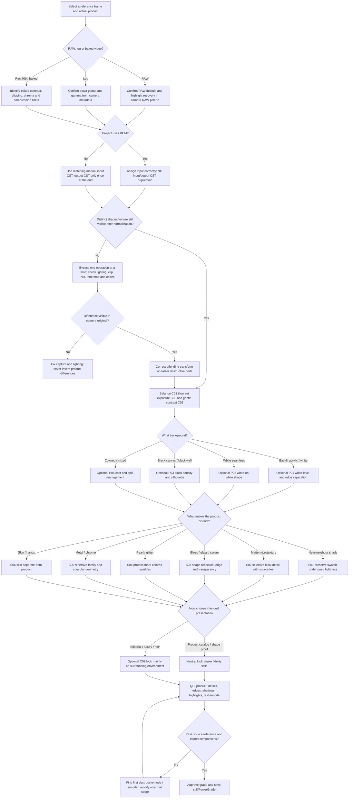
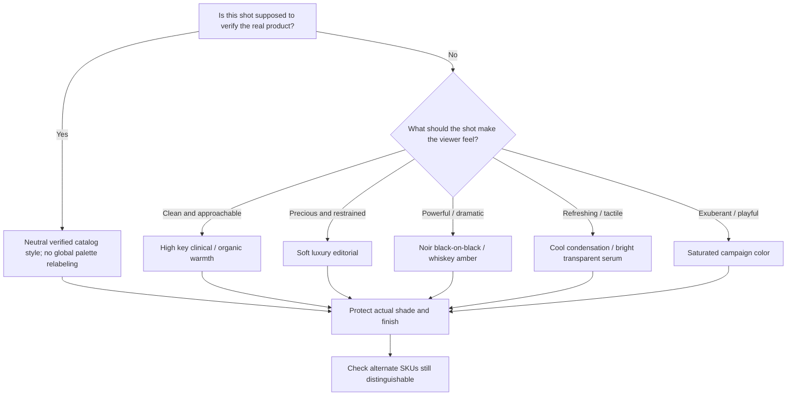
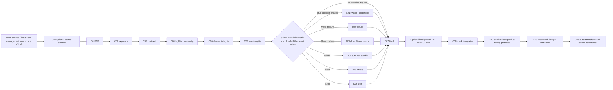
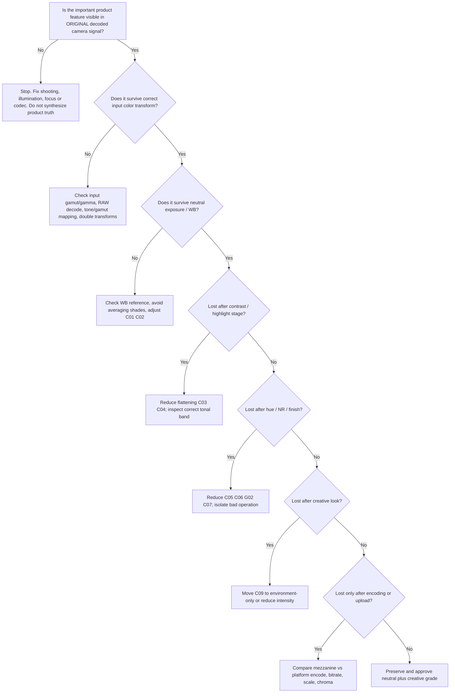
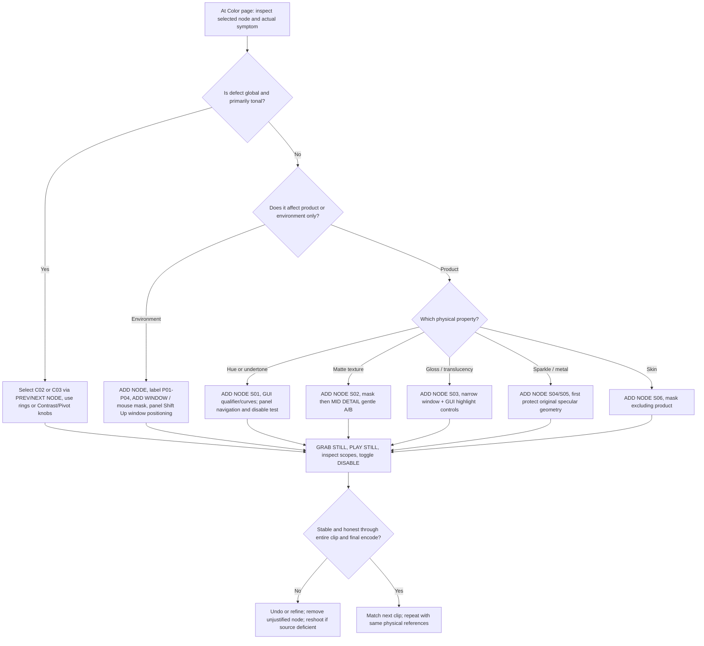

# THE BEAUTY & PRODUCT GRADING FIELD MANUAL

**A practical DaVinci Resolve node-by-node operating manual for cosmetics, swatches, liquids, reflective products, white acrylic, black velvet, whiskey, droplets, jewelry and commercial product work.**

**Document status:** consolidated long-form edition built from the user's complete 3,588-line general grading reference, the full text of two earlier beauty-product research reports, and an additional practical production module. This is a *working reference*, not a four-page research summary. Existing writings are retained verbatim later in this file for traceability; the new front section is the navigable operating guide.

## How to navigate this file

1. **PART I — Production map and decision trees:** where to start, the exact node to choose next, and what evidence justifies the choice.
2. **PART II — The reusable grade:** exact Resolve node placement, serial and parallel routing, masks, curves, scopes, shot matching and render tests.
3. **PART III — Product categories and looks:** practical recipes for different sets and surface materials; these are independent procedures, not interchangeable presets.
4. **PART IV — Fidelity laboratory and QC:** preserve differences between similar shades, gradients, opacity, surface finishes, droplet microstructure and highlight sparkle.
5. **APPENDIX A — Previous integrated research (expanded version):** original text preserved, not abridged.
6. **APPENDIX B — Previous integrated research (first version):** original text preserved, not abridged.
7. **APPENDIX C — User's Universal Color Grading Workflow (Expanded Edition):** original text preserved, not abridged.

**Essential principle:** A consumer buying a shade of lipstick or an amber liquid needs to see the product that actually exists. Creative grading can control atmosphere and background; it must not collapse real differences between product variants or fabricate differences absent in the recorded signal. For honest swatch work, neutral reference and controlled capture outrank a trendy look.

**Version and controls note:** Written against Resolve 20–21 conventions. UI labels and shortcuts vary by build and platform. Verify software-specific options in the [Blackmagic Resolve Reference Manual](https://documents.blackmagicdesign.com/UserManuals/DaVinciResolveReferenceManual.pdf), and treat numerical settings below as diagnostic starting points, never universal targets. Curve percentages below are proportions along the graphical input-brightness axis, not equivalent IRE readings.

---

# PART I — A DECISION TREE YOU CAN ACTUALLY GRADE FROM

## 1. Start with the source, not with the look

**Before editing a node:** choose a representative frame showing the hardest material (whitest white, darkest black, lightest swatch, strongest glitter flash). Open the source in the Color page, and note: (a) camera/codec/bit depth, (b) intended color space, (c) whether the product differs in the source from neighboring products, (d) whether the distinguishing visual feature is hue, chroma, lightness, opacity, roughness, reflection or texture. Grade the actual reason for differentiation, not a presumed proxy.

**Five-minute source triage**

1. Choose a reference clip and note frame number and product ID in the clip name or metadata. Put three neighboring shades in the same shot if possible.
2. Right-click the clip in the Media Pool and inspect Clip Attributes; separately inspect the camera-recorded profile and RAW metadata. Clip Attributes alone may not tell you what log gamma was recorded; use camera metadata and on-set notes.
3. If recording is RAW, open the **Camera RAW** palette on the Color page and confirm decode settings. Don't assume changing ISO changes RAW exposure the same way for every camera.
4. Open **Workspace → Video Scopes** and show RGB Parade plus Luma Waveform. Use the vectorscope when color fidelity is the question. Keep the viewer at 100% for fine-detail tests; a scaled viewer may hide fine texture or exaggerate sharpening.
5. Temporarily bypass grading with **Shift+D** (default Resolve shortcut on many builds) and examine source or the lowest available technical display transform. Caution: bypassing project color management is not the same as bypassing nodes; a log source without a display transform will look flat.
6. Use a camera-specific technical transform, *one time only*, and re-evaluate. If two swatches merge at that moment, do not start Hue vs Hue corrections: check input color space, transform tone mapping, gamut mapping, saturation and reference lighting.
7. If source lacks an edge, tiny crease or hue difference at appropriate zoom, grading cannot reconstruct truth. Reshoot, change lighting angle, remove excessive diffusion or capture in a codec with more usable chroma/detail.

### Master decision tree — from source to optional node



### Small style decision tree



### One-screen problem lookup

| Visible symptom | First **test** before grading | Next node or action | Definition of finished |
|---|---|---|---|
| Two foundations have become identical beige | Source frame → one correct display transform → C03 off | Repair first destructive transform; then **S01** selective swatch node | Same ordering of lightness and undertone as physical samples / approved reference |
| Swatch ridges vanish | Toggle NR, C03 and output transform independently at 100% | First reduce **G02 NR**; then **S02** if captured detail exists | Real ridges return without outline halos or extra invented grain |
| White acrylic background swallows bottle edge | Check RGB channels for clipped white rim and background | **P01** white / edge separation; ideally relight | Bottle edge legible with no visible gray halo |
| White jar melts into white sweep | Check whether surfaces differ in original | **P02** white-object shape, not a single global Gain pull | Jar geometry reads but set stays clean white |
| Black bottle disappears | Check original against brighter temporary viewing grade | **P03** black silhouette/edge, recover existing side reflection | Rim and volume readable, background remains dark |
| Amber whiskey looks electric orange | Compare real/approved bottle and orange-red channel | **P05** liquid density/chroma | Amber has gradation, not a flat neon patch |
| Droplets look painted on | Toggle NR, glow, Midtone Detail, sharpening | **P06** condensation microtexture | Random natural bead structure, crisp important drops, no halos |
| Gel looks like opaque paint | Check transmitted edge and shadow information | **S03** opacity/refraction correction | Visible internal transmission or color gradient, where recorded |
| Glitter became white dots | Toggle highlight desat, denoise, temporal smoothing | **S04** sparkle preservation | Colored point flashes remain sharp; no crawling artifacts |
| Chrome looks like plastic | Check whether distinct white/black strip reflections were lit | **S05** highlight/reflectance shaping | Recognizable specular geometry and metal density |
| Hand looks gorgeous, product shade wrong | Bypass skin corrections, check matte spill | **S06** dedicated hand correction | Skin improves without altering the swatch |
| Delivered video loses gradients | Render higher-bitrate mezzanine + platform encode and compare | **G13** output/QC and if needed conservative contrast | Approval survives actual platform compression |

## 2. The faithful-versus-creative boundary

**Accuracy shots:** foundation shade ladder, actual product color versus packaging, comparison swatches and product catalogue. Keep the camera reference chart and approved sample on a controlled monitor. The correct answer may be an unglamorous grade. Do not brighten one swatch while darkening another merely to emphasize marketing differentiation. A local adjustment is appropriate only to restore what the captured product really demonstrates.

**Creative shots:** classic whiskey amber, black-wall luxury perfume, moody chilled drinks, metallic details, floating droplets, campaign titles. More aggressive environment, background and lighting-response shaping are acceptable. If the product is sold by its precise cosmetic shade, keep the actual cosmetic hue isolated from the creative look where necessary.

**Important capture reality:** Many of the features we want—dark-glass edge reflections, specular beads on condensation, gold strip reflections, backlight through amber whiskey—are chiefly determined by *source size, angle, flags, polarization, exposure and camera placement*. A color node cannot place a rectangular softbox reflection where none was captured.

---

# PART II — REUSABLE NODE ARCHITECTURE AND EXACT UI PROCEDURES

## 3. Build the base chain once

A practical compact clip-level chain:

```text
CAMERA RAW/decode or correctly tagged clip
      ↓
G01  SOURCE DIAG / optional sensor correction
      ↓
G02  NOISE REPAIR (optional; normally bypassed)
      ↓
C01  WHITE BALANCE
      ↓
C02  BASE EXPOSURE
      ↓
C03  CONTRAST / TONE SHAPE
      ↓
C04  SPECULAR SAFETY
      ↓
C05  GLOBAL CHROMA
      ↓
C06  BASE HUE / UNDERTONE INTEGRITY
      ↓
[P01 / P02 / P03 / P04 / P05 / P06 when required]
      ↓
[S01 / S02 / S03 / S04 / S05 / S06 as selective nodes]
      ↓
C07  PRODUCT DETAIL / FINISH (optional)
      ↓
C08  LOCAL INTEGRATION / SPILL CHECK
      ↓
C09  CREATIVE LOOK (usually bypassed for fidelity shots)
      ↓
C10  SHOT MATCH / MASTER TRIM
      ↓
DISPLAY/OUTPUT CONVERSION: ONE place only
      ↓
QC encode and reference comparison
```

**Why so many empty nodes?** The template is a map, not an instruction to adjust each node. For a clean e-commerce shot you may only change C01–C03. Most optional nodes should remain bypassed. Stop when the actual product and intended image are correct.

### How to make and name a node (don't skip this)

1. Open the **Color** page. If you don't see the node graph, select **Nodes** at the top of the page.
2. Select the existing node at the upper-right graph.
3. Press **Alt+S** (Windows/Linux) or **Option+S** (macOS) to add a serial node after the selected one. If your shortcut mapping differs, right-click an empty graph area and choose **Add Node → Add Serial**.
4. Right-click the node → **Node Label**, type `C01 WB`, press Enter. Number IDs are useful because the Color page's graphical node indexes may change after insertion.
5. Repeat, each time selecting the rightmost node before adding the next. Drag node tiles in the graph to tidy *layout only*; wires determine processing order. If you accidentally join a wrong output to the wrong input, inspect and fix the wires before grading.
6. To bypass a selected node, use **Ctrl+D** / **Cmd+D** (where configured), or click the node's disable toggle. If unclear, check the node context menu. Make the node visibly active before moving sliders.
7. Open **Gallery**, grab a Still from the ungraded or minimally adjusted setup and save a template PowerGrade. For reliable re-use use the **PowerGrade album** in the Gallery; ordinary Gallery stills may be tied to the current project. Export grades in Resolve-supported formats rather than assuming a .dpx image file alone retains the entire node structure.

### Where each important tool lives

| Function | Resolve Color page location | What you're looking for |
|---|---|---|
| WB, Offset, Lift/Gamma/Gain, Contrast/Pivot, Saturation, Midtone Detail | **Primaries** palette, Wheels or Bars | Color and tonal controls |
| Exposure and narrow tonal zones | **HDR Wheels** palette | Exposure, Light, Highlight, Specular zones; zone boundaries adjustable |
| Custom S-curve | **Curves** palette → Custom | diagonal input→output transfer curve |
| Hue-specific adjustments | **Curves** palette → Hue vs Hue / Sat / Lum | hue sampled on horizontal axis |
| Low/high luminance-driven saturation | **Curves** → Lum vs Sat | saturation modifier versus brightness |
| High-selectivity color | **Color Warper** palette | hue/saturation mesh or chroma/luma view |
| Select product by hue / sat / luminance | **Qualifier** palette | HSL key, highlight preview |
| Restrict to physical area | **Window** palette | ellipse, polygon, gradient, pen shapes |
| Moving product isolation | **Tracker** palette | track the Window with motion |
| Temporally stable detail cleanup | **Motion Effects** palette | Temporal NR and Spatial NR where available in Studio |
| Edge sharpening, blur, diffusion | **Blur/Sharpen** palette | radius, H/V and mode as version supports |
| Limit a node's intensity | **Key** palette → Key Output Gain | 1 full correction, 0 no correction |
| Camera log to DWG | **Effects** → search “Color Space Transform” | OFX CST input/output gamut and gamma |
| RGB Waveform / Parade / vectorscope | **Workspace → Video Scopes** or Scopes toggle | exposure and channel structure |
| Compare a reference still | **Gallery** → select still → image wipe / split screen | source and target in the same viewer |

## 4. Absolutely distinguish RCM from manual CST

### Option A — Project uses DaVinci YRGB Color Managed (recommended default)

1. Open **Project Settings** (gear) → **Color Management**.
2. Set **Color Science** to `DaVinci YRGB Color Managed`.
3. Under custom color-processing controls if needed, choose **Timeline Color Space** `DaVinci Wide Gamut / Intermediate`.
4. Set the intended output, such as `Rec.709 Gamma 2.4`, explicitly; for Mac/web viewing differences, evaluate display and viewing environment separately. Do not pick a gamma simply because one OS Preview appears brighter.
5. Assign each clip's true **Input Color Space** in the Media Pool when auto-detection is wrong or metadata is missing. For example, explicitly tag S-Gamut3.Cine / S-Log3 only for clips actually recorded in those settings.
6. Grade C01–C10 as normal. RCM handles the technical transforms before/after your node operations according to the project pipeline.
7. **Do not also add an input CST to DWG or an output CST to Rec.709 to that same RCM pipeline.** If you're seeing radioactive colors or doubly steep contrast, this is among the first things to check.

### Option B — Ordinary DaVinci YRGB (manual node CST)

1. Set **Color Science** to `DaVinci YRGB` (not Color Managed). Decide on a consistent working space, preferably DWG/Intermediate.
2. Insert a first serial node `T01 IN CST` before C01. Drag **Color Space Transform** from Effects Library onto it.
3. In CST's OpenFX inspector set **Input Color Space** to the *actual camera gamut*, **Input Gamma** to the *actual camera log curve*, **Output Color Space** `DaVinci Wide Gamut`, **Output Gamma** `DaVinci Intermediate`.
4. For baked Rec.709 footage, a Rec.709-to-DWG transform can be valid in a mixed scene-referred pipeline, but does not restore lost camera latitude; don't apply a log input transform to an ordinary Rec.709 clip.
5. Insert `T99 OUT CST` after C10. Input `DaVinci Wide Gamut / DaVinci Intermediate`; Output `Rec.709 / Gamma 2.4` or the specifically required mastering target. Select suitable tone and gamut mapping for your source and look; assess on a calibrated output.
6. When comparing CST-on/off for a log clip, do NOT conclude loss of detail simply because the log preview looks flatter. Examine the same values through a consistent neutral display transform and compare clipping/texture at the final viewed state.
7. No technical transform should occur twice. The input is in one place; the output is in one place. If using project/timeline LUTs or display LUTs, document them too.

**RAW warning:** A Camera RAW palette's decode and a CST are not interchangeable. Decode color science can vary by RAW format and camera metadata; select a sensible working decode before applying a manually selected source→DWG CST, or use RCM's supported RAW input handling. Do not guess BRAW gamma from a LUT filename.

## 5. Universal mask operation, explained in clicks

**Use this identical procedure** for a swatch patch, part of a bottle, label, jar, or hand. It is the prerequisite for every selective example below.

1. Select node `S01` or the appropriate option. Use **Qualifier** palette → HSL. Click the **picker/eyedropper**, then sample a central area of the desired region. For a non-uniform region, use add-to-sample eyedropper strokes where available.
2. Activate **Highlight** (often the Shift+H shortcut): selected pixels appear as a distinct colored or monochrome highlight depending on viewer settings. You now see the *matte*, not the grade. White/highlighted is what this node will affect; black/unselected is protected.
3. Widen hue, saturation and luminance range enough to capture the **full variation of the actual product**. Overly narrow qualifiers remove natural gradients and can cause crawling edges as a bottle moves.
4. In the **Window** palette choose a circle/ellipse for a round jar or a **Curve/Polygon** window for an irregular swatch. Draw its edge a little **outside** the visible object; soften sufficiently to avoid cut-out outlines. A Window and Qualifier in the same node normally combine, allowing just the color *within* that spatial region.
5. Move the playhead through at least three points of the shot: beginning, middle, end. If the product moves, open **Tracker** palette. Select window tracking, go to a sharp representative frame and track forwards and backwards. Scrub all three locations again. If tracking slips, manually adjust and retrack rather than using a bigger blur as camouflage.
6. For persistent edge chatter, adjust qualifier **Clean Black / Clean White / Blur Radius** or corresponding matte cleanup controls. Don't erase tiny glitter or droplet structure in the process. Key edges should be soft enough to avoid halos but not so soft that they bleed into adjacent swatches.
7. Click Highlight off. Make a deliberately exaggerated exposure change to test whether only the intended region moves. Immediately reset this diagnostic change. If the entire frame moves, the matte wasn't active; if the background changes, the selection spills.
8. Open **Key** palette → **Key Output Gain**. Leave at 1.00 for full intended correction; reduce toward 0 (for example 0.5) to reduce the correction without rewriting every control. Use it as an intensity fader, not a fix for a fundamentally incorrect mask.
9. Compare the node bypass. The surrounding environment should stay unchanged unless you intentionally selected it. Always view at full resolution to check fine bright matte edges.

**What is a qualifier?** A selector based on pixel color/brightness. **What is a Power Window?** A selectable shape in the image. **What is a matte?** The grayscale instruction that decides *where* the correction applies. **Feather/softness** is a gradual transition between selected and unselected pixels. None of these changes a frame by itself; the node still needs a color or tonal adjustment.

### Serial, parallel and layer mixing: when each is appropriate

- **Serial** means each node sees the result of the previous node. Use this for reliable general corrections: WB → exposure → contrast → global chroma → output.
- **Parallel** lets separately selected corrections work from the same incoming stage and be combined by a **Parallel Mixer**. In the node graph select the node where the branch should occur, press **Alt+P/Option+P** (default), and inspect the mixer/output wires. Use when independent mattes shouldn't inherit the preceding selective grade. Example: a branch for lipstick, a branch for the hand, a branch for the white background.
- **Layer Mixer** combines graded layers and layer order matters; useful when the upper selection should deliberately override the lower selection or when blending/composite modes matter. Create via **Alt+L/Option+L** where mapped. Do not confuse a Layer Mixer with a true object segmentation matte; you still must key/window each branch correctly.
- **Avoid overlap fights:** Two selections both containing the same bright lip-gloss edge can double-correct or shift the edge. Temporarily exaggerate one branch at a time and show each matte in Highlight mode; decide which node owns the overlapping pixels. Use subtract-window/qualifier narrowing or deliberate Layer Mixer priority.
- **Where to branch:** after C06 base color and before C07 finish is a sensible starting point. For RCM both branches normally work in the same intermediate space. For manual CST keep both input and output transforms outside the selective bank.

Suggested separated branch sketch:

```text
... C06 BASE COLOR ──────────┬→ S01 SWATCH HUE ────┐
                            ├→ S02 TEXTURE ────────┤
                            ├→ S05 METAL ──────────┤→ Parallel Mixer → C07 FINISH → C08 ...
                            └→ S06 HAND/SKIN ──────┘
```

**Rule:** A chain with four optional branches is not automatically better than a chain with four nodes disabled. Build only the branches needed by this shot.

## 6. C01 white balance — exact operation

**Purpose:** Keep neutral whites and grays actually neutral *without accidentally neutralizing a deliberately warm whiskey, a cream label, or pink makeup*. Located in **Color → Primaries Wheels/Bars**. This is a technical decision, not creative warmth.

1. From the source shoot, identify a neutral gray card in the *same lighting used on the actual product*. A white acrylic panel lit from behind is NOT automatically a neutral white-balance target; LEDs and tinted diffusion can shift it.
2. Select `C01 WB`, open **Primaries** palette, locate **Temperature** and **Tint**. If you have reliable chart measurements use RAW WB controls early where possible; otherwise trim temp/tint conservatively.
3. Display **RGB Parade**. Examine the neutral patch; if its R/G/B signals are not aligned under even neutral illumination, adjust Temperature to correct warm-vs-cool bias, Tint to correct green-vs-magenta bias. These controls are not a spectrometer and cannot fix a light source with poor spectral reproduction.
4. Watch a warm-colored reference and blue/green product simultaneously; neutralizing the white should not crush all warm creams into beige or make mint packaging cyan.
5. Toggle node. If whites become neutral while product chroma relationships change for the worse, inspect exposure, camera input settings and light source. You may need a color chart or better illumination, not arbitrary Temp.
6. Stop when neutrals are neutral under the intended look and neighboring products retain their natural color relationships.

**Pitfall:** Do not white-balance off a gold bottle label, warm-toned paper, cream-colored cap, off-white swatch, shaded gray wall or the specular highlight of a colored LED. A neutral sampled under a different light does not calibrate the product under another source.

## 7. C02 exposure — preserve density without clipping

1. Select `C02 EXPOSURE`. Show **Luma Waveform** and **RGB Parade**. Open Primaries Wheels; with RCM/Intermediate work, Offset makes broad brightness changes, while HDR Wheels Exposure is a useful alternative with more explicit exposure-like behavior; use one primary method consistently.
2. First determine which image element must remain differentiated: the pale beige cream on white, the interior of a black perfume jar, the amber gradient, or the translucent serum edge. Do not set exposure from the background alone.
3. Temporarily raise exposure slightly to inspect what exists in dark product regions; undo the test. If all values are identically black with no separable source data, no downstream mask can recover shape.
4. Move overall exposure toward the reference by small increments. Observe not only the top and bottom of waveform, but the **spread of tones inside the product**. If an entire cream swatch squeezes into one narrow stripe, it has lost local contrast even if nothing touches zero or 100.
5. Compare the clipping state of individual RGB channels. A warm amber area can be clipped in red even while its overall luma waveform looks safe.
6. Stop before source content merges at either end. True specular pinpoints may legitimately clip in a stylistic bottle shot, but a large swatch patch or readable bottle label should not.

**Do not apply generic “white objects always 90 IRE” rules.** White acrylic behind a translucent object can sit near display white; a matte white powder may need considerably more separation to show structure. Matching by material matters more than a magic number.

## 8. C03 Custom Curves — every single click explained

**Goal:** Increase or decrease contrast *within the brightness range belonging to the product* while preserving the shade order and not creating crushed blacks or chalky whites.

**First, the vocabulary:** In **Curves → Custom**, the horizontal x-axis represents **input tonal value**: left black, right white. The vertical y-axis represents **output tonal value**: bottom black, top white. The default diagonal means input brightness equals output brightness (within the curve tool's own processing model). A **control point** is a dot created by clicking the diagonal. An **anchor point** is exactly the same dot left in place to limit changes elsewhere. There is no “Anchor” button. A **steeper part** of the curve spreads nearby input brightness values farther apart; a flatter part compresses them. The waveform is a DIFFERENT graph: its horizontal position represents horizontal *image position*, not brightness.

### Standard S-curve, five operations

1. Select `C03 CONTRAST` and open **Curves** palette → **Custom**. Confirm you're adjusting the neutral/master curve, rather than deliberately creating an RGB channel color cast. On some versions, controls show Y/R/G/B or a linked-channel control. Keep RGB neutral for a first pass.
2. **Left-click ON the diagonal line** about 25% of the distance from bottom-left toward top-right. A small dot appears; leave it where it is. This is a *lower anchor*. If your version has a modifier-assisted “add point without shifting shape” operation, use it, but simply clicking an unchanged diagonal is sufficient.
3. Left-click the diagonal about 75% of the way across; leave that point in place. This is the upper anchor.
4. Left-click a point around 40% across the line. Drag it **a tiny distance down**. This slightly darkens that midtone region.
5. Left-click a point around 60% across. Drag it **a tiny distance up**. This brightens that upper-midtone region. The resulting gentle S is exactly the contrast effect you're familiar with. You have simply placed anchors around it to limit collateral movement.
6. Bypass C03: ask whether surface ridges, semi-translucent gradients and nude undertones are more readable after the curve. If you see halos, dramatic posterization or a product shifting from beige to a solid brown patch, reduce the bends or skip local contrast entirely.

### If your bright swatch has flat surface texture

1. Keep the existing S-curve subtle. Use the reference frame to estimate which range of **brightness values** (not horizontal picture positions!) dominates the swatch. You may temporarily mask the swatch and examine the resulting waveform to estimate its level.
2. If a swatch lies mostly in the upper middle values, add two unchanged points surrounding that band (for example near 50% and 85% along the curve; these are *illustrative graph coordinates*, not exact IRE targets).
3. Inside those anchors, add one point slightly below the diagonal at the darker side and one slightly above the diagonal at the brighter side. Move each point only a few pixels of the graph initially.
4. Switch to a magnified view of an actual ridge or paintbrush mark. The gradation should become more visible but must remain natural. Compare every adjacent shade, not just the hero patch.
5. If fine ridges remain absent with C03 bypassed but also absent from the source, a curve cannot recover them: fix lighting or capture. If they exist but vanish only after denoising, fix G02 before adding exaggerated contrast.

### If black product on black background disappears

Keep enough tonal separation in the original: do not drive lower curve points into the lower horizontal axis until a wide swathe maps to the same zero. Put a low unchanged anchor, shape mid-dark values with one restrained point and check the product rim. For black-on-black, local rim/edge light (P03) is commonly a more honest choice than aggressively raising every black pixel.

### If specular highlights are ugly

Place an anchor below the brightest region (e.g. upper quarter), then gently lower the far-right segment or use HDR wheels for better highlight-domain control. **Do not pull down white acrylic indiscriminately**: a bright neutral background can legitimately remain white, while only large clipped product reflections require separate shaping. Any “highlight recovery” applied after source clipping cannot restore physically uncaptured detail.

**Signs to stop:** You can still tell apart adjacent shades; all cream ridges retain direction and relief; waveform has no large unintended pile-up at top/bottom; and bypassing the curve shows improvement rather than mere extra punch.

## 9. C04 highlight/specular structure, not blanket highlight desaturation

1. Select `C04 SPECULAR`. First inspect the brightest product pixels (glass rim, droplet, mica, polished cap). Determine whether they are *neutral light reflections* or actual colored material. Do not assume the latter should become white.
2. Open **HDR Wheels** palette and locate the high tonal zones (Highlight/Specular; names and zone defaults can vary). Use the zone preview/graph, and test a small downward adjustment of the relevant zone's **Exposure** or brightness control. Confirm the effect occurs primarily on the reflection instead of the whole jar.
3. If the background is also white, mask just the subject or its reflection before adjusting. Use S03/P01 if a meaningful geometric restriction is required.
4. Open **Curves → Lum vs Sat** only when a clipped or near-neutral highlight has an unwanted color cast. Add unchanged control points before the critical brightness band, then gently reduce saturation only in the affected far-right region. Do not preemptively desaturate the whole top end: this can erase real yellow/gold glints or pearlescent sparkle.
5. Compare the material appearance. Gloss remains glossy when it retains bright, spatially organized highlights. A flattened gloss reflection often makes cream look matte.
6. Check at least five consecutive frames. Small traveling speculars should not pulse or disappear because a qualifier crosses their brightness range.

## 10. C05 global saturation and C06 hue integrity

### C05 chroma — first-pass instructions

1. Open **Primaries** controls on `C05 CHROMA`. Find **Saturation** and **Color Boost**. Start from neutral default; don't copy numeric values between log-native and display-referred processing without checking their effect.
2. Display Vectorscope. Adjust saturation gradually while comparing an approved actual reference and adjacent swatches. Watch the near-neighbor nude/beige hues: do they stay distinct, or swing toward the same preferred orange?
3. If an already saturated label turns neon before pale cream becomes readable, reset global saturation. Localized work in S01 or S05 is the correct next step, not more global saturation.
4. If increasing saturation amplifies colored shadow speckle, decrease C05; investigate codec and G02. Never treat chroma noise as a real iridescent pigment.

### C06 Hue vs Hue — actual point procedure

1. Select `C06 BASE HUE`, open **Curves → Hue vs Hue**.
2. Select the curve's on-image hue picker (often a pipette). Click the *middle of the real product*, away from a hot reflection, shadow, overlaid hand or other shade. Resolve creates or positions points around the sampled hue.
3. Inspect which hue neighborhood will be affected; narrow the affected interval by moving surrounding points closer to the center if the curve UI permits. Do not collapse the neighboring shade into the same affected range accidentally.
4. Move the central hue point a **small** distance vertically while comparing the product against approved sample; the target is correction of an actual shift, not marketing saturation. If you need to push beige into pink to make the product readable, stop and revisit capture.
5. Turn the node off/on, then show the other swatches. A hue curve works globally by hue unless you **also** confine it with a Window/Qualifier. For shade-critical video, prefer that spatial isolation when multiple products share a hue family.
6. In **Hue vs Sat**, the vertical movement changes saturation for that hue family; in **Hue vs Lum**, it changes luminance. Use only one mechanism for the observed problem and reassess; hue is not a substitute for opacity, shadow gradient or gloss.

## 11. C07/C08/C09/C10 — finish, integration, style and match

### C07 PRODUCT FINISH: texture without fake crispness

1. Bypass spatial and temporal noise reduction, any Midtone Detail and Sharpen nodes. View the original at 100% and identify *real* pores, streaks, brush marks, cream peaks or individual water droplets.
2. On `C07 DETAIL`, in Primaries locate **Midtone Detail**. Start at zero. Increase in a small amount and evaluate only on a region masked to the product. Do not trust a numerical prescription blindly; a value that works on a 4K macro shot may destroy a compressed smartphone clip.
3. Toggle on/off on both stationary and moving frames. If product suddenly looks crunchy, shows edge outlines, starts to sparkle unnaturally or the skin becomes gritty, back off.
4. If using **Blur/Sharpen** palette, make genuinely small adjustments and check for bright/dark halos around a single label letter and a water-droplet edge. The H/V controls are not replacements for optical focus. If your footage is soft due to missed focus, sharpening cannot recover missing structures.
5. Only consider denoise when noise itself is visible and objectionable; compare with the actual swatch structure before committing. Time-based smoothing can mistake moving glitter for temporal noise.

### C08 LOCAL INTEGRATION: undo mask seams

1. Toggle optional nodes one by one, both with their mattes visible and invisible. Inspect edges and transitions.
2. If a cream selection leaves a lighter ring, adjust the selective mask's Window softness/Qualifier cleanup—not global contrast.
3. If a color change looks too strong but the matte is right, lower the selective node's **Key Output Gain** to blend it. Record the gain you settled on in the node label if revisiting is likely.
4. Recheck motion; a stationary grade still can hide a tracker drifting off the bottle at frame 90.

### C09 CREATIVE LOOK: separate style from truth

1. Save an approved neutral Still **before** adding style. Duplicate grade version or create a clearly labeled `C09 LOOK` node.
2. For e-commerce and shade-comparison shots keep C09 bypassed. For hero shots, apply style mainly through environment/background and selective tonal architecture, not arbitrary changes to commercial product colors.
3. Build warm/cool separation with small color-wheel adjustments in appropriate shadows and highlights, or apply a validated creative LUT at a known color-space stage. A Rec.709 display LUT in DWG can be the wrong transform; read LUT documentation and place it correctly.
4. Compare product skin/chroma with C09 off; if actual lipstick shade changes meaningfully, protect it with a qualified branch or reduce look gain.

### C10 MATCH: horizontal across the edit

1. Choose a hero shot with a reliable chart/neutral and representative product. Grab a reference Still in Gallery.
2. For the next clip, first match C01 WB across all shots, then C02 exposure across all shots, then C03 contrast, then global chroma and selective branches. This *horizontal* matching keeps you from finishing one shot while all others are still mismatched.
3. Use Image Wipe/Split Screen or adjacent shots and scopes. Compare the same patch/material, not random bright pixels. For luxury product footage, specular shapes may change as camera angle changes; match perceived product material and brand color rather than identical waveform silhouettes.
4. Finally create a mezzanine review and phone/social test encode; the output is part of the grade's reality.

---


# PART III — TWELVE PRODUCT-SPECIFIC GRADING PLAYBOOKS

The following are procedures to perform **after** the Part II technical balance, not magic presets. A bracketed node is optional: insert it only if the indicated failure is genuinely present. All ranges are exploratory, not prescriptions. For RCM, keep the input/output conversion at project level; for manual DaVinci YRGB, keep the two CSTs around the clip chain. Check color on an appropriate calibrated display and preserve the neutral still for every setup.

## 12. Category 01 — Color-critical cosmetic shade ladders (foundation, lipstick, concealer, ointments)

**Target:** different physical shades remain different in exactly the way observed, even when subtle. **Typical danger:** hue curves, global Color Boost, contrast and temporal NR homogenize neighbouring beige/pink/peach/neutral undertones.

**Capture contract.** Shoot product samples, gray reference and ColorChecker under the actual fixed light. Record shade identifier, angle, aperture, WB, camera gamut/gamma and lens. Keep the same thickness and substrate; compare skin-on-skin separately from card-on-card. Use a soft directional key plus a controllable low-angle side source so there is texture to preserve; lock camera auto-WB and exposure. Capture a short controlled pan if the product's gloss must be judged from moving highlights. Chart exposure should not be clipped in any channel.

**Graph:** `C01 WB → C02 EXP → C03 CONTRAST (extremely restrained) → C05 CHROMA (neutral) → [S01 SWATCH] → [S02 MICROTEXTURE] → C10 MATCH`; C09 LOOK bypassed. If the swatches are adjacent, **do not** use one global Hue-vs-Hue correction that pulls all shades toward the same preferred nude.

**Resolve procedure:**

1. Select representative frames for **at least three adjacent SKUs**. Grab a Gallery still of the neutral reference before creative work. Use the identical transform on all takes.
2. Disable C03/C05/C07 and any NR. Check whether swatches are distinguishable in a correctly displayed minimally processed source. If not: inspect capture. No color operation can truthfully invent a missing undertone.
3. In C01 use a neutral card, not the white acrylic, for Temp/Tint. In C02 adjust exposure against the card and product. Check **RGB Parade** for individual channel clipping—luma may look safe while one color channel is flat.
4. In C03 begin with a straight curve. If a swatch's tiny ridge shadows require more separation, add an unchanged point below its brightness band and another above it by **clicking the diagonal**, then add inner adjustment points. Drag the darker inner point down a few screen pixels and brighter inner point up. An unchanged point is an **anchor**, not a different Resolve tool. Check all neighbouring shades after every movement.
5. Use S01 only to correct a demonstrated capture/rendering error. Select S01 → **Window** → polygon around *one product region*. Put window edge just outside the material and apply softness. In **Qualifier → HSL**, sample the swatch. Turn **Highlight** on to inspect the matte and widen hue/sat/luma ranges until it covers all its natural unevenness, including edges and sheen. If the matte excludes gloss, decide whether that exclusion is correct rather than blindly increasing Clean White.
6. With Highlight off, if the product is truly too warm, nudge the selected product with **Temp/Tint or Color Warper**, then check the physical reference. For slight lightness mismatch, adjust Gamma/HDR Light rather than Hue. Only apply as much correction as demonstrably justified. Use **Key → Key Output Gain** to reduce the isolated correction if necessary.
7. For S02 texture, first disable Temporal NR and compare at 100% viewer zoom. If actual detail survives, try a *tiny* positive Midtone Detail change in an isolated window; toggle C07/S02 independently. If texture becomes gritty, sparkly or sharpened around artificial edges, restore 0. Never sharpen a globally denoised image to fabricate lost microtexture.
8. Step through beginning/middle/end, particularly if hand or applicator moves; use the **Tracker** on a Power Window when required. If tracking drifts or matte chatters, broaden the qualifier and reduce strength, not just feather until everything blurs.
9. Export a neutral mezzanine and the actual social delivery file. Compare at 100%, side by side with the approved source/reference. Look for codec homogenization: two distinct undertones becoming a single block after H.264/H.265 and platform reprocessing.

**STOP** when the rank/order of warmth, lightness and chroma agrees with actual samples and each true swatch still reads differently. If the original video itself does not contain the distinctions, stop grading and correct capture.

## 13. Category 02 — Backlit white acrylic, light tables and translucent rims

**Target:** convincingly luminous white without severing product edges or destroying transparent gradients. **Danger:** the background may be intentionally 100% white, yet a clear bottle or pale ointment needs a near-white contour and internal variation.

**Capture contract.** Light beneath or behind acrylic separately from the product. Record two reference passes: background-only and product-on-set. Prevent direct unflagged light from entering the lens; use side strips/black cards to create glass edge definition. Lock exposure so the product's informative rim and body stay below clipping even if some background goes clean white. Distinguish white *transmission* from white *reflection*.

**Graph:** `C01 → C02 → C03 → [P01 BACKGROUND] → [S03 TRANSLUCENT EDGE] → C08 EDGE-QC → C10`.

**Resolve procedure:**

1. Open RGB Parade and waveform; ask which pixels form the white luminous plane and which belong to the product. Examine source at 100% to see if an edge is actually there.
2. Insert P01 after C06. On P01 click **Window → Gradient/Curve** to cover the background, deliberately excluding the bottle with a shape or combination of windows. Use the Window's softness rather than drawing the boundary on the product silhouette.
3. Turn Highlight on. Confirm the white plane is selected and bottle edges are unselected. Optionally add **Luma Qualifier** *inside* the spatial background window for bright background only; examine the matte on the full sweep.
4. With Highlight off, adjust P01 **Gain** or HDR Light only enough to normalize the background across adjacent shots. Don't make background *gray* just to lower waveform peaks. A clean white plane is valid if intentional; focus on product information.
5. Insert S03 after P01. Use a soft window around the product. To reveal transmitted detail recorded in clear plastic, pull a small amount of upper-mid brightness with HDR **Light/Highlight** or gentle curve while **leaving tiny speculars bright**. A wide flat shoulder usually turns glass into a gray smudge.
6. If left and right edges differ, use separate tracked oval/curve windows in separate serial nodes. Do not force one single window to correct both directions; remember selective exposure cannot recover an edge blown out at capture.
7. If edge grading makes a glow/gray outline, inspect P01 and S03 mattes at beginning/middle/end. Reduce softness/spill and Key Output Gain; a visible halo is not “premium diffusion.”

**STOP** when the background reads as deliberate white, acrylic illumination feels even where intended, and the rim/body are legible without an artificial matte outline. **Reshoot** if the bottle perimeter has merged with a clipped white field in all channels.

## 14. Category 03 — White seamless, white-on-white cartons and matte white jars

**Target:** white surface stays white, object geometry reads through *real* shadows and reflections. **Danger:** lowering global highlights muddies the white set; raising contrast adds ugly gray edge halos.

**Capture contract.** Give the sweep and product different light directions. Add a narrow side strip or negative fill to define the object's shoulder and lid. Leave real soft contact shadow. Avoid relying on post-created fake shadows.

**Graph:** `C01 → C02 → C03 → [P02 WHITE OBJECT SHAPE] → C10`. P02 separates product from sweep, not the other way round.

**Resolve procedure:**

1. Check white packaging against neutral chart. Don't assume that paper packaging is spectrally neutral. In C01 correct the chart first, then evaluate *perceived* object white against approved packaging.
2. Insert P02 after base corrections. In **Window**, choose a curve shape that follows the carton or jar. Click points around the product outline and close the shape. Soften subtly so the matte is not a sticker.
3. Use the **Tracker** for moving jars. For static top shots, frame-by-frame scrub at motion blur or turntable transitions even if no tracking seems necessary.
4. Temporarily exaggerate Gamma DOWN on P02 and inspect only the jar changes. Restore, then apply **very small** exposure separation to the object if the captured object is genuinely too flat. Use the weakest curve that separates its lid/shoulder from white sweep.
5. Protect the label with a second restrictive window if the label becomes dirty. It's acceptable for a matte white object to remain bright; adding a dramatic gray shape to it misrepresents the material.
6. Inspect 100% on object rim and corners. If a dark border appears, refine P02 matte; if object remains boundaryless in source, redo side lighting.

**STOP** when jar lid, shoulders and subtle contact shadow are legible and the sweep isn't gray/blue due to the fix.

## 15. Category 04 — Black canvas, velvet wall, dark-on-dark luxury products

**Target:** black has depth and photographic richness; product silhouette and finish remain legible. **Danger:** lift blacks and reveal cloth texture/noise everywhere, or crush all meaningful product blacks into zero.

**Capture contract.** Separate subject from background physically; flag spill onto black textile. Use shaped narrow edge strips, ideally one cool/neutral rim plus restrained fill. Include a controlled background-only frame. Try exposure variants: black with important contours is not the same as clipping the entire frame into black.

**Graph:** `C01 → C02 → C03 → [P03 BLACK FIELD] → [S03/S05 SUBJECT RIM] → C08 → C10`.

**Resolve procedure:**

1. Open luma waveform. Inspect product and dark backdrop in the *source* with a temporary bright monitoring transform, not as an export. Look for real physical separation between black object and black wall.
2. Insert P03; use **Window → Curve or Gradient** to select the wall/canvas only. Optionally use a Luma qualifier inside that window if the wall texture needs smoothing/density, but watch for noise crawling.
3. Toggle Highlight to confirm no part of bottle/jar label falls inside P03. Reduce the background with **Gamma/Lift** slightly until it feels dark, stopping before broad temporal noise is exaggerated or image becomes a black slab. On final waveform small regions may correctly sit at black; do not apply a universal 'blacks must always be 0 IRE' target.
4. Add a separate *product rim* node with a narrow tracked Window aligned to the illuminated contour. A modest Gamma/HDR **Shadow/Light** increase can reveal captured rim gradients. Don't use a hard Luma qualifier that causes flickering as the product rotates.
5. Inspect camera movement across three frames. If rim tracking fails, correct the tracking or use two soft region windows. Never paint an edge bright merely because the actual lighting omitted it.
6. Compare black, chrome, plastic and glass surfaces if more than one material appears: they require different reflection structure, not a global shadow-lift.

**STOP** when product shape survives even on a normal viewing-sized phone display while the background remains dark enough to look intentional. **Relight** if the original contains no edge separation.

## 16. Category 05 — Classic whiskey or spirits bottle, amber liquid glowing against black

**Target:** transmitted amber liquid with dimensional gradation, readable silhouette, clear glass neck and legible label; black background remains theatrical. **Danger:** an orange saturated blob, blown golden shoulders, opaque liquid, flat or unreadable label.

**Capture contract.** Backlight bottle through amber liquid with flagged light behind glass, not through the visible label; add two strips at the sides to define profile. Shoot a clean bottle, a label-protected variant and a nominal reference with chart. Avoid mixing radically different spectrum sources between amber and reference. Never assume whiskey should be maximally orange; judge the actual liquid sample.

**Graph:** `C01 → C02 → C03 → [P03 BLACK] → [P05 AMBER] → [S03 GLASS] → [P07 LABEL] → C08 → C09 (optional) → C10`.

**Resolve procedure:**

1. Save neutral grade still. Balance C01 to the chart; in C02 preserve bright glass shoulders and label. Inspect RGB Parade for channel clipping in liquid: if the red channel is flat at the top, lowering orange saturation afterward cannot reconstruct that channel's lost gradient.
2. Insert P05 after base balance. In **Window → Curve**, draw a loose bottle-body region covering liquid, avoiding most label and reflections; soften. In **Qualifier → HSL**, sample middle amber *away from hot rims*. Switch on Highlight and widen Hue/Sat/Luma range to include the liquid's dark and bright gradations, not just its brightest orange patch.
3. With matte off, use **Hue vs Sat** or Color Warper to tame excess red/orange. Make small alterations and compare real bottle reference. Avoid broadly reducing highlights' saturation, which removes authentic amber glints.
4. If amber looks thin instead of deep, change its **lightness distribution** before chroma: a tiny Gamma reduction in the darker liquid region, or a restrained Custom Curve, may restore recorded depth. Never pull down whole bottle until it becomes opaque brown.
5. Insert S03 for glass neck/shoulders with a soft spatial Window. Keep narrow white specular strips bright. The primary adjustment may be **no adjustment at all** if lighting already establishes glass; only fix a genuine cast or premature clipped plateau.
6. Insert P07 LABEL as a tracked window around label. If readability is low, slightly lift label Gamma and lower conflicting background light locally, rather than whitening all amber or sharpening the entire shot. The paper's intended color should remain believable.
7. Insert P03 to trim only the backdrop. Double-check it never contaminates transparent bottle edges; a deepened black passing through glass can make the glass look cut out.
8. Render 10 seconds and inspect label flicker and glass reflection movement. Recheck a phone screen; black surroundings can obscure the label more than the grading monitor predicts.

**STOP** when the liquid has a continuous amber gradient, clear transmission near thinner areas, lively controlled highlights, readable brand and deep black stage. A bottle where liquid looks like opaque orange plastic has failed.

## 17. Category 06 — Wet, chilled, dark bottle with beads and flowing condensation

**Target:** droplets read as transparent *three-dimensional beads* with moving micro-highlights, while cool dark cinematic mood remains. **Danger:** NR erases droplets, sharpening draws white outlines, glow smears water, cyan grade recolors brand/product.

**Capture contract.** Use a narrow specular strip and a gentle counter-light, with a black/negative-fill field to keep drops dimensional. Test bead size under actual shooting frame rate and shutter. Fresh condensation moves; include tracking/higher shutter tests. Distinguish sprayed glycerin droplets from actual moisture in client wording if accuracy is relevant.

**Graph:** `G02 NR (normally OFF) → C01 → C02 → C03 → [P06 DROPLETS] → [S03 GLASS] → [P07 LABEL] → C09 COOL STYLE (optional) → C10`.

**Resolve procedure:**

1. Begin at 100% image magnification on a frame with both large droplets and tiny mist. Toggle every denoise operation OFF; if beads recover, use less NR, not stronger local sharpening.
2. Open `P06 DROPLETS` → **Window** and select bottle body; soften its edges. Don't rely on a bright-only qualifier, because droplet volume includes dark refraction rims and light hot spots.
3. In Primaries **Midtone Detail**, try a very small positive increase while monitoring two beads at opposite ends of frame. If halos become visible around bead edges or the background noise rises faster than bead detail, back off or return to zero.
4. If the water is strangely flat but source contains high and low parts, build a *very gentle* local contrast adjustment in P06. First click two unchanged outer curve points, then a low interior point (drag slightly down) and high interior point (drag slightly up). Keep the change within bead tonal range. Avoid clipping isolated tiny white sparkle highlights.
5. In C09 apply cool or teal atmosphere **selectively to the background and shadows**, leaving label/product identity protected with separate Window or branch. A globally blue brand label usually looks like a cheap filter.
6. Scrub five frames from a moving drip. Temporal NR and keyframed qualifiers can cause stationary-sounding highlights or popping beads. Check playback at delivery frame rate, not just single frames.
7. Save a compressed delivery test. Inspect whether individual small droplets have become block-shaped or vanished from chroma-subsampled encode.

**STOP** when wetness looks like optically captured refraction, not drawn-on edge strokes. If the drops are absent at capture, the fix is a different light position, not +30 sharpening.

## 18. Category 07 — Serum, clear gel, oil, perfume and refractive glass

**Target:** visible physical transmission, viscosity cues, internal gradation and controlled lens-like reflections. **Danger:** lifted shadows turn a clear liquid opaque; highlight desaturation neutralizes the product tint; global contrast crushes thin glass edges.

**Capture contract.** Backlight through product with a small diffused source or a soft strip, plus negative fill to define refractive edge. Photograph the liquid against both black and white diagnostic cards when possible; clear products need different lighting geometry for edge and internal particles. Capture moving tilts to reveal meniscus and viscosity.

**Graph:** `C01 → C02 → [S03 TRANSMISSION] → [P01/P03 BACKDROP] → [P07 LABEL] → C10`.

**Resolve procedure:**

1. First identify which gradients were recorded *inside the product* vs reflected off its container. Do not normalize them into a uniform pale fill. Verify there is actual edge data in source.
2. Isolate the vessel with a soft Window. On `S03 TRANSMISSION`, use HDR **Light/Highlight** or Custom Curve to maintain a gradual change between transparent center, curved sides and intense rim. Keep tiny white specular points bright but avoid huge flattened plateaus.
3. If liquid is naturally tinted (amber oil/pink gel), compare source under neutral display and sample reference. Use an isolated Hue vs Sat correction only for a genuine cast; do not remove tint because it is near highlights.
4. If bubbles or suspended particles are diagnostic, turn OFF temporal NR and excessive sharpening. Monitor bubbles at normal speed and 100% zoom in motion.
5. Use separate P01/P03 for background only. On black, do not automatically brighten the liquid body. On white, don't automatically clip the product rim.
6. Track moving glass with Window → Tracker; evaluate beginning/middle/end for clipping and edge halos. Through clear glass, background may legitimately remain visible; an aggressive matte that cuts it out creates fake opacity.

**STOP** when internal liquid is legible, edges have natural contrast, and transparency has not been converted into gray plastic.

## 19. Category 08 — Matte powder, cream, lipstick and ointment macro surfaces

**Target:** the correct softness/hardness and material relief, not artificial 'sharpness.' **Danger:** temporal smoothing destroys pigment granules and cream peaks; positive Midtone Detail makes matte powders look gritty; skin retouch diffuses texture.

**Capture contract.** Alternate large soft key with a low-angle raking light and compare; the second is often essential for microrelief. Stabilize focus, macro depth of field and movement. For a cream swatch, shoot before product settles or dries if physical finish must match usage. Record formulation state, temperature and delay after application.

**Graph:** `G02 (usually OFF) → C01 → C02 → C03 → [S02 MICROTEXTURE] → [S01 SHADE] → C10`.

**Resolve procedure:**

1. Make a 100% crop of actual brush marks/granules. Toggle all NR, blur, sharpening and Midtone Detail. If source already has material structure, leave cleanup bypassed by default.
2. In S02 apply a Window around the actual product, **not** the entire hand. Check matte borders so any skin texture does not turn unnaturally rough.
3. Use **Midtone Detail** first, beginning at 0. Increase until relief becomes easier to read, then reduce by roughly half as a conservative test. This is an artistic starting discipline, not an official numeric recipe.
4. If one area is locally glossy but material is meant to read matte, inspect source light reflections and lighting first. A node cannot truthfully relight it to have a different bidirectional reflectance. Consider softening just an *offending reflection*, not erasing every highlight.
5. In S01 correct only demonstrable underlying shade error; a product's matte finish can itself change apparent lightness. Preserve the shot's texture while correcting lightness, never push pastel makeup toward a fashionable orange.
6. In fast motion, examine texture's temporal consistency across 10 frames. Crispy chatter or noise dancing on granules indicates sharpening/NR artifacts or compression.

**STOP** when powders remain soft/matte, cream peaks remain dimensional, and all color variants remain distinguishable.

## 20. Category 09 — Mica, pearlescent makeup, fine glitter and shifting shimmer

**Target:** preserve actual angle-dependent colored sparkles and the distinction between glitter sizes. **Danger:** highlight desaturation makes color glints white; temporal NR treats sparkle as noise; global sharpen produces artificial points.

**Capture contract.** Record moving angle tests under both a soft source and a small hard source. A static frame cannot describe changing interference/reflective behavior. Avoid overexposing individual bright glitter grains across RGB channels, especially magenta/cyan particles.

**Graph:** `G02 OFF → C01 → C02 → C03 → [S04 GLITTER] → [C04 SPECULAR] → C10`; global highlight-desat bypassed unless proven necessary.

**Resolve procedure:**

1. Scrub the source during an angle change. Confirm individual grains physically flash rather than simply camera-noise flicker. Establish a reference segment with some motion.
2. Disable Temporal NR and Spatial NR. In `C04`, do NOT default to lowering high-end saturation; sample a real pearlescent glint to see whether its hue survives.
3. Isolate product with a broad tracked Window in `S04`. If a global Hue-vs-Sat adjustment is needed, use it sparingly for excess chroma and keep an unchanged reference. Don't key the exact flashing hue only: its selection may disappear or chatter when the grain moves.
4. Use midtone/exposure tonal adjustment only if sparkles lost spatial separation through an avoidable curve shoulder. Raise contrast slightly in the relevant zone while retaining highlight points (no broad flat clipping plateau).
5. View at delivery resolution and motion speed. If isolated grains become white squares or smear, reduce sharpening and consider higher-quality mezzanine; avoid solving with extra saturation.
6. Test the actual platform encode. Tiny sparkles often stress video codecs; the deliverable needs verification even when the mezzanine looks pristine.

**STOP** when physical hue, size distribution and motion of sparkle are plausible, not digitally painted confetti.

## 21. Category 10 — Gold, silver, chrome jewelry and metallized caps

**Target:** metal reads by shaped reflection, not by saturation; preserve hallmark/stone detail and correct alloy tone. **Danger:** chrome becomes gray plastic, gold turns yellow-orange, sharpening produces white rims, dark reflections become solid black bands.

**Capture contract.** Use large narrow diffusion strips and black cards as the objects that metals literally reflect. Move the reflected panels until polished shapes read on camera. Avoid relying on post to invent geometry. Preserve intentionally narrow whites and blacks in reflections.

**Graph:** `C01 → C02 → C03 → [S05 METAL] → [P07 LABEL/STONE] → C09 optional → C10`.

**Resolve procedure:**

1. In neutral display inspect actual reflection geometry at 100%. Is it a white rectangular band with dark adjacent gradient? That's a material cue; don't flatten the band trying to normalize exposure.
2. On `S05 METAL` draw a soft tracked Window surrounding the metal, not a single hue qualifier: silver and chrome may be almost neutral and therefore share hue with background.
3. If a metal band clips prematurely, try a small HDR highlight adjustment in S05; compare with C04 OFF. Allow a few tiny speculars to approach white. The important feature is a **gradient around** the reflection, not a uniform ceiling.
4. For gold, compare real approved target or physically lit reference. If over-orange, reduce Hue-vs-Sat of its hue *inside the product window* by a small amount. Preserve gold's natural dark-to-light color movement; do not make every gold pixel identical.
5. Protect gemstones/hallmarks by separate window/branch if gold correction affects them. For chrome, avoid general saturation additions: the convincing impression is often neutral bands and surrounding contrast.
6. Evaluate rotating frames for reflective continuity and tracking. If reflection boundary jumps, problem may be a difficult key; reduce selectivity or move correction to broader geometry.

**STOP** when metal shape, highlights and shadows are continuous, actual alloy color remains believable, and engraving/stone details are readable.

## 22. Category 11 — Hands, models' skin, nails and products together

**Target:** healthy believable skin without recoloring the cosmetic or erasing pores, nail polish texture or subtle shade boundaries. **Danger:** common skin corrections select warm beige foundation and lipstick as if it were skin.

**Capture contract.** Use lighting/reference on the actual model, record skin with and without applied product, and keep focus from drifting between hand and swatch. Skin reference is not one universal hue/IRE level; use consistent lighting and known source.

**Graph:** `C01 → C02 → C03 → [S06 HAND SKIN] ∥ [S01 PRODUCT] → MIXER → C08 → C10`.

**Resolve procedure:**

1. Add two **Parallel** branch nodes from a common clean input (select existing node → Alt/Option+P or context menu → Add Parallel). Label `S06 SKIN` and `S01 COSMETIC`. Confirm both feed a **Parallel Mixer** and neither inherits the other's selective correction.
2. In SKIN branch use **Window → Curve/Polygon** to isolate the hand/arm and **Qualifier → HSL** to refine selection. Preview Highlight and explicitly exclude lipstick/foundation patches from the skin matte. Add a second subtracting window where needed. Skin and nude product can overlap chromatically; geometry usually must do the heavy lifting.
3. Adjust skin mildly with Temp/Tint or HDR Light. Avoid generic 'put skin on the skin-tone line' automation; the line indicates common hue tendency, not an approved brand/ethnicity color target.
4. In the cosmetic branch build a **separate** product Window and qualifier; match actual swatch reference. If branches overlap on transition pixels, refine both mattes before trying to reduce entire grade strength.
5. Scrub hand motion. Window tracking may fail when fingers bend; refine per shot with keyframes or smaller windows rather than letting the skin correction wash over cosmetics.
6. Check microtexture: avoid negative Midtone Detail on the whole shot when cream and skin both contain intentional surface detail. If skin retouch is requested, treat it as a separate dedicated optional node with protected product matte.

**STOP** when skin is plausible and cosmetic color is unchanged by skin correction; no hue boundary flicker at the product edge.

## 23. Category 12 — Extreme macro, top-down swatches, turntables and product-in-motion

**Target:** stable focus and surface detail through movement; continuous color and specular shape; no tracking flutter. **Danger:** tracking masks lose small targets, NR causes temporal smears, shallow depth of field creates confusing apparent texture changes.

**Capture contract.** Lock WB and consistent exposure. Use adequate depth of field for target; assess diffraction and light output. For turntables, control light reflections and rotation speed. For top-down liquid drips, lock shutter and capture frame rate intentionally, protect glossy acrylic from scratches with clean replaceable removable films when appropriate, and use separate exposure/reference frames for the clear plate.

**Graph:** `G02 conditional → C01 → C02 → C03 → [S02 TEXTURE] → [S03 REFLECTION] → C08 TRACK/MATTE CHECK → C10`.

**Resolve procedure:**

1. Start by viewing full-res source at a *sharp* representative frame. Mark the frame and another near the weakest focus; a single still cannot validate motion.
2. Apply no temporal NR initially. If required for sensor noise, test the least aggressive temporal settings against motion edges, then spatial only if necessary. Ensure no cream ridges/discrete droplets disappear.
3. Insert a product Window and open Tracker. Track forwards from a clear frame, then backwards. Scrub at least beginning/mid/end. If rotating packaging reveals new surfaces that a simple Power Window doesn't follow, use a broader parent Window and a secondary qualifier or manually animated points.
4. For moving glitter, never rely on narrow brightness isolation: individual highlights enter/leave the key continuously. Correct broad product reflectance instead.
5. Use C03 and S02 only if local real detail is visible with those nodes bypassed. Check a high-contrast letter/edge at 100% for halo lines, and render a test section with real motion.
6. If the macro object moves in/out of focus, do not boost sharpness globally. Consider reducing the prominence of that shot or choosing a different take; no color node restores original optical detail.
7. For a rotating dark product, use P03 background only, and don't force reflections to remain fixed across frames—moving highlights are essential evidence of rotation.

**STOP** when masks hold over the entire shot, textures are stable frame-to-frame, and physical highlight movement looks continuous.

---

# PART IV — STYLES, SELECTION RULES AND DELIVERY LAB

## 24. Style architectures: choose one *after* a neutral base exists

For style nodes, first create a neutral approved Gallery still. Always constrain or bypass any look that changes genuine product SKU color. Values are expressed as **relative visual intent**, not guaranteed Resolve slider readouts.

| Style | Background treatment | Product treatment | Enable | Avoid / failure |
|---|---|---|---|---|
| **Truthful catalog** | Clean, evenly lit, neutral | Reference-matched gamut and finish | C01–C03, S01 if justified | C09 look, global hue unification |
| **Clinical skincare** | Airy white, controlled gentle shadows | Clear serum transmission, skin natural | P01/P02, S03, mild C03 | White clipping on translucent rim |
| **Soft luxury editorial** | Soft neutrals, gently compressed tonal ends | Product retains grade-accurate color and soft speculars | Mild C03, C09 on environment | Diffusion that erases cream relief |
| **Glossy premium commercial** | Deeper contrast, clean shapes | Bright structured long reflections | C03, S03, S05, C04 | Blanket desaturation of highlights |
| **Whiskey chiaroscuro** | Deep but graded black | Rich transmitted amber, separate label | P03, P05, P07, S03 | Opaque neon-orange whiskey |
| **Noir black-on-black** | Velvet low keys, subtle dark gradients | Sparse rim illumination and legible silhouette | P03, localized S03 | Black clipping across entire product |
| **Condensation cinematic** | Cool restrained shadow palette | Crisp true droplets, protected brand | P06, S03, selective C09 | Denoise blur, cyan label |
| **Amber / warm gold prestige** | Warm side accents, rich dark surroundings | Gold stays metallic, amber density | P05, S05, environment C09 | Over-orange product identity |
| **Cool steel / blue prestige** | Cool atmospheric background | Chrome neutral, labels protected | S05, environment C09 | Blue-cast silver and skin |
| **Organic warm skincare** | Creamy off-white / earth neutrals | Matte and healthy but accurately tinted | S02, S06, small C09 background | Artificially tan skin, orange creams |
| **Hyper-macro tactile** | Restrained, simple field | Texture, physical relief, gloss geometry | S02/P06, minimum NR | Oversharpened noise / fake roughness |
| **Playful saturated campaign** | Bold palette distinct from SKU | Exact product colors remain protected | C09 environment, parallel S01 | Color cross-contamination |

### Building a look without contaminating product color

1. Create `C09 LOOK` **after** all technical and product-fidelity corrections; save a Gallery Still of the neutral stage.
2. On a **background-only** node use Window → polygon/gradient to cover the set. Turn Highlight on and inspect for spill onto product edges, especially transparent glass. Don't assume a qualifier alone can separate a pastel product from pastel background.
3. For *warm editorial*: nudge shadow wheel subtly warmer or cool the shadows against modestly warm highlights—choose the direction consistent with client references. For *blue prestige*: bias only background shadow/midtones cyan-blue, leaving white chrome/speculars neutral. For *noir*: darken portions of environment while keeping real product edge highlights; use local contrast rather than crushing product blacks.
4. For *whiskey*: finish amber P05 first; then style the stage around it. For *wet bottle*: preserve P06 droplets before trying glow, halation or diffusion. Avoid creative glow on swatch proof shots.
5. Bypass C09, then switch it back on while observing a known swatch patch, brand label and neutral card. If those change significantly, constrain C09 more precisely, reduce Key Output Gain, or bypass style for that shot.
6. Compare on different display sizes, using a controlled reference monitor as the grading authority. Social platform screenshots are secondary diagnostics, not color references.

## 25. An actual next-node decision table

| Question at current stage | Choose this next | Or do this instead | Completion test |
|---|---|---|---|
| Wrong camera color transform? | Project RCM input assignment / `T01 IN CST` | Correct RAW decode first | Neutrals and gamut respond plausibly; no double transform |
| Whole shot too warm/green? | `C01 WHITE BALANCE` | Fix mismatched source illumination | Neutral chart no longer skewed; swatch still natural |
| Whole shot too bright/dark? | `C02 EXPOSURE` | Change RAW decode exposure when supported | No avoidable channel clipping; reference level consistent |
| All local differences weak? | `C03 CONTRAST` small correction | Check source light and compressed profile | More shape without losing near shades |
| Pale object lost in white background? | `P01` or `P02` | Side/rim relight if edge never existed | No matte halo; real edge visible |
| Dark product lost on black? | `P03`, then rim window | Rim/strip light on set | Shape readable and black still black |
| Amber liquid neon/opaque? | `P05` windowed chroma and luma | Change backlight & clipping at source | Liquid has transmitted amber gradients |
| Label cannot be read? | `P07` label window | Reposition reflection during shoot | Real typography reads without edge oversharpening |
| Two beige products collapse? | Disable grade sequentially → `S01` only if real mismatch | Re-capture under spectrally better lighting | Difference agrees with real samples |
| Cream ridges disappear? | Reduce NR → `S02` | Low-angle light / focus | True relief restored, no invented grain |
| Droplets are soft? | Reduce NR → `P06` | Better hard strip & shutter | Bead structure visible during motion |
| Chrome looks painted? | `S05` then C04 | Shape softbox reflection | Clean bands + gradations, no gray slab |
| Glitter turns white? | Disable highlight-desaturation / NR → `S04` | More highlight headroom in camera | Colored angle-dependent sparks intact |
| Skin and cosmetic both shift? | Parallel `S06` and `S01` | Rebuild nonoverlapping mattes | Skin looks true; cosmetic reference protected |
| Shadows broken after upload? | QC encoding pass | Restore from mezzanine / revise encode | Distribution and label survive delivery |

## 26. Five-step faithful swatch verification test

1. On a chart-lit take, save a neutral still with source ID, light source, camera/codec, and true shade labels. Keep uncompressed or high-quality mezzanine reference.
2. Display three nearly adjacent shades next to each other. Bypass **all** processing one stage at a time, including NR, C03, C04, C05, C06, C07 and C09. Record first node that changes their ordering or makes them identical. Never claim visual 'improvement' if the difference is merely added saturation to all three.
3. For each shade, compare a clean *central patch* that avoids gloss and cast shadow; then separately inspect edge sheen and microtexture. Their appearance depends on light, so do not judge undertone by a single white specular point.
4. Compare final mezzanine vs encoded delivery at actual presentation size and at 100%. If near-neutral shades collapse only in encoded video, try a higher-quality master, reduce unnecessary filtering and harsh curves, and test realistic platform encodes rather than recoloring one SKU.
5. Obtain physical-sample or client-approved reference sign-off; if the source cannot represent subtle differences with integrity under intended lighting, mark the grade as capture-limited instead of manufacturing a differentiating hue.

## 27. Output and on-set troubleshooting matrix

| Failure | Likely origin | First action | Never do this as a first fix |
|---|---|---|---|
| Smooth acrylic gradient turns into bands | 8-bit input, aggressive transform/grade, low-bitrate encoder | Compare scene-referred mezzanine and encode; soften heavy curve | Add saturation or sharpen |
| Powder looks plastic | Too much NR / insufficient raking light | Bypass G02; inspect source and light | Push massive midtone detail |
| Pearl flashes appear white | Clipped color channel, global highlight desat | Check RGB parade, C04, source | Hue-shift white pixels to fake mica |
| Dark bottle has no volume | Missing strip reflection, product blacks clipped | Lift monitoring only, inspect raw; relight | Invent a luminous rim with qualifier |
| White bottle has black outline | Window edge / qualifier too hard | Inspect Highlight matte and softness | Blur whole image |
| Skin correction changes lipstick | Overlapping keys / skin window | Exclude cosmetic in skin branch | Counter-hue-shift the lip product in same node |
| Beer/whiskey liquid looks like paint | Chroma overboost and steep contrast, wrong backlight | Recheck P05, highlight transmission | Add orange saturation |
| Droplet edges shimmer or crawl | NR, sharpen, moving hard key | Disable NR/SHARP, broaden window, track | More global blur |
| Label not legible after export | Too little luminance separation, compression | Check mezzanine first; P07 label window | Sharpen entire frame |
| Style shifts actual foundation | Global look node acting on product | Mask style to environment / neutral version | Hide change in final social encode |

## 28. Master QC checklist (before client or platform delivery)

- [ ] Source camera transform is correct; RCM and manual CST are not duplicated.
- [ ] A source-derived or chart-derived neutral reference still is saved.
- [ ] White acrylic remains luminous without losing real clear-product borders.
- [ ] Black velvet remains deep without swallowing important dark-product rims.
- [ ] Amber liquids retain internal gradients and label readability.
- [ ] Condensation droplets remain individual in both still and motion.
- [ ] All neighbouring cosmetic shades preserve truthful lightness/hue relationships.
- [ ] Matte, satin, glossy and pearlescent finishes are distinguishable.
- [ ] Spatial qualifiers/windows have no visible halos or leaking corrections.
- [ ] Tracker matches beginning/middle/end; no hue or reflection flicker.
- [ ] Temporal NR has not erased product granules, microtexture or moving glints.
- [ ] No false edge from sharpening and no flattened product highlights.
- [ ] Brand label and pack colors still agree with approved reference.
- [ ] Mezzanine master checked at native resolution and normal speed.
- [ ] Platform-specific encode examined for shade collapse, contouring and low-key crush.
- [ ] Creative looks are clearly separated from fidelity/proof imagery.

---


---

# APPENDIX A — COMPLETE LATEST BEAUTY-PRODUCT RESEARCH REPORT

> Archived source reproduced in full for continuity. Terminology, recipes and software-version specifics may differ from the new operational guide above.

# Integrated DaVinci Resolve Beauty-Product Grading Workflow

## Scope, operating principle, and what has changed from the previous report

This rewrite uses your uploaded `universal-color-grading-workflow-expanded(1).md` as the **primary model for pedagogical depth and node-by-node structure**, rather than merely borrowing its general philosophy. The reference does not just name tools: it tells the operator where they are, what the controls mean, what order to touch them in, what to watch while adjusting them, what failure looks like, how to bypass-test the result, and what optional node should be inserted when the basic node is insufficient. That is the level this workflow is built around. fileciteturn1file0

The central difference from a normal commercial grade is that **the cosmetic itself is treated as measurement-critical content**. “Nice-looking” is subordinate to preserving distinctions between adjacent shades, opacity levels, undertones, surface roughness, gloss, translucency, mica, glitter, and micro-specular structure. Cosmetic manufacturers themselves treat small shade and finish differences as important quality-control variables, and objective color-difference systems such as CIEDE2000 exist precisely because equal numerical distances in simpler color coordinate systems do not correspond perfectly to equal perceived differences. citeturn236179search5turn236179search7

The workflow therefore follows one rule throughout:

> **Never improve a beauty-product image by destroying the visual evidence that distinguishes one SKU, finish, or formulation from another.**

That means there is no universal instruction such as “make skin 55 IRE,” “put whites at 90%,” “always use S-Log,” “always desaturate highlights,” or “set Midtone Detail to +15.” Those can be convenient heuristics in other contexts, but they are not reliable product-reproduction rules. Exposure, highlight position, chroma, and texture must be established relative to the actual object, lighting geometry, capture format, display transform, and reference capture.

DaVinci Resolve 21.1 separates primary controls, HDR tools, curves, ColorSlice, Color Warper, qualifiers, windows, Magic Mask, tracker, blur/key controls, node editing, and serial/parallel/layer-node operations into distinct parts of the Color page. Blackmagic's current manual explicitly devotes separate chapters to these systems, so the architecture below deliberately assigns them separate responsibilities instead of building a few overloaded “do everything” nodes. citeturn650857search7turn593018search0

### Tool-location cheat sheet for this workflow

At 1920×1080 or higher, Resolve 21.1 normally exposes a set of color palettes at lower left and selection/masking palettes around the lower center; at lower interface resolutions these can be merged or rearranged. Blackmagic's 21.1 documentation identifies Primaries, HDR, RGB Mixer and Motion Effects among the left palettes, with Curves, Color Warper, Qualifier, Window, Tracker, Magic Mask, Blur, Key and Sizing among the center palettes. citeturn479796search1turn479796search3

| Task | Resolve 21.x location |
|---|---|
| Primaries Wheels | Color page → Primaries → Color Wheels |
| Primaries Bars | Color page → Primaries → Bars |
| HDR wheels | Color page → HDR palette |
| Custom Curves | Color page → Curves → Custom |
| Hue vs Hue | Color page → Curves → Hue vs Hue |
| Hue vs Sat | Color page → Curves → Hue vs Sat |
| Hue vs Lum | Color page → Curves → Hue vs Lum |
| Lum vs Sat | Color page → Curves → Lum vs Sat |
| Color Warper | Color page → Color Warper |
| HSL Qualifier | Color page → Qualifier → HSL |
| 3D qualifier modes | Color page → Qualifier, mode selector |
| Power Window | Color page → Window |
| Window tracking | Color page → Tracker |
| Magic Mask | Color page → Magic Mask |
| Blur / Sharpen | Color page → Blur |
| Node key strength | Color page → Key → Key Output Gain |
| Noise reduction | Color page → Motion Effects; Studio functionality varies |
| Color Space Transform | Effects → Resolve FX Color → Color Space Transform |
| Group Pre-Clip / Clip / Group Post-Clip | Color page → node graph mode selector |
| Scopes | Workspace → Video Scopes or Scopes panel |
| Gallery still | Color page → Gallery → Grab Still |
| Input Color Space assignment | Media Pool / clip context menu when using RCM |
| Project color management | Project Settings → Color Management |

The exact keyboard shortcuts can be customized, so for a daily professional document I would **not** make the keyboard mapping the authoritative instruction. The right-click node commands are more robust: in the node graph, right-click → **Add Node → Add Serial / Add Parallel / Add Layer** as appropriate. Blackmagic documents serial, parallel and layer processing as separate node-graph operations. citeturn593018search0

### The master architecture

This is the recommended full template. You will not enable every optional node for every shot.

```text
GROUP PRE-CLIP
│
├── G01  INPUT / RAW INTERPRETATION
├── G02  SENSOR + CODEC CLEANUP                    [OPTIONAL]
└── G03  INPUT NORMALIZATION                       [MANUAL-CST WORKFLOW ONLY]
       │
       ▼
CLIP NODES
│
├── C01  TECHNICAL WHITE BALANCE
├── C02  EXPOSURE / TONAL PLACEMENT
├── C03  CONTRAST + RANGE SHAPING
├── C04  HIGHLIGHT / SPECULAR PROTECTION
├── C05  GLOBAL CHROMA DENSITY
├── C06  BASE HUE INTEGRITY
├── C07  BASE TEXTURE / DETAIL
│
├──────────── PRODUCT SELECTIVE PARALLEL STAGE ─────────────┐
│                                                           │
│   S01  SWATCH SHADE SEPARATION                            │
│   S02  SWATCH MICROTEXTURE / FINISH                       │
│   S03  GLOSS / GEL / TRANSLUCENCY / SPECULARS             │
│   S04  SHIMMER / MICA / GLITTER / METAL                   │
│   S05  HANDS / MODEL SKIN                                 │
│   S06  WHITE / ACRYLIC / BACKGROUND                       │
│                                                           │
└──────────────────────► PARALLEL MIXER ◄────────────────────┘
                         │
                         ▼
├── C08  LOCAL INTEGRATION / EDGE CHECK
├── C09  SHOT MATCH TRIM
└── C10  PRODUCT-SAFE CREATIVE LOOK              [OPTIONAL]
       │
       ▼
GROUP POST-CLIP
│
├── G11  CAMPAIGN LOOK / COMMON FINISH             [OPTIONAL]
├── G12  OUTPUT TRANSFORM                          [MANUAL-CST ONLY]
└── G13  OUTPUT TRIM / DELIVERY QC
```

In an **RCM project**, G03 and G12 are normally absent because input and output transforms are handled by color management. In a **manual CST project**, G03 converts camera encoding into the working space and G12 converts the working space to the mastering space. Do not do both unless you intentionally understand and require two different transforms. Resolve Color Management exists specifically to manage conversions between camera, working, monitoring and output color spaces, and RCM can read metadata for supported source formats or accept manual per-clip input assignments. citeturn650857search6turn479796search5

The rest of this document explains how to build and operate that structure.

## Capture protocol: preventing shade and texture loss before Resolve

No grade can recover distinctions that were never recorded. This is particularly important with ointments, lip products, pale foundations and near-neutral beige shades because their important differences may be encoded as **very small chromatic differences plus subtle spatial texture and specular behavior**.

### Build a reproducible reference shot first

At the beginning of every lighting setup, record a short reference clip containing:

1. the actual hero product or swatches;
2. a neutral white-balance target;
3. a color target such as ColorChecker Video;
4. if practical, a small neutral gray step or exposure reference;
5. the model's hand/skin if skin will appear in the final setup.

X-Rite specifically recommends recording a spectrally neutral reference to establish white balance and using ColorChecker targets to maintain consistency across cameras, lenses, ambient changes and production stages. citeturn236179search0turn236179search2

Do **not** substitute “something that looks white” for the neutral target when shade accuracy matters. Ordinary paper, acrylic, fabric and painted surfaces can have their own spectral biases; X-Rite explicitly warns that visually white objects are not necessarily neutral references under different illuminants. citeturn236179search2

### Swatch capture protocol

For a run of lipstick, foundation or ointment swatches:

1. Clean the application surface.
2. Apply every shade using the same approximate swatch thickness.
3. Keep the same camera angle and focal distance.
4. Lock white balance manually.
5. Lock exposure.
6. Lock aperture.
7. Lock shutter.
8. Lock ISO unless the lighting genuinely changes.
9. Do not use auto tone, auto HDR, auto white balance or dynamic “beauty” modes.
10. Record the reference card under **the same light reaching the swatches**.
11. Shoot the products in their intended comparison order before changing anything in the lighting rig.

The practical objective is to make the camera the constant and let the product be the variable.

### Use two kinds of light, not one

For honest swatch reproduction, distinguish between **color illumination** and **texture illumination**.

Your broad soft source should make the base shade readable without violent hotspots. A second more directional or grazing source can reveal ridges, particles, brush marks, thickness and surface topography.

If the image looks beautifully soft but every ointment looks like the same plastic smear, the soft lighting may have removed the angular cues that describe the surface.

If the image looks “hyper-detailed” but the product is covered in clipped white sparkles, the grazing source is too hard, too frontal, too intense, or the exposure is too high.

Lighting geometry controls whether reflections, structures and surface irregularities become visible; industrial vision guidance makes the same basic point: diffuse illumination suppresses many reflections, while targeted directional or polarized setups can expose or suppress particular surface features. citeturn236179search8

### Cross-polarization is not automatically desirable

Cross-polarization can be excellent when you need to see **body color** without a distracting surface reflection.

Typical arrangement:

```text
LIGHT
  ↓
linear polarizing film
  ↓
PRODUCT
  ↓
camera polarizer rotated ~90° relative to light
  ↓
CAMERA
```

But do not automatically use it for:

- gloss,
- shimmer,
- mica,
- glitter,
- metallic foil,
- chrome packaging,
- wet gel,
- glossy lips.

Those products are partly defined by the very reflections polarization removes. Polarization is particularly useful for suppressing reflections from many non-metallic surfaces; its effect on metallic surfaces is more limited. citeturn236179search8

For a product whose finish matters, record either:

```text
A — NORMAL LIGHTING: finish / gloss / sparkle truth
B — CROSS-POLARIZED: body-color reference
```

That gives the colorist a way to distinguish “wrong hue” from “surface reflection made this look lighter.”

### Do not assume log is automatically more accurate

Log acquisition is useful because it can retain a broad range for post-processing, but it does not magically create color precision. The meaningful capture questions are:

```text
bit depth
chroma subsampling
codec quality
sensor noise
exposure
camera processing
sharpening
noise reduction
gamut
transfer function
```

A well-exposed 10-bit log source usually gives you much more freedom to separate nearby shades than an aggressively processed low-bitrate 8-bit source, but a poorly exposed log image can still be materially worse.

The diagnostic question is therefore not:

> “Was this shot in log?”

It is:

> “Did this recording preserve enough luminance, chroma and spatial information for these products?”

### The on-set “three-neighbor test”

Whenever you shoot several near-identical shades, choose three adjacent products:

```text
A = slightly warmer / peachier
B = nominal neutral
C = slightly cooler / pinker
```

Before dismantling the set:

1. Put A, B and C in one frame if possible.
2. Record 5–10 seconds.
3. Look at a properly normalized monitor.
4. Ask whether you can **reliably identify all three without reading the labels**.
5. Zoom into texture.
6. Ask whether the finish differences are still visible.

If you cannot distinguish them on the properly normalized source, do not plan to “fix it in Resolve.” Fix capture first.

## Color management and diagnostic setup

### RCM workflow: preferred for a repeatable multi-camera shop

Resolve's color management system is designed to transform sources from their acquisition spaces into a common working space and then to the chosen output space. Blackmagic's own training uses **DaVinci YRGB Color Managed** and a DaVinci Wide Gamut configuration for mixed log/HD material, with the output space selected according to delivery. citeturn479796search4turn479796search5

For a beauty-product template:

1. Click **Project Settings**.
2. Open **Color Management**.
3. Set **Color Science** → `DaVinci YRGB Color Managed`.
4. Use a wide-gamut working configuration; DaVinci Wide Gamut / DaVinci Intermediate is a practical Resolve-native choice.
5. Set the **Output Color Space** to the actual master requirement.
6. Save.
7. In the Media Pool, inspect every camera family.
8. Right-click representative clips → verify **Input Color Space**.
9. If Resolve metadata interpretation is wrong, manually assign the correct input space.
10. Put a known chart clip on the timeline and verify that the transform looks plausible before grading.

Blackmagic notes that some RAW, QuickTime and MXF sources contain metadata RCM can use automatically, but that should not be interpreted as “metadata is always correct.” citeturn479796search5

#### What you must not do

Do not:

```text
RCM input transform
        +
camera-to-DWG CST in G03
```

unless the CST is doing a genuinely different, intentional job.

That is the classic double-transform failure.

Symptoms include:

- strange contrast;
- exaggerated saturation;
- altered product undertones;
- clipped or compressed highlights;
- swatch colors that no longer agree with your reference.

### Manual CST workflow

Use this when you want the transforms visible in the node tree or have a pipeline that specifically depends on explicit CSTs.

Build:

```text
G03 INPUT CST
        ↓
[C01 ... C10 grade in working space]
        ↓
G12 OUTPUT CST
```

#### G03 setup

1. Switch node graph to **Group Pre-Clip** if several clips share the same camera encoding.
2. Add a serial node.
3. Right-click → Node Label → `G03 INPUT CST`.
4. Open **Effects**.
5. Find **Color Space Transform**.
6. Drag it onto G03.
7. Set:
   - **Input Color Space** = actual camera gamut.
   - **Input Gamma** = actual camera gamma/log curve.
   - **Output Color Space** = working gamut.
   - **Output Gamma** = working gamma.
8. Do not add a creative LUT in this node.
9. Bypass G03 and inspect the expected difference.

If your timeline is already RCM-managed, you generally do **not** also use this node for the same camera conversion.

#### G12 setup

1. Switch to **Group Post-Clip**.
2. Add serial node.
3. Label it `G12 OUTPUT CST`.
4. Apply Color Space Transform.
5. Input = your working space.
6. Output = required mastering space.

For SDR Rec.709 work, the exact output gamma depends on monitoring and delivery assumptions; do not infer one universal setting from the words “for web.”

### Why grading controls behave differently depending on working space

Resolve's HDR palette is explicitly designed around zone-based exposure/color controls, while Primaries operate with different tonal relationships; Blackmagic describes HDR controls as allowing users to define and manipulate tonal ranges from shadows through specular whites. citeturn650857search5

This matters because:

```text
Gamma +0.05
```

is not a physical quantity.

Neither is:

```text
HDR Light +0.20
```

Those values only make sense in the context of:

- source encoding;
- timeline/working space;
- preceding transforms;
- picture content;
- control mode.

Therefore every numeric value below is either:

1. a **starting range**, or
2. a **calibration procedure**.

It is never presented as a universal product-grade constant.

### Diagnostic scopes layout

Use at least:

```text
Waveform
RGB Parade
Vectorscope
```

Blackmagic describes Parade as useful for channel balance, Waveform for luminance/color levels, Vectorscope for hue/saturation relationships, Histogram for tonal distribution, and CIE Chromaticity for checking colors against a target gamut. citeturn650857search6

For cosmetics, the key scopes question is often not “is the product on the skin-tone line?” but:

> **Are product A and product B still measurably and visibly different after each processing stage?**

### The swatch-collapse diagnostic

Pick two adjacent swatches, A and B.

At each stage:

```text
camera original
↓
input transform
↓
C01/C02
↓
C03 contrast
↓
C05 chroma
↓
C06 hue work
↓
C07 texture
↓
selective branch
↓
look
↓
output transform
↓
export
```

Bypass downstream nodes and compare.

If A and B are distinct before C03 but nearly identical after C03, C03 is the problem.

If they survive the grade but collapse in the exported H.264, the grade is not the immediate problem.

This one test should be routine for the entire workflow.

## Node architecture, mixing, mattes, and routing

### Serial nodes

A serial chain means:

```text
SOURCE → A → B → C → OUTPUT
```

B receives **the already-modified output of A**, and C receives the result of both.

Use serial processing when operations logically depend on earlier operations:

```text
white balance
↓
exposure
↓
contrast
↓
chroma
```

This is the default architecture for C01–C07.

### Parallel nodes

A parallel stage looks conceptually like:

```text
                  ┌→ S01 SHADE ─────┐
                  ├→ S02 TEXTURE ───┤
C07 ──────────────├→ S03 GLOSS ─────┤→ PARALLEL MIXER → C08
                  ├→ S04 SHIMMER ───┤
                  ├→ S05 SKIN ──────┤
                  └→ S06 BG ────────┘
```

All S-nodes receive essentially the **same upstream state**. Their results are then combined.

This is exactly why parallel processing is useful here: “make swatch 3 slightly peachier” should not necessarily feed into the qualifier that isolates hand skin, and “recover glitter sparkle” should not change the pixels on which the background key was originally constructed.

Blackmagic treats serial, parallel and layer nodes as distinct compositing structures and separately documents combining keys/mattes. citeturn593018search0

### Layer nodes

Layer mixing is more like ordered compositing:

```text
BOTTOM LAYER = base
TOP LAYER    = takes precedence where its key is active
```

Use a Layer Mixer when **precedence** matters.

Example:

```text
BASE PRODUCT GRADE
        +
precisely isolated metallic logo correction above it
```

If the logo matte overlaps with a general product-body correction, a layer architecture can be more predictable because you intentionally decide which correction wins.

### How to create the six-node parallel branch

1. Click `C07 BASE TEXTURE`.
2. Right-click node graph → **Add Node → Add Parallel**.
3. Label new node `S01 SWATCH SHADE`.
4. Repeat until you have six product-selective nodes.
5. Verify all six terminate into the same **Parallel Mixer**.
6. Rename each node.
7. Leave unused branches disabled rather than deleting the architecture.

If node-graph readability becomes poor, Resolve 21 adds a layer-list view for node management, and Resolve 21 supports up to eight node-stack layers. citeturn650857search8turn650857search4

### Qualifier plus window: the standard beauty matte

For a swatch on a hand:

```text
HSL qualifier = "pixels with this color"
AND
Power Window = "only inside this physical region"
```

The intersection is normally far safer than using hue alone.

#### Build it

1. Select the S-node.
2. Open **Qualifier**.
3. Choose HSL.
4. Click eyedropper.
5. Sample the center of the swatch.
6. Use add-sample eyedropper to include representative variations.
7. Turn on **Highlight** matte view.
8. Adjust Hue/Sat/Lum ranges.
9. Open **Window**.
10. Add a circle, ellipse, rectangle or custom curve around the swatch.
11. Increase softness.
12. Open **Tracker**.
13. Track forward and backward if the subject moves.
14. Return to Qualifier.
15. Refine matte edges.
16. Toggle Highlight off.
17. Make the color correction.
18. Toggle node bypass repeatedly.

Resolve has dedicated qualifier, window and tracker palettes for exactly these secondary-selection workflows. citeturn593018search0turn479796search1

### Key Output Gain: your emergency brake

Every selective node should be judged at full effect first and then, if necessary, reduced by the node's output key.

Workflow:

1. Select node.
2. Open **Key** palette.
3. Find **Key Output Gain**.
4. Reduce from full strength until the correction stops announcing itself.

For delicate swatch work, this is often better than rebuilding a dozen tiny color-control values.

### Avoid overlapping matte fights

Bad architecture:

```text
S01 changes pinks
S05 changes skin
both keys include the pink lipstick swatch
```

Now two independent corrections hit the same pixels.

Symptoms:

- weird edge hue;
- oversaturation;
- difficult matching;
- “why does bypassing skin change the lipstick?”

Fix hierarchy:

1. Tighten the window.
2. Tighten qualifier.
3. Use matte subtraction if appropriate.
4. If precedence is required, move one correction to a Layer Mixer.
5. If the correction is tiny, reduce Key Output Gain.

## Core and selective node chapters

### G01 — Input and RAW interpretation

**Purpose:** establish the cleanest technically valid source before ordinary grading.

Blackmagic states that RAW controls are processed before the node editor and can include exposure, white balance, highlight recovery, gamma and related decoding parameters. citeturn650857search6

#### Use when

Use this for RAW/BRAW/camera-RAW footage.

Skip RAW-specific controls for ordinary encoded ProRes/H.264/H.265/etc. clips.

#### Procedure

1. Select representative shot.
2. Open **Camera RAW** palette.
3. Decide whether project decoding or clip decoding is appropriate.
4. Set decode parameters from known camera metadata first.
5. Correct gross WB mistakes here if RAW permits genuinely non-destructive reinterpretation.
6. Correct major exposure interpretation here if needed.
7. Do **not** create the cosmetic look here.
8. Compare reference-card frame.

#### Watch

- RGB Parade on neutral chart patches.
- Highlight detail in glossy packaging.
- shadow noise.
- whether adjacent swatch colors separate more clearly or less clearly.

#### Failure

If RAW exposure is pushed hard enough that noise or highlight rolloff changes dramatically, you are no longer merely “normalizing.”

### G02 — Sensor and codec cleanup

**Purpose:** remove defects that interfere with grading **without erasing cosmetic texture**.

Blackmagic's own guidance describes temporal NR as comparing multiple frames and spatial NR as operating within individual frames, and recommends beginning with temporal treatment before slowly adding spatial treatment. citeturn650857search6

#### Use when

- sensor chroma noise is visible;
- macro shadows crawl;
- compression noise is distracting;
- reflective packaging has chroma speckle unrelated to the product.

#### Skip when

A clean source does not need NR.

#### Procedure

1. Add serial node before C01.
2. Label `G02 NR`.
3. Open **Motion Effects**.
4. Start with temporal NR.
5. Set the smallest temporal radius/motion configuration that actually addresses the noise.
6. Increase chroma reduction before aggressively reducing luma detail if the main defect is colored speckle.
7. Add spatial NR only if residual single-frame noise remains.
8. Inspect at **100% viewer zoom or greater**.
9. Compare texture on the ointment, pores on hands, mica edges and printed packaging.
10. Bypass.

#### Critical beauty-product test

If noise disappears **and so do tiny ridges in the ointment**, the setting is too strong.

If glitter particles begin to look smeared between frames, temporal processing is too aggressive.

If a matte powder suddenly looks like cream, stop.

### C01 — Technical white balance

**Purpose:** neutralize illuminant/camera bias before judging product hue.

#### Tool

Primaries → Temp/Tint, RGB balance controls, or RAW WB if applicable.

#### Procedure

1. Label node `C01 WB`.
2. Display the reference-card frame.
3. Open RGB Parade.
4. Inspect a neutral patch.
5. Correct obvious blue/orange error with temperature.
6. Correct green/magenta error with tint.
7. If RGB neutrality remains non-linear across dark/mid/light neutral patches, do **not** force one global Temp/Tint move to solve everything.
8. Compare the actual swatch after neutralization.
9. Grab a still.
10. Bypass node.

#### Do not calibrate by skin

Skin is not neutral.

Neither is white acrylic necessarily neutral.

Neither is product packaging.

Use the known neutral reference.

#### Practical completion criterion

A neutral reference should look neutral **and** nearby cosmetic shades should retain their original ordering.

If:

```text
peach > neutral > pink
```

becomes:

```text
orange > orange > orange
```

your balance or transform is wrong.

### C02 — Exposure and tonal placement

**Purpose:** put product, hand, background and speculars into a workable tonal relationship without imposing “cinematic contrast.”

#### Controls

Use Offset first for broad movement, then Lift/Gamma/Gain or HDR-zone controls when narrower placement is needed.

Blackmagic exposes Temp, Tint, Contrast, Pivot and Mid/Detail alongside Lift/Gamma/Gain/Offset in Primaries, while the HDR palette gives range-oriented controls. citeturn479796search1

#### Procedure

1. Label `C02 EXPOSURE`.
2. Open waveform.
3. Identify:
   - swatch body;
   - white/background;
   - darkest meaningful packaging detail;
   - specular peak.
4. Use Offset for global exposure correction.
5. Stop before forcing the white background to an arbitrary number.
6. If the product body is correct but highlights are wrong, switch to a more localized tonal control rather than continuing Offset.
7. If using HDR wheels, manipulate only the relevant zone.
8. Compare at least two neighboring swatches.
9. Verify the darker shade still reads darker if that is physically true.
10. Bypass.

#### Calibration method instead of fixed IRE

Ask:

- Is there detail in the palest foundation?
- Can I see thickness variation in the gel?
- Are important gloss highlights clipped?
- Is a white cap distinct from the white background?
- Is a pale beige product still distinguishable from ivory acrylic?

Those answers matter more than a universal waveform target.

### C03 — Contrast and range shaping

**Purpose:** create usable separation without collapsing close shades or flattening surface variation.

This is where the prior report was especially too vague.

#### Preferred tools

Custom Curves or restrained Contrast/Pivot.

#### Click-by-click curve procedure

1. Label node `C03 CONTRAST`.
2. Open **Curves → Custom**.
3. Leave Y/R/G/B linked for the first pass.
4. Look at the waveform.
5. Identify approximate tonal location of the cosmetic body.
6. Click one anchor **below** that region.
7. Click one anchor **above** it.
8. If you need more local contrast, create a gentle increase in slope through the product's tonal range.
9. If highlights are harsh, put an anchor below the specular region and soften the upper curve.
10. If blacks need density, shape lower curve without flattening a broad region against zero.
11. Recheck adjacent swatches.

Your uploaded model correctly emphasizes that the curve's **slope**, not “S-curve mythology,” is what changes local contrast, and it explicitly teaches operators to identify crushing by flattening on the waveform and visible loss of shadow detail. fileciteturn1file1 fileciteturn1file2

#### The beauty-specific danger

A strong S curve can make:

```text
pale peach
pale beige
pale pink
```

all appear to converge because the subtle differences in their mid-light chroma/luma structure are compressed.

#### A/B test

1. Full-screen the three closest shades.
2. Bypass C03.
3. Enable.
4. Ask another operator to identify them.
5. If identification becomes harder, C03 has damaged product discrimination.

#### Fixes

If shadows collapse:
- lift/reduce lower curve compression.

If glossy whites clip:
- soften upper shoulder.

If beige shades merge:
- reduce curve steepness/compression around their actual tonal region.

If banding appears:
- reduce curve extremity and inspect source bit depth/compression before adding more processing. Your reference also flags banding as a common consequence of aggressive tonal work, especially on limited-precision material. fileciteturn1file0

### C04 — Highlight and specular protection

**Purpose:** protect meaningful bright information rather than automatically “desaturating highlights.”

#### Important distinction

There are three different bright things:

```text
A. diffuse pale product body
B. ordinary glossy reflection
C. point sparkle / metallic glint
```

Do not treat them as one highlight class.

#### Procedure

1. Label `C04 HIGHLIGHTS`.
2. Open waveform and RGB Parade.
3. Locate the brightest product highlight visually and spatially.
4. If it clips because of exposure placement, use a high-range tonal control.
5. If it is not clipped but has an ugly color fringe, inspect individual RGB channels.
6. Only use **Lum vs Sat** if excessive saturation is genuinely the problem.
7. If using Lum vs Sat:
   - open Curves → Lum vs Sat;
   - place an anchor below the range you want untouched;
   - place another anchor nearer the highlight range;
   - lower the upper part gently;
   - preserve colored metallic or shimmer highlights if those colors are real.
8. Bypass repeatedly.

Do not copy the older generic habit “always pull down the right side of Lum vs Sat.” That can destroy colored shimmer, tinted gloss and metallic packaging.

### C05 — Global chroma density

**Purpose:** establish overall color intensity before selective shade corrections.

#### Controls

Primaries Saturation and, where useful, Color Boost.

#### Procedure

1. Label `C05 CHROMA`.
2. Put three neighboring shades on screen or use still/wipe references.
3. Begin with global Saturation.
4. Move it slowly until the products resemble the controlled reference.
5. Stop.
6. If weakly saturated colors need slightly more presence but already-saturated colors do not, test Color Boost instead of another large Saturation increase.
7. Inspect skin.
8. Inspect packaging.
9. Inspect white/gray neutrals.
10. Bypass.

#### Wrong result

If every lipstick suddenly becomes redder but their undertones become less distinguishable, you increased “impact” while reducing information.

Back off.

### C06 — Base hue integrity

**Purpose:** correct broad systematic hue errors before SKU-specific fixes.

#### Preferred tools

Hue vs Hue, Hue vs Sat, Hue vs Lum, Color Warper.

Resolve provides both conventional hue curves and the Color Warper as distinct tools; Blackmagic's current manual gives Curves and Color Warper separate chapters. citeturn650857search7

#### Hue-vs-Hue procedure

Example: every dusty rose shade leans slightly orange.

1. Label `C06 BASE HUE`.
2. Open **Curves → Hue vs Hue**.
3. Activate picker.
4. Click representative dusty-rose area.
5. Resolve places/control-selects the relevant hue region.
6. Add or preserve neighboring anchors to limit the affected range.
7. Move the center adjustment only enough to correct the systematic bias.
8. Inspect:
   - lipstick;
   - fingers;
   - packaging;
   - background.
9. If unrelated regions move, narrow the range or move the correction to S01.
10. Bypass.

#### Hue-vs-Sat procedure

Use when hue is correct but a family of colors is consistently too strong/weak.

#### Hue-vs-Lum procedure

Use when a hue family is reproduced at the wrong apparent lightness.

For cosmetics, Hue vs Lum is easy to abuse: making pink “prettier” by brightening it can change perceived shade identity.

### C07 — Base texture and detail

**Purpose:** establish a neutral texture baseline before product-specific texture work.

#### Do not conflate these

```text
Sharpening ≠ local contrast ≠ Midtone Detail ≠ noise reduction.
```

Your uploaded reference makes this distinction explicitly and warns that excessive sharpening creates halos while Midtone Detail changes local/mid-frequency contrast rather than simply increasing edge acutance. fileciteturn1file3

#### Procedure

1. Label `C07 BASE TEXTURE`.
2. Viewer to 100%.
3. Choose a frame with:
   - skin;
   - swatch edge;
   - microtexture;
   - printed label.
4. Test Midtone Detail in a tiny positive direction.
5. Watch whether:
   - ointment ridges gain dimensionality;
   - pores become ugly;
   - text gains false edge contrast.
6. Reset.
7. Test Sharpen separately.
8. Look specifically for halos around:
   - white lettering;
   - compact edges;
   - glitter particles;
   - swatch boundaries.
9. Choose the tool that fixes the actual problem.
10. Keep this node conservative because S02/S04 exist for product-specific work.

#### Disable by default if

The camera has already applied strong sharpening.

### S01 — Swatch shade separation

**Purpose:** preserve or restore true differences among adjacent product shades without creating fictional color differences.

This is the most important selective branch for lipstick/foundation runs.

#### Build the node

1. From C07, add a Parallel Node.
2. Label `S01 SWATCH SHADE`.
3. Open Qualifier.
4. Turn Highlight mode on.
5. Sample the target swatch.
6. Add samples across its:
   - center;
   - lighter edge;
   - darker/thicker region.
7. Add a Power Window around the physical swatch.
8. Soften the window.
9. Track if necessary.
10. Refine qualifier.
11. Turn Highlight off.

#### For nearly identical beige foundations

Do **not** begin by cranking saturation.

Use this order:

1. Determine the actual distinction:
   - more yellow?
   - more red?
   - more olive/green?
   - lighter?
   - darker?
2. Use **Color Warper** or Hue vs Hue for hue-angle correction.
3. Use Hue vs Sat only if chroma is wrong.
4. Use Hue vs Lum or small luminance adjustment only if measured/observed lightness is wrong.
5. Keep comparison swatches simultaneously visible.
6. Bypass S01.

#### Beige example

Reference says:

```text
Shade A = slightly peach
Shade B = neutral beige
Shade C = slightly olive
```

But graded image says:

```text
A = orange beige
B = orange beige
C = orange beige
```

Procedure:

1. Disable C10/G11 creative look.
2. Verify C01.
3. Verify C03.
4. In S01, isolate A.
5. Use Color Warper to move A subtly toward its real peach bias.
6. Isolate B in a separate serial sub-node if needed; keep neutral.
7. Isolate C and preserve its green-yellow/olive component.
8. Compare all three.
9. Reduce each key-output gain until the corrections cease to look “enhanced.”

#### Pink/peach lipstick variant

A pale peach and pale rose can collapse because saturation and contrast exaggerate their common red component while suppressing their small yellow-vs-magenta distinction.

Use:

```text
Hue discrimination first
Saturation second
Lightness last
```

not:

```text
Saturation +30
```

#### Scope check

The vectorscope traces do not need to be dramatically separated. They need to remain **distinct in the appropriate direction**.

#### Completion checklist

- A/B/C can be identified blind.
- Correct shade ordering preserved.
- Swatch does not glow unnaturally against skin.
- Skin outside matte unchanged.
- No halo around swatch edge.
- Bypass makes the grade less accurate, not merely less colorful.

### S02 — Swatch microtexture and finish

**Purpose:** differentiate matte, satin, balm, cream and ointment through spatial detail rather than fake chroma.

#### Matte powder procedure

1. Add/enable `S02 TEXTURE`.
2. Window around powder/product.
3. Add luma/chroma qualifier only if required.
4. Viewer 100–200%.
5. Test small positive Midtone Detail.
6. Watch grain structure.
7. Stop before it becomes gritty.
8. If the powder is supposed to be very smooth, test zero or slightly negative local-detail treatment.
9. Bypass.

A matte powder should not gain tiny glossy edge halos.

#### Cream/ointment procedure

You want:

```text
ridge height
smear thickness
surface discontinuity
```

not sharpened noise.

1. Use Midtone Detail first.
2. If edges are genuinely soft due to optics/focus, very mild sharpening may help, but do not try to rescue out-of-focus footage.
3. Watch the highlight-shadow pairs on each ridge.
4. If NR in G02 erased them, fix G02 rather than over-sharpening here.

#### Satin finish

A satin swatch often sits between diffuse matte and strong gloss.

Use gentler texture enhancement than powder and gentler specular emphasis than lip gloss.

### S03 — Gloss, gel, translucency and specular structure

**Purpose:** preserve the visual cues that make transparent and glossy products look wet, clear, thick or glass-like.

#### Gel/ointment translucency

The information is often in:

- visible background/skin through the product;
- internal color density;
- bright surface reflection;
- dark edge/thickness variation.

Do not “correct” all those variations into one even patch.

#### Procedure

1. Label `S03 GLOSS`.
2. Window around product.
3. Use luma qualifier to isolate upper reflective range if needed.
4. Feather heavily enough to avoid crunchy islands.
5. Use HDR highlight/specular controls or a local curve.
6. Make small luminance adjustments to reflections.
7. Keep body color from S01 intact.
8. If the reflection is neutral in reality, do not saturate it.
9. If the product has tinted internal transmission, preserve it.
10. Bypass.

#### Lip gloss

For lip gloss on skin:

1. Qualify/window the lips/product.
2. Protect point highlights.
3. Avoid aggressive face smoothing before this branch.
4. If the gloss looks flat, first check whether its reflection contrast was removed by C03, G02 or lighting.
5. Increase local reflection separation only after those checks.

### S04 — Shimmer, mica, glitter, gold and silver

**Purpose:** maintain sparkle structure without turning it into clipped digital noise.

#### Glitter

Glitter requires **temporal evaluation**.

A still frame is insufficient because sparkle often appears through changing reflections frame to frame.

Procedure:

1. Select a moving clip.
2. Viewer 100%.
3. Play.
4. Enable S04.
5. Use window around product.
6. If possible, qualify high-luminance points.
7. Apply tiny highlight/local-contrast adjustment.
8. Play again.
9. Watch for:
   - flicker becoming harsher;
   - clipped white dots;
   - chroma edges;
   - temporal NR smearing particles.
10. Bypass while playing, not just paused.

#### Mica/shimmer

If mica has an actual colored reflectance, an automatic highlight-desaturation curve can destroy it. Check C04 before touching S04.

#### Gold packaging

Gold is not simply:

```text
yellow + saturation
```

It needs:

- warm body reflection;
- bright specular;
- darker reflected environment;
- sufficient local contrast.

Procedure:

1. Window package.
2. Qualify gold if background contains similar hues.
3. Correct hue first.
4. Correct chroma second.
5. Shape reflection contrast third.
6. Ensure bright specular remains bright.
7. Avoid lifting every dark reflection; those dark reflections make the surface look metallic.

#### Silver/chrome

Do **not** “neutralize” every reflected color.

Silver packaging reflects the environment.

You should neutralize a systematic camera/lighting cast only when it is actually wrong.

### S05 — Hands and model skin

**Purpose:** keep the presentation human and healthy without using skin correction to contaminate product color.

The vectorscope is commonly used to inspect skin hue direction, but a skin-line heuristic is not a fixed exposure or ethnicity target. Blackmagic itself describes the vectorscope as useful for identifying skin-color shifts such as green, yellow or magenta. citeturn650857search6

#### Procedure

1. Label `S05 SKIN`.
2. Add HSL qualifier on representative skin.
3. Add a window around hand/face.
4. Highlight matte.
5. Exclude swatches.
6. If swatch lies inside skin range:
   - tighten window;
   - subtract a window around swatch;
   - or redesign layer/matte structure.
7. Refine matte.
8. Correct skin exposure/color gently.
9. If using Face Refinement, keep it in a dedicated face node, not in the product node.
10. Bypass.

Blackmagic's Face Refinement can generate tracked facial-region masks and provides controls for targeted face retouching; it should therefore be treated as a specialized retouching stage, not a general product-grade shortcut. citeturn650857search6

#### Skin texture warning

Beauty advertising often asks for retouching, but this workflow's purpose is **product fidelity**.

If smoothing removes the skin relief that demonstrates foundation coverage or cream behavior, you have damaged the evidence.

### S06 — White, translucent acrylic and background

**Purpose:** control background presentation without using the background as an excuse to crush pale products.

#### Backlit white acrylic

Backlit acrylic can behave like a large luminous surface.

The key separation problem is:

```text
pale product
vs
bright background
```

not “make background 100%.”

#### Procedure

1. Label `S06 BACKGROUND`.
2. Add window/qualifier for acrylic.
3. Track if necessary.
4. Open waveform.
5. Adjust background independently from product.
6. Preserve edge contrast around translucent/pale products.
7. If background has slight cyan/magenta contamination, correct only the background.
8. Do not globally white-balance the product from the acrylic unless the acrylic is a known neutral reference.
9. Inspect for banding.
10. Bypass.

#### Non-backlit white sweep

You may choose a slightly denser white if it better preserves a white cap or translucent gel.

White-on-white commercial photography depends on **separation**, not mathematical maximal whiteness.

#### Translucent acrylic

If product shadows/refractions are useful for volume, preserve them.

Do not key the acrylic so aggressively that every subtle gray disappears.

### C08 — Local integration

**Purpose:** catch artifacts caused by the selective branch.

#### Procedure

1. Label `C08 INTEGRATION`.
2. Disable every S-node.
3. Re-enable one at a time.
4. Inspect boundaries at 100–200%.
5. Look for:
   - matte chatter;
   - hue halos;
   - softness mismatch;
   - edge darkening;
   - double corrections.
6. Fix the problem in the offending S-node first.
7. Use C08 only for a tiny final integration adjustment.

Do not use C08 as a garbage bin.

### C09 — Shot-match trim

**Purpose:** match the shot to a hero reference after its local product problems are solved.

Blackmagic's Gallery allows stills and grade reuse, while middle-click copying and group grading are built into the Color-page workflow. citeturn650857search6

#### Procedure

1. Grade hero shot.
2. Grab still.
3. Load reference still.
4. Enable wipe/split comparison.
5. Match in this order:
   - WB;
   - exposure;
   - product density;
   - contrast;
   - chroma;
   - local product corrections.
6. Use C09 for the final tiny trim only.

If C09 needs huge correction, go back upstream.

### C10 — Product-safe creative look

**Purpose:** add campaign character without changing SKU identity.

#### This node should be bypassable

A good beauty look should leave the technical product grade underneath intact.

#### Procedure

1. Label `C10 LOOK`.
2. Decide what the look is actually doing:
   - warmer ambience?
   - cooler shadows?
   - softer contrast?
   - reduced background saturation?
3. Implement only that.
4. Compare adjacent products.
5. Reduce Key Output Gain.
6. Bypass.

#### Rule

If the creative look makes two distinct products look more alike, the look is too strong or should be spatially excluded from the product.

### G11 — Common campaign finish

**Purpose:** one shared adjustment for the whole product family.

Good candidates:

- subtle campaign-wide contrast bias;
- restrained ambient color character;
- common non-product background treatment.

Bad candidates:

- fixing one lipstick;
- correcting one hand;
- repairing one highlight.

Resolve group grading allows common pre-clip and post-clip grades to affect multiple grouped shots, which is exactly why a shared campaign treatment belongs here rather than being copied manually into every clip. citeturn650857search6turn650857search4

### G13 — Output trim and delivery QC

**Purpose:** final output verification, not rescue.

#### Procedure

1. Monitor through actual output transform.
2. Open waveform, RGB Parade and vectorscope.
3. Check clipping.
4. Check gamut behavior.
5. Check gradients.
6. Check adjacent product discrimination.
7. Render a short test.
8. Re-import render.
9. Compare source-grade vs encoded file.
10. Only then render the campaign.

If legal/video-range limiting is required, follow the actual delivery specification. Do not apply a blanket limiter merely because “professional grades use a limiter.”

## Product-specific recipes and troubleshooting

### Nearly identical lipstick shades

Assume:

```text
01 Nude Peach
02 Nude Rose
03 Nude Beige
```

#### Correct workflow

First disable:

```text
C10 LOOK
G11 CAMPAIGN LOOK
```

Then verify:

```text
C01 WB
C02 exposure
C03 contrast
C05 chroma
```

If they are still too similar, enable S01.

For each shade:

1. qualify + window;
2. identify actual hue difference;
3. make minimum Hue vs Hue/Warper move;
4. check lightness;
5. check saturation;
6. reduce node key strength;
7. compare all three simultaneously.

#### Wrong workflow

```text
Rose → +20 saturation
Peach → +20 warmth
Beige → -20 saturation
```

That is not reproduction. It is product redesign.

### Foundation shade ladder

For a foundation family:

```text
fair cool
fair neutral
fair warm
medium cool
medium neutral
medium warm
...
```

Your first task is to preserve the **topology** of the shade family.

Meaning:

- “warm” remains warmer than its neutral neighbor;
- “cool” remains cooler;
- increasing depth remains increasing depth;
- neutral shades do not acquire a campaign tint.

When one camera profile pushes every fair shade pink, correct the common bias in C06.

When one individual shade is still wrong, fix it in S01.

### Matte pressed powder

Use:

```text
C03 gentle contrast
C07 neutral detail
S02 texture
```

Avoid:

```text
heavy specular node
strong sharpen
face smoothing
```

Completion test:

- fine powder surface visible;
- embossing visible;
- no glossy artificial edge;
- shade remains accurate.

### Cream, balm and ointment

Use:

```text
S01 body color
S02 ridge/microtexture
S03 translucent/gloss structure
```

Do not try to solve all three with a single contrast node.

A cream may have correct body color but wrong gloss.

An ointment may have correct gloss but flattened thickness variation.

Treat those as separate dimensions.

### Lip gloss

Priorities:

```text
body tint
transparency
wet specular
lip texture
```

Protect speculars.

Do not allow skin retouching to smear them.

### Shimmer and mica

Priorities:

```text
base pigment
reflective particle color
particle density
moving sparkle
```

Always evaluate in motion.

### Glitter

If glitter vanishes:

1. bypass G02 NR;
2. bypass C04 highlight treatment;
3. bypass C03;
4. bypass output compression by comparing timeline to a high-quality intermediate;
5. determine the exact stage where the sparkle disappears.

Do **not** immediately add sharpening.

### Gold packaging

If gold looks like yellow plastic:

1. verify lighting/reflection geometry;
2. restore specular-to-body contrast;
3. check whether S04/C04 desaturated the highlights;
4. check if noise reduction flattened fine reflections;
5. then correct hue/chroma.

### Silver packaging

If silver looks gray and dead:

1. inspect highlight/shadow reflection range;
2. check C03 compression;
3. check S04;
4. do not globally saturate it.

### White product on white background

If a pale cream disappears:

1. do not simply darken the cream;
2. adjust S06 background first;
3. use slight background density or gradient;
4. preserve contact shadow/refraction if real;
5. use local contrast only after spatial separation is correct.

### Product on model's hand

Recommended separation:

```text
C01–C07        GLOBAL
   │
   ├── S01 PRODUCT COLOR
   ├── S02 PRODUCT TEXTURE
   ├── S03 PRODUCT GLOSS
   └── S05 SKIN
```

The product and skin should never be forced into the same HSL correction simply because their hues overlap.

### “Everything became orange”

Diagnostic order:

```text
Input color-space tag
→ double CST?
→ WB
→ C05 saturation
→ C06 broad hue correction
→ creative look
→ output transform
```

### “All nude shades became the same beige”

Diagnostic order:

```text
source file
→ normalization
→ C03 local contrast
→ C05 saturation
→ hue look
→ compression/export
```

The first node at which separation disappears is where you fix it.

### “Texture disappeared after grading”

Diagnostic order:

```text
G02 NR
→ C03 compression
→ C07 negative Midtone Detail / blur
→ S02
→ skin/beauty processing
→ export codec
→ platform transcode
```

### “Texture is visible in log but disappears after normalization”

Check:

1. correct input gamma/gamut;
2. double transform;
3. tone mapping;
4. highlight compression;
5. whether the normalized image is simply brighter and hiding low-contrast relief;
6. clipping.

Do not conclude “log retains texture, Rec.709 destroys texture” without isolating the transform.

### “Non-log footage has weak shade separation”

Likely investigation:

- camera picture style;
- internal saturation/hue processing;
- 8-bit precision;
- chroma subsampling;
- sharpening;
- temporal/spatial noise reduction;
- exposure.

Grade gently.

Avoid aggressive hue remapping on already processed footage.

### “The grade is correct in Resolve but wrong after upload”

Render this chain:

```text
MASTER
↓
platform file
↓
re-import platform file
↓
compare
```

Then, if possible:

```text
actual uploaded/transcoded version
↓
download/view on controlled display
↓
compare
```

Social encoders can materially change low-level texture, gradients and chroma detail, so final approval should include the actual distribution path rather than only the pristine timeline master.

## Daily production workflow, PowerGrades, matching, and QC

### PowerGrade architecture

Create at least three reusable templates.

#### Beauty Fidelity — RCM

```text
C01 WB
C02 EXPOSURE
C03 CONTRAST
C04 HIGHLIGHTS
C05 CHROMA
C06 BASE HUE
C07 TEXTURE
   ├ S01 SHADE
   ├ S02 TEXTURE
   ├ S03 GLOSS
   ├ S04 SHIMMER
   ├ S05 SKIN
   └ S06 BACKGROUND
C08 INTEGRATION
C09 MATCH
C10 LOOK
```

#### Beauty Fidelity — Manual CST

```text
G03 INPUT CST
    ↓
same clip architecture
    ↓
G12 OUTPUT CST
```

#### Beauty Swatch Lab

Strip away almost all style:

```text
INPUT
C01 WB
C02 EXPOSURE
C03 MINIMAL CONTRAST
C05 CHROMA CALIBRATION
S01 SHADE
S02 TEXTURE
S03 GLOSS
OUTPUT
```

This is the template for technically honest product-reference work.

### How to save the architecture

The Color-page Gallery is designed to store and reuse grades; Blackmagic documents saved stills and reusable grade workflows as standard Color-page functionality. citeturn650857search6

Build your clean template with most controls at neutral.

Grab a still.

Store it in a PowerGrade album.

Name variants clearly:

```text
PG_BEAUTY_RCM_v01
PG_BEAUTY_CST_v01
PG_SWATCH_LAB_v01
PG_SHIMMER_v01
PG_WHITE_ACRYLIC_v01
```

### Horizontal matching workflow

Your reference document's strongest operational habit is worth keeping: do not completely finish clip 1, then completely finish clip 2, then clip 3. It advocates working horizontally through comparable correction stages so that matching decisions remain coherent. fileciteturn1file6

For beauty work:

```text
ALL SHOTS: C01 WB
ALL SHOTS: C02 exposure
ALL SHOTS: C03 contrast
ALL SHOTS: C05 chroma
ALL PRODUCT SHOTS: S01 shade integrity
ALL TEXTURE SHOTS: S02
ALL GLOSS SHOTS: S03
ALL SHIMMER SHOTS: S04
ALL SKIN SHOTS: S05
ALL WHITE-SET SHOTS: S06
ALL SHOTS: C09 match
ALL SHOTS: C10/G11 look
```

That is considerably safer than making one lipstick shot perfect and then discovering 40 shots later that the entire campaign drifted warm.

### Hero-reference procedure

For every setup:

1. Pick the best-exposed, best-focused representative shot.
2. Grade technical nodes.
3. Compare against on-set reference.
4. Grade product-specific nodes.
5. Grab still.
6. Label still with:
   - camera;
   - product;
   - shade;
   - lighting setup;
   - date/version.
7. Use Gallery wipe comparison for matching.

### Reference hierarchy

Use this order of authority:

```text
1. actual product under controlled viewing
2. controlled reference photography / chart
3. approved hero frame
4. scopes
5. operator memory
```

Human visual memory for subtle color differences is not a sufficiently reliable reference for closely related cosmetic shades.

### CIE ΔE as a diagnostic, not a grading target

CIEDE2000 is a standardized formula intended to better correlate numerical color difference with perceived difference than simple Euclidean distances in older color spaces. citeturn236179search7

That makes ΔE useful when you have a controlled measurement pipeline.

It does **not** mean:

```text
ΔE < arbitrary number = video objectively perfect
```

because the video reproduction also involves:

- surface geometry;
- metamerism;
- illumination;
- camera spectral response;
- display;
- viewing environment;
- gloss;
- texture.

Use ΔE to answer questions such as:

> “Did our new camera pipeline make shade B systematically farther from the reference?”

not:

> “Can I ignore the picture because a single patch measurement passed?”

### Final bypass ladder

Before approval, perform:

```text
S01 off/on
S02 off/on
S03 off/on
S04 off/on
S05 off/on
S06 off/on
C10 off/on
G11 off/on
ALL GRADE off/on
```

Every node should have an intelligible job.

If bypassing a node improves product fidelity, fix or remove the node.

If bypassing a node makes no visible difference, ask why it exists.

Your uploaded reference makes essentially the same operational point with its “bypass test”: a node that is invisible may be unnecessary, while a node whose removal destroys the image may be carrying too many responsibilities. fileciteturn1file5

### Five-minute day-to-day checklist

Use this after the detailed workflow becomes habitual:

1. **Reference:** chart/product reference present and trustworthy.
2. **Input:** correct camera color space; no double transform.
3. **WB:** neutral target is neutral.
4. **Exposure:** important product body and specular information retained.
5. **Contrast:** neighboring shades still distinct.
6. **Chroma:** realistic, not merely attractive.
7. **Hue:** undertones preserved.
8. **Texture:** product finish survives NR/contrast/sharpening.
9. **S01:** shade identity correct.
10. **S02:** matte/cream/ointment texture correct.
11. **S03:** gloss/transparency correct.
12. **S04:** shimmer/glitter/metal reads physically.
13. **S05:** skin good but does not contaminate product.
14. **S06:** background clean but product remains separated.
15. **Look:** creative treatment does not alter SKU relationships.
16. **Match:** compare hero still.
17. **Export:** render/re-import test.
18. **Platform:** check final transcoded distribution version.

### Approval standard

The finished shot should pass four different tests.

**Color identity:** Adjacent products remain distinguishable in the same way they are distinguishable in controlled reality.

**Material identity:** Matte looks matte, cream looks creamy, gel looks translucent, gloss looks wet, mica looks pearlescent, glitter sparkles, gold reads metallic and silver retains reflected structure.

**Photographic integrity:** The image can still be attractive and polished, but polishing has not replaced actual product evidence with generic “beauty” processing.

**Pipeline integrity:** The same distinctions survive input transform, grade, output transform, rendered master and real delivery encode.

That is the standard I would use for a beauty-product grade: not “does it pop?”, but **does it remain recognizably, reproducibly, materially the same product after every stage of the image pipeline?**


---

# APPENDIX B — COMPLETE EARLIER BEAUTY-PRODUCT RESEARCH REPORT

> Archived source reproduced in full for continuity. Terminology, recipes and software-version specifics may differ from the new operational guide above.

# Integrated DaVinci Resolve Beauty-Product Grading Workflow

## Scope, color-management policy, and the one rule that matters most

This workflow consolidates the architecture of the uploaded **Universal Color Grading Workflow** with the swatch-fidelity problem into a single production system. The original document’s strongest ideas are retained: normalize before styling, separate node responsibilities, match horizontally across shots rather than finishing one shot at a time, use repeatable PowerGrade structures, and keep technical correction distinct from taste. fileciteturn1file0 The important correction for beauty work is that **product fidelity is no longer a secondary concern after the “normal” grade**. Shade separation, translucency, gloss, microtexture, and specular behavior have to survive the entire pipeline.

This report is written against **DaVinci Resolve 21.1**, which is the current Blackmagic Design reference manual listed in November 2026. UI names and exact effect availability can differ slightly between Resolve Free and Studio, and Blackmagic does move controls between releases, so any menu location marked “version-dependent” should be checked against your installed build. Resolve’s current documentation still treats nodes as sequential image-processing stages, supports project color management, grouped pre-clip and post-clip grading, HDR wheels, Color Warper, professional scopes, temporal/spatial NR, Resolve FX, and wide-gamut workflows. citeturn688769search0turn153873search2turn153873search3

For beauty-product work, the governing principle is:

**Do not make the product prettier by making it less distinguishable.**

A lipstick, ointment, cream, shimmer, gloss, serum, concealer, or foundation has several independently meaningful visual properties:

- body color;
- undertone;
- lightness;
- opacity/translucency;
- surface roughness;
- gloss/specularity;
- particulate sparkle or pearlescence;
- thickness and edge behavior.

Those properties are encoded partly in chroma, partly in luminance, partly in spatial texture, and partly in the shape and movement of highlights. A grade can therefore make a frame appear “better” while simultaneously making the product less truthful.

That is especially easy with near-neighbor swatches. Two beige or pink products can be separated by only a small perceptual color difference. CIEDE2000 exists precisely because simple numerical distances in RGB or even raw XYZ coordinates do not correspond uniformly to perceptual color difference; CIELAB and CIEDE2000 are useful as *measurement tools*, not as a magical grading target. citeturn148547search0

The second governing principle is that **information can disappear before Resolve ever sees it**. Bit depth controls the number of representable levels and therefore the smoothness of subtle shade transitions; chroma subsampling reduces spatial color resolution. Apple’s ProRes technical documentation notes that 4:2:0 contains one chroma pair for four luma samples, while 4:2:2 preserves twice as much horizontal chroma resolution, and that higher bit depth materially improves subtle tonal and color gradations. citeturn781865search6turn781865search7 Log recording can preserve useful dynamic range, but log is not automatically superior: Sony explicitly warns that S-Log is designed for post-production grading and may expose more shadow noise, and recommends test shooting the complete grading chain rather than assuming it will behave better. citeturn781865search1turn781865search2

Consequently, the workflow below separates four things that generic grading workflows often blur together:

```text
CAPTURE TRUTH
     ↓
COLOR-SPACE NORMALIZATION
     ↓
PRODUCT FIDELITY / SHOT MATCHING
     ↓
CREATIVE PRESENTATION
     ↓
DELIVERY TRANSFORM + QC
```

For cosmetics, **creative presentation must never destroy capture truth without an explicit client decision**.

## Capture protocol before Resolve

### Why your textures disappear

The failure you described—subtle color and surface differences disappearing either after grading or when shooting a baked non-log profile—can come from several places. A useful diagnostic order is:

```text
LIGHTING
  ↓
LENS / FOCUS / DIFFUSION
  ↓
SENSOR EXPOSURE
  ↓
IN-CAMERA PROFILE / NR / SHARPENING
  ↓
BIT DEPTH + CHROMA SUBSAMPLING + CODEC
  ↓
INPUT TRANSFORM / LUT / RCM
  ↓
CONTRAST + SATURATION
  ↓
POST NR / TEXTURE PROCESSING
  ↓
OUTPUT TRANSFORM
  ↓
EXPORT COMPRESSION
  ↓
SOCIAL PLATFORM TRANSCODE
```

Do not start by blaming Resolve. If two ointments are already nearly identical in the camera original at 200% inspection, the grade cannot invent the missing distinction honestly.

### Reference capture is mandatory for serious swatch work

At the beginning of every lighting setup, record a reference chart **in the same light reaching the product**. A ColorChecker Video or equivalent gives you spectrally neutral white-balance material, grayscale references, chromatic patches, and skin references. X-Rite specifically positions these targets for camera-to-camera matching, exposure alignment, neutral balance, and consistent color under changing lighting. citeturn148547search4turn148547search6turn148547search7

For a swatch-heavy production, shoot:

```text
A. Color chart / gray card
B. Empty background / acrylic
C. Product package
D. Product swatch
E. Swatch + hand/skin if applicable
F. Optional cross-polarized reference
G. Optional normal/parallel-polarized texture reference
```

Do this again whenever you materially change:

- key-light position;
- diffusion;
- white acrylic illumination;
- camera;
- lens;
- filtration;
- exposure regime;
- white balance.

The chart is not there so that Resolve can blindly auto-match it. It is there to tell you whether a shift occurred in capture, ingest, or grading.

### Lighting glossy and textured cosmetics

A cosmetic surface does not have a single “color.” What the camera sees is a combination of diffuse reflection, surface reflection, and in some materials subsurface scattering. Research on skin imaging demonstrates that polarization can separate these components: parallel-polarized imagery preserves and enhances surface-reflection information, whereas cross-polarized imaging suppresses glare and shows more pigment/subsurface information. citeturn420710search0turn420710search1

That has a direct practical implication:

**Do not cross-polarize everything if finish matters.**

Cross-polarization can improve measurement of pigment color, but it can also erase exactly the cues that tell the viewer that one product is glossy, wet, satin, or oily. Clinical photography literature explicitly warns that cross-polarization reduces surface reflection and can therefore reduce visible texture/morphology; using polarized and ordinary views together is preferable when both color and surface appearance matter. citeturn420710search2turn420710search5

A strong default lighting arrangement for swatches is:

```text
                 SOFT KEY
               30–60° SIDE
                    \
                     \
CAMERA  ----------  SWATCH
                     /
                    /
             NARROW / HARDER
               GRAZING LIGHT
```

The broad source establishes base color and shape. The grazing source creates controlled micro-shadows and specular structure. Move the grazing source until changes in thickness, ridges, pores, brush marks, mica, oiliness, or gel surface become visible without creating uncontrolled clipping.

For a glossy or translucent ointment, a large frontal softbox alone is often disastrous: it can create a huge smooth reflection that visually wipes out microstructure.

For matte powders, the opposite problem can occur: too-hard light turns microtexture into distracting craters and exaggerates a dry finish.

### White acrylic and pale product

Treat white acrylic as a **separate exposure problem**.

Do not expose the frame so that both the acrylic and a pale cream are pushed against display white. You need luminance separation.

Prefer:

```text
product highlight      < display clipping
product body           clearly below highlight
background white       bright, but not necessarily 100 IRE
small speculars        may approach display peak
```

There is no universal IRE number for the product because skin tone, acrylic transmission, camera transform and creative intent differ. The useful requirement is **separation**, not “make white equal 100.”

With backlit acrylic, expose the acrylic just high enough to read as white, then light the product from the front/side independently. If the background is doing all the illumination, pale or translucent material tends to collapse into it.

### Codec and camera-profile policy

For near-neighbor shade work, prioritize:

```text
10-bit or higher
4:2:2 or better
low-compression acquisition
manual white balance
manual exposure
minimal in-camera texture processing
```

This is not because 8-bit 4:2:0 is automatically unusable. It is because every destructive transformation reduces your margin. Apple notes that bit depth directly affects subtle tonal/color gradation and that 4:2:0 carries substantially less chroma resolution than 4:2:2. citeturn781865search6

If your camera offers good 10-bit log, log is usually attractive because you retain more grading freedom. If its log mode is noisy or implemented in a weak codec, a well-exposed 10-bit scene-referred or restrained baked profile can be preferable. Sony itself recommends evaluating log by shooting and grading tests rather than assuming it wins automatically. citeturn781865search1turn781865search2

For every camera/profile combination you actually use, build a **five-minute torture test**:

```text
1. three near-identical nude/peach/pink swatches
2. matte + satin + gloss versions
3. translucent gel
4. metallic/pearlescent sample
5. pale cream on white acrylic
6. ColorChecker / neutral card
```

Shoot your candidate log and non-log settings and run them through your actual Resolve pipeline. The winner is whichever preserves the distinctions you sell.

## Color management and pipeline placement

### Recommended project architecture

The most stable beauty workflow separates **camera normalization**, **per-shot correction**, **shared look**, and **delivery** across Resolve’s grading levels.

```text
RAW / CLIP METADATA
      ↓
GROUP PRE-CLIP     camera-family normalization
      ↓
CLIP               shot + product fidelity
      ↓
GROUP POST-CLIP    campaign/product-family presentation
      ↓
TIMELINE           final common trim / QC
      ↓
OUTPUT TRANSFORM   project-managed OR manual CST
```

Resolve officially provides Group Pre-Clip and Group Post-Clip grading specifically so corrections common to groups of clips can be applied around the individual clip grade. citeturn153873search3

Create groups based primarily on:

```text
camera + profile + lighting setup
```

not merely “all shots in Scene 3.”

You might therefore have:

```text
A_CAM_LOG_KEY_A
A_CAM_LOG_KEY_B
B_CAM_709_KEY_A
MACRO_CAM_KEY_A
```

This prevents a shared camera correction from leaking into unrelated lighting.

### RCM workflow — recommended for most productions

In Project Settings → Color Management:

```text
Color science:
    DaVinci YRGB Color Managed

Working / timeline:
    DaVinci Wide Gamut / DaVinci Intermediate

Input:
    tag each clip with its real camera color space/gamma

Output:
    Rec.709 / your actual mastering output
```

Resolve’s color-management system is specifically designed to transform camera encodings into a common working space and then into the monitoring/output standard. citeturn153873search3turn688769search2

The exact presets shown in Resolve 21.1 may vary depending on whether you choose automatic or custom RCM.

**When using RCM, do not put input or output CST nodes into the normal node tree.**

That is one of the most common sources of crushed contrast, over-saturation and shade collapse:

```text
WRONG:

camera Log
  ↓
RCM input transform
  ↓
manual CST Log → DWG
  ↓
grade
  ↓
manual CST DWG → 709
  ↓
RCM output transform
```

You have transformed twice.

Your RCM graph should conceptually be:

```text
[Resolve input management]
          ↓
GROUP PRE
          ↓
CLIP NODES
          ↓
GROUP POST
          ↓
TIMELINE
          ↓
[Resolve output management]
```

### Manual-CST workflow

Use this if you want the transforms visible in the graph or need unusual per-camera behavior.

Set project color science to ordinary **DaVinci YRGB**, then build:

```text
GROUP PRE
┌───────────────────────────────────┐
│ GP01 INPUT CST                    │
│ Camera gamut/gamma                │
│           ↓                       │
│ DaVinci Wide Gamut                │
│ DaVinci Intermediate              │
└───────────────────────────────────┘

           ↓ CLIP GRADING ↓

TIMELINE
┌───────────────────────────────────┐
│ TL90 OUTPUT CST                   │
│ DaVinci Wide Gamut                │
│ DaVinci Intermediate              │
│           ↓                       │
│ Rec.709 / mastering gamma         │
└───────────────────────────────────┘
```

Blackmagic’s own Colorist Guide demonstrates the same two-CST principle: one transform into a wide working space and a second transform into the display space. It also recommends setting the timeline color space to DaVinci Wide Gamut/Intermediate when grading that way because grading tools and effects can depend on the selected working space. citeturn153873search8

For a standard SDR master, Rec.709 remains the relevant HDTV colorimetry standard, with BT.1886 providing the reference display EOTF for studio HDTV displays. citeturn148547search1turn148547search2

### Tone mapping and gamut mapping

Do not casually stack:

```text
camera LUT
+ CST
+ Film Look Creator
+ another output LUT
```

and then wonder where your pink-beige separation went.

For fidelity work, keep the technical transform simple and known. If an RCM/CST gamut-compression or tone-mapping option is being used, stress-test it against your three closest swatches. A transform that is excellent for skies and neon signage may compress the separation of neighboring product colors enough to matter commercially.

The test is simple:

```text
Transform ON
Transform OFF / alternate transform
      ↓
compare only the relative relationships between swatches
```

You are not asking which image looks prettier. You are asking:

**Does A still look more peach than B? Is C still visibly deeper than B?**

## The production node architecture

The following is the recommended fixed backbone.

The backbone exists on every beauty-product clip. Optional nodes are already created and labelled in the PowerGrade but bypassed until required.

```text
GROUP PRE-CLIP
──────────────

GP01  [MANUAL ONLY] INPUT CST
GP02  CAMERA BASE / SENSOR TRIM
GP03  CAMERA FIXES OPTIONAL


CLIP LEVEL
──────────

C01   CLEANUP / NR          [OPTIONAL]
  ↓
C02   PRIMARY WB
  ↓
C03   PRIMARY EXPOSURE
  ↓
C04   TONAL SHAPE
  ↓
C05   HIGHLIGHT / SPECULAR GUARD
  ↓
C06   GLOBAL CHROMA / DENSITY
  ↓
                    ┌─ S01 SWATCH SHADE
                    ├─ S02 SWATCH LUMA
                    ├─ S03 FINISH / SPECULAR
C07 SELECTIVES ────┼─ S04 BACKGROUND
                    ├─ S05 HAND / SKIN
                    └─ S06 GLITTER / METAL
                          ↓
                    PARALLEL MIXER
                          ↓
C08   MICROTEXTURE
  ↓
C09   SHARPEN / DETAIL     [OPTIONAL]
  ↓
C10   REPAIR / CLEANUP     [OPTIONAL]
  ↓
C11   LOCAL SHAPING        [OPTIONAL]
  ↓
C12   VIGNETTE             [OPTIONAL]


GROUP POST-CLIP
───────────────

GPOST01 CAMPAIGN LOOK       [OPTIONAL]
GPOST02 LOOK PROTECTION


TIMELINE
────────

TL01  MASTER TRIM
TL02  DELIVERY QC
TL90  [MANUAL ONLY] OUTPUT CST
```

This is deliberately more granular than the original ten-node architecture. The original workflow’s N2 primary balance, N3 contrast, N4 highlight protection, N5 saturation, N6 hue sculpt, N7 texture, and N8–N10 finishing logic remain, but beauty grading needs the product-specific branches to occur **before creative finishing**, not as an afterthought. fileciteturn1file3

Blackmagic describes serial nodes as sequential stages; its current color tools also support parallel correction structures and extensive use of qualifiers, windows and effects. citeturn153873search2

### GP01 — INPUT CST

**Manual-CST projects only.**

Set:

```text
Input Color Space: exact camera gamut
Input Gamma:       exact camera gamma
Output Color Space: DaVinci Wide Gamut
Output Gamma:       DaVinci Intermediate
```

Do not do exposure, saturation, look development or skin work here.

**Bypass test:** comparing bypassed/non-bypassed should look like an encoding change, not a creative grade.

**RCM:** delete or bypass this node.

### GP02 — CAMERA BASE / SENSOR TRIM

Use only for behavior shared by that camera/setup.

Examples:

- camera consistently green by a tiny amount;
- one lens/camera pair slightly warmer;
- camera-family exposure normalization;
- mild sensor-level chroma problem.

Do not correct shot-specific white balance here.

Recommended tools:

```text
Offset
Temp/Tint
very gentle RGB balance
```

The node should generally remain subtle.

### GP03 — CAMERA FIXES OPTIONAL

Reserved for:

- fixed-pattern sensor problem;
- lens chromatic aberration;
- persistent dead pixel;
- camera-specific edge problem.

Keep it bypassed otherwise.

### C01 — CLEANUP / NR

Noise reduction is **not mandatory**.

For perfectly exposed, clean beauty footage:

```text
C01 = bypassed
```

If needed, begin with **Temporal NR**, then add the minimum Spatial NR necessary. Blackmagic explicitly advises starting with temporal noise reduction and adding spatial reduction gradually, because temporal processing analyzes multiple frames while spatial processing can soften detail. citeturn153873search3

For ointments and powders, this is critical because fine spatial variation may actually *be the product*.

A conservative starting philosophy is:

```text
Temporal:
    2 frames
    Better or Enhanced mode if performance permits
    small luma threshold
    smaller or similar chroma threshold

Spatial:
    OFF initially
```

Exact numerical thresholds are camera/noise dependent; no universal number is defensible.

At 100–200%:

```text
toggle C01 ON / OFF
```

If the noise disappears **and so do micro-ridges in the ointment**, the NR is wrong.

If glossy micro-highlights stop sparkling independently and turn into wax, the NR is wrong.

If glitter grains merge into mush, the NR is wrong.

The quality criterion is not “clean.” It is:

**noise reduced without reducing product discriminability.**

### C02 — PRIMARY WB

Purpose:

```text
neutrality and chromatic baseline
```

Tools:

```text
Primaries
Temp / Tint
Offset color control
RGB Parade
neutral references
```

Use the chart/gray reference whenever possible.

Do **not** use the product itself as your white-balance target.

A pink-beige cosmetic is not neutral just because you think it “ought to be beige.”

The completion test is:

```text
neutral target neutral
skin plausible
background believable
swatches retain relative differences
```

### C03 — PRIMARY EXPOSURE

Separate this from white balance.

Tools:

```text
Offset
HDR Exposure
Primaries Gain/Gamma/Lift as appropriate
Waveform
```

For product work, Offset or HDR zone controls are often preferable to brutally dragging Lift/Gamma/Gain because they allow more predictable placement in a wide-gamut timeline. Resolve’s HDR palette provides independent tonal-zone controls including highlight and specular ranges. citeturn153873search2

Do not establish black and white simply by forcing the waveform to 0 and 100.

Beauty products often need meaningful information at both extremes.

A pale ointment against white acrylic may work better with:

```text
background     85–95-ish IRE
product body   distinctly below/above local background
specular       higher still
```

Those values are a visual starting point, not a standard.

### C04 — TONAL SHAPE

This replaces the more generic “cinematic contrast” mentality.

Product advertising usually benefits from controlled tonal separation, not a strong S-curve.

Tools:

```text
Contrast / Pivot
Custom Curve
HDR wheels
```

Start extremely mildly.

The most important test is not overall punch. Put two neighboring swatches side-by-side in the viewer and bypass C04.

If:

```text
BEFORE:
A = peach
B = pink-beige
C = warm nude

AFTER:
A = beige
B = beige
C = beige
```

your contrast curve is compressing useful information.

This happens especially if you simultaneously:

- deepen shadows;
- raise highlight roll-off;
- add global saturation;
- compress the middle of the scale.

Near-neighbor products often live mostly in the midtones.

### C05 — HIGHLIGHT / SPECULAR GUARD

The original workflow’s highlight-saturation protection remains useful, but beauty work needs one correction: **do not automatically desaturate every highlight**.

A specular reflection on gloss, metallic packaging, mica or pearlescence may carry genuine color information.

Use one of:

```text
HDR Highlight / Specular wheel
Luma vs Sat
Luma qualifier
soft Power Window
```

Default behavior:

```text
leave C05 neutral
```

Only reduce highlight chroma when you have an actual problem:

- colored clipping;
- sensor-channel breakup;
- ugly saturation caused by the transform;
- near-white background contamination.

Start with a gentle Lum-vs-Sat rolloff affecting only the very top of the luminance range.

Do not pull saturation to zero.

**Stress test:**

Temporarily exaggerate C06 saturation.

If C05 prevents ugly color contamination while colored product highlights still look colored, it is doing the correct job.

### C06 — GLOBAL CHROMA / DENSITY

This is not an “add saturation until nice” node.

Primary control:

```text
Saturation
```

Secondary controls:

```text
Color Boost
Sat vs Sat / Hue vs Sat if absolutely needed
```

For product fidelity, normal saturation often beats aggressive Color Boost because nonlinear/smart saturation controls can change the relative spacing between colors.

Start at default.

Increase only when the transformed image is genuinely under-saturated.

The vectorscope should be used comparatively. Resolve’s professional scopes are specifically designed for objective evaluation of luminance, hue, saturation, gamut and RGB-channel relationships. citeturn153873search3

The swatch test is more important than the size of the scope blob:

```text
shade 1
shade 2
shade 3

must spread apart meaningfully,
not collapse onto one chromatic direction.
```

### C07 — SELECTIVES BANK

This is the heart of the beauty workflow.

Create six nodes sharing a common upstream input and feed them into a **Parallel Mixer**.

```text
                 ┌──────── S01 SHADE
                 │
                 ├──────── S02 LUMA
C06 ─────────────┼──────── S03 FINISH
                 │
                 ├──────── S04 BACKGROUND
                 │
                 ├──────── S05 SKIN
                 │
                 └──────── S06 GLITTER
                         ↓
                 PARALLEL MIXER
```

Why parallel?

Because all the secondaries see the same C06 image instead of seeing the previous selective correction.

That is exactly what you want when a beige product, hand, acrylic and gold cap partially overlap in hue.

Use a **Layer Mixer** instead when the order itself must matter: for example, when one isolated correction should explicitly override another through an alpha/key relationship. Parallel is the normal choice for independent product corrections.

### S01 — SWATCH SHADE

Use only when near-neighbor products are insufficiently distinguishable **but the distinction is present in the source**.

Tools in priority order:

```text
Color Warper
Hue vs Hue
Hue vs Sat
Qualifier + Primaries
```

Resolve’s Color Warper supports hue/saturation and luminance-aware color manipulation and is particularly useful when you need to alter a narrow color neighborhood rather than rotate a huge hue range. citeturn153873search2

Workflow:

```text
1. Pick the swatch.
2. Inspect qualifier matte.
3. Widen enough to avoid edge chatter.
4. Blur/clean matte gently.
5. Make the smallest required move.
6. Bypass repeatedly.
```

Do not “beautify” three shades toward the same fashionable peach.

Your job is often the opposite:

```text
warm nude stays warm nude
cool nude stays cool nude
pink nude stays pink nude
```

A tiny hue correction is preferable to a large saturation correction.

### S02 — SWATCH LUMA / OPACITY

This exists because products that differ by opacity or coverage can look chromatically similar.

Tools:

```text
Luma qualifier
HDR zone
soft window
Hue vs Lum
Gamma/Offset
```

Typical use cases:

- translucent gel looks falsely opaque;
- pale cream disappears against acrylic;
- one swatch needs 2–4% luminance separation from another;
- dark pigment has lost internal texture.

Make corrections small enough that the relative visual hierarchy still matches the product.

### S03 — FINISH / SPECULAR

This is for:

```text
matte
satin
gloss
wet gel
ointment
oil
```

Do **not** grade all of them using the same texture node.

The literature on skin gloss shows that perceived gloss is strongly related to the distribution and contrast of surface reflections, not merely global brightness. citeturn420710search4turn420710search9

For matte:

```text
avoid elevated specular contrast
possibly slight negative Midtone Detail
keep body color dense
```

For satin:

```text
preserve medium-width highlight
very mild local contrast
```

For glossy/wet:

```text
preserve specular peak
preserve highlight/body separation
do not flatten with highlight compression
```

For gel/translucent:

```text
preserve bright edge / transmitted-light behavior
avoid excessive black density
avoid excessive global saturation
```

You can isolate speculars with a luminance key and use HDR Highlight/Specular controls rather than a blunt curve.

### S04 — WHITE BACKGROUND / ACRYLIC

Treat background independently.

Qualify/window the background and:

```text
neutralize tint
smooth exposure variations gently
set brightness
protect product edges
```

Never use the acrylic node to “erase” edge separation around translucent product.

If the product edge disappears when S04 is enabled, your matte is too aggressive.

### S05 — HAND / SKIN

Product truth and human attractiveness are separate responsibilities.

If a model’s hand is too red but the swatch is also red:

**do not rotate the entire red/orange region.**

Qualify/window the skin.

Use:

```text
Qualifier
Magic Mask if reliable
Power Window + tracker
small WB / hue / saturation adjustment
```

The skin-tone indicator on a vectorscope is useful for direction, but real skin is not required to sit on one mathematically exact line; illumination, undertone and creative intent matter.

Keep this node separate from S01 so a lipstick shade cannot accidentally follow your skin correction.

### S06 — GLITTER / PEARLESCENCE / METAL

Only enable when required.

The key quantity is generally **sparkle contrast and highlight motion**, not saturation.

Useful tools:

```text
HDR Highlight / Specular
Luma qualifier
tiny Midtone Detail increase
tiny sharpening
local window
```

Do not qualify glitter solely by hue if it changes color with view angle.

Pearlescent materials can shift hue with reflection angle. “Correcting” every frame toward one hue can literally remove the intended optical behavior.

### C08 — MICROTEXTURE

This is where the original generic texture node becomes a product-specific tool.

Use primarily:

```text
Midtone Detail
```

Evaluate at 100%.

Starting *exploration* ranges, not recipes:

```text
cream / ointment           -5 … +5
matte powder               0 … +8
textured balm              0 … +8
glitter                    0 … +10
metal packaging            0 … +10
hand / skin beauty         -10 … 0
```

If you can visibly see “the Midtone Detail effect,” you are probably near the danger zone.

The correct question is:

**Can I tell what this product would feel like?**

For an ointment, you want the viewer to perceive:

- thickness;
- ridges;
- wetness;
- smoothness;
- translucency.

Not merely “sharpness.”

### C09 — SHARPEN / DETAIL

Bypassed by default.

Use only when actual optical detail is under-resolved.

Sharpening does not recover texture that was never captured.

Do not sharpen a swatch to compensate for:

- missed focus;
- motion blur;
- diffusion filter;
- aggressive NR;
- social compression.

A small amount may help metallic edges or lettering, but inspect halos around white acrylic/product boundaries.

### C10 — REPAIR / CLEANUP

For:

- dust;
- stray hair;
- tiny package blemish;
- sensor spots;
- cosmetic debris that was not part of the intended sample.

This should **not** become “retouch the actual cosmetic texture.”

If the client is selling a cream because of its texture, cleaning away all the texture is false representation.

### C11 — LOCAL SHAPING

Optional windows for local exposure:

```text
product lift
package control
edge darkening
reflection suppression
background gradient repair
```

Use wide, soft windows.

A viewer should not see the mask.

### C12 — VIGNETTE

Usually bypassed for swatch-reference imagery.

For hero advertising:

```text
large window
invert
very small exposure reduction
huge softness
```

Do not vignette a white-background packshot simply because the PowerGrade contains the node.

### GPOST01 — CAMPAIGN LOOK

This is where presentation belongs.

Examples:

```text
slight warm/cool bias
gentle subtractive palette
film-inspired curve
Film Look Creator
halation
glow
grain
```

Resolve 21 includes Film Look Creator and Resolve FX for filmic properties including halation, bloom, grain and vignette. citeturn153873search7

For faithful cosmetics, start with this node bypassed.

Then turn it on.

Ask:

```text
Does the look improve atmosphere?
AND
Can I still distinguish every approved shade and finish?
```

If not, the look loses.

### GPOST02 — LOOK PROTECTION

This is a compensating protection node.

Typical jobs:

- restore product saturation lost by the look;
- protect white package neutrality;
- stop halation invading swatch edges;
- reduce look effect on skin;
- prevent grain from obscuring tiny glitter.

A useful production pattern is:

```text
GPOST01 LOOK
       ↓
GPOST02 PRODUCT PROTECTION
```

rather than modifying dozens of clip nodes because the look is too strong.

### TL01 — MASTER TRIM

Tiny project-wide trim only.

Use this if the whole campaign comes back from the client as:

```text
“slightly warmer”
“2% darker”
“a touch less saturated”
```

Do not use TL01 to repair one shade.

### TL02 — DELIVERY QC

Usually neutral.

Use for a project-wide delivery-specific trim only when required.

Do not blindly slap a Video Limiter on online beauty content. A limiter can alter high-value chroma and specular behavior. For broadcast, use the actual delivery specification and Resolve’s broadcast-safe facilities; Resolve 21.1 exposes broadcast-safe project settings as part of Project Settings. citeturn688769search2

### TL90 — OUTPUT CST

**Manual-CST workflow only.**

```text
Input:
    DaVinci Wide Gamut
    DaVinci Intermediate

Output:
    required delivery color space / gamma
```

RCM projects must not contain this node.

## Optional product-specific variants

### Near-neighbor foundation/concealer PowerGrade

Use:

```text
C01 NR                 OFF unless needed
C02 WB
C03 EXPOSURE
C04 very mild contrast
C05 specular guard
C06 saturation near neutral
S01 SWATCH SHADE       ACTIVE
S02 SWATCH LUMA        ACTIVE
S05 SKIN               if hand/model
C08 texture            near zero
LOOK                    OFF initially
```

Run the shade-discrimination test before enabling any look.

### Ointment / balm / cream

Priority:

```text
texture > gloss shape > color density > aesthetic contrast
```

Use a soft broad key and narrow grazing source at capture.

Grade:

```text
C04 low contrast
C05 preserve highlight shape
S03 finish active
C08 microtexture active
C09 sharpen usually OFF
```

Cross-polarization is useful for a *reference* showing pigment/body color but should not be your sole beauty shot if the gloss itself is part of what is being sold. Polarization research demonstrates exactly this tradeoff between suppressing surface reflection and revealing subsurface/pigment information. citeturn420710search0turn420710search2

### Matte powder

Keep speculars restrained but do not blur the powder structure.

```text
C01 NR conservative
C04 moderate tonal separation
S03 finish: suppress stray hot reflection
C08 slight positive MD if needed
```

Watch macro shots closely: excessive positive detail can make a normal powder look dry and chalky.

### Gloss / serum / gel

Do not normalize the highlights away.

```text
C05 VERY conservative
S03 preserve reflection
S02 preserve translucency
C04 avoid crushing body tones
```

A broad luminous highlight and a narrow specular peak communicate different viscosities. Preserve what was actually photographed.

### Glitter / mica / pearl

Preserve frame-to-frame sparkle.

Aggressive temporal NR is especially dangerous because a valid sparkling particle can look to an algorithm like transient noise.

Check:

```text
C01 OFF
then ON
```

while playing at full speed, not just on a paused frame.

If individual sparkles stop appearing/disappearing naturally, reduce NR.

### Jewelry / metallic packaging

Use:

```text
C05 specular zone
S06 metallic branch
C08 local detail
C09 very light sharpen if needed
```

Do not force metal highlights below an arbitrary IRE number if the material genuinely requires brilliant specular peaks.

### Pale product against white acrylic

Create separation by controlling either:

```text
background luminance
product body luminance
product edge contrast
or light direction
```

Prefer fixing it physically on set.

In post:

```text
S02 PRODUCT
S04 BACKGROUND
```

should be separate parallel nodes.

Do not solve it with an aggressive global S-curve.

### Macro detail

Macro makes errors visible that are irrelevant in medium shots.

Create a separate camera/shot group and use a separate PowerGrade variant:

```text
NR lower
Midtone Detail lower
sharpening lower
qualifier blur higher
window softness higher
```

The paradox is that macro contains *more visible detail*, so it usually needs **less digital detail enhancement**.

## Swatch-fidelity testing, matching, and troubleshooting

### The discriminability test

For every swatch campaign, make a reference frame containing the closest three to five shades.

Call it:

```text
SWATCH_TRUTH_REFERENCE
```

Grab a Gallery still before the creative look.

Resolve scopes provide objective information for exposure, RGB balance, hue and saturation; use them alongside visual comparison. citeturn153873search3

For each important node, perform:

```text
C04 OFF / ON
C05 OFF / ON
C06 OFF / ON
SELECTIVES OFF / ON
C08 OFF / ON
LOOK OFF / ON
```

At each stage answer:

```text
Can I identify every shade?
Can I identify every finish?
Is their order from lighter→darker still correct?
Is warm→cool ordering still correct?
Can I distinguish opacity?
Can I distinguish gloss/matte?
```

If the answer changes at one node, you found the destructive operation.

### Texture stress test

At 100–200%:

```text
NR OFF / ON
MID DETAIL OFF / ON
SHARPEN OFF / ON
LOOK OFF / ON
```

Look for:

- micro-ridge disappearance;
- smeared gel edges;
- glitter fusion;
- powder becoming plastic;
- halos;
- temporal crawling;
- skin looking waxed.

Then play the shot.

Texture that looks acceptable paused may fall apart temporally.

### CIEDE2000 as a diagnostic

If you are doing highly controlled commercial reproduction, sample standardized swatch regions from a fixed reference capture and compare measured CIELAB values between:

```text
camera/reference conversion
graded master
encoded deliverable
platform download
```

CIEDE2000 is standardized by CIE specifically as a perceptual color-difference formula. citeturn148547search0

But do not set a universal rule such as:

```text
ΔE < 2 = correct commercial cosmetic
```

That would be unjustified.

Reasons include:

- camera spectral sensitivity;
- illuminant metamerism;
- display state;
- surface gloss;
- product geometry;
- surrounding colors;
- viewing conditions.

Use ΔE to identify **unexpected drift in a controlled system**, not to certify subjective product appearance.

### Failure: “all my nude shades become beige after grading”

Test in this order:

```text
1 input transform
2 white balance
3 contrast
4 saturation
5 look/LUT
6 output transform
```

The most common culprit is not necessarily hue correction.

Contrast and tone mapping can reduce separation in low-chroma neighboring colors; a stylized LUT can do the same.

Bypass the look first.

If separation returns, do not repair every swatch individually. Fix the look.

### Failure: “texture disappears after grade”

Bypass:

```text
NR
contrast
highlight rolloff
Midtone Detail
Glow/Halation
sharpening
```

If texture was visible before normalization but disappears immediately afterward, examine the transform and monitoring chain.

If it disappears before grading entirely in non-log camera footage, inspect:

- in-camera noise reduction;
- sharpening/beauty processing;
- codec;
- exposure;
- lighting.

### Failure: gloss and matte look identical

Do not add saturation.

Inspect the **highlight distribution**.

If the original also looks identical, relight.

The distinction between matte and gloss is fundamentally tied to the surface-reflection structure. Research on cosmetic/skin appearance consistently finds that specular reflection characteristics strongly affect perceived gloss. citeturn420710search4turn420710search8turn420710search9

### Failure: pale cream disappears on white

Bypass:

```text
C04 tonal shape
S04 background
look
```

Then:

```text
lower background slightly
or
raise/darken product body a few percent
or
increase local edge separation
```

Avoid trying to “fix” it with 20 points of saturation.

### Failure: glitter became dead

Check:

```text
Temporal NR
highlight compression
glow
downscaling
social encode
```

Temporal processing and compression are both capable of removing small, transient high-frequency events.

### Failure: skin looks nice but swatch is wrong

Your skin and product corrections are coupled.

Move skin to S05 and swatch to S01.

Never use one orange/red Hue-vs-Hue adjustment for both.

### Horizontal matching

Retain the original workflow’s horizontal method because it is particularly effective here. fileciteturn1file1

Do:

```text
C02 WB — every shot
C03 EXPOSURE — every shot
C04 TONAL SHAPE — every shot
C05 SPECULAR — every shot
C06 CHROMA — every shot
SELECTIVES — every shot
C08 TEXTURE — every shot
LOOK — every shot
```

not:

```text
finish shot 1 completely
finish shot 2 completely
finish shot 3 completely
```

For beauty work, build multiple hero references:

```text
HERO_PACKAGE
HERO_SWATCH
HERO_SKIN
HERO_WHITE_BG
HERO_GLITTER
```

One reference still cannot represent every material behavior.

## PowerGrades, export, and final QC

Build three PowerGrades rather than one giant grade full of active corrections.

### BEAUTY_BASE_ACES/RCM

```text
GP02 CAMERA BASE
GP03 CAMERA FIX

C01 NR                      bypass
C02 WB
C03 EXPOSURE
C04 TONAL
C05 SPECULAR
C06 CHROMA

S01 SHADE                   bypass
S02 LUMA                    bypass
S03 FINISH                  bypass
S04 BACKGROUND              bypass
S05 SKIN                    bypass
S06 GLITTER                 bypass

C08 MICROTEXTURE
C09 SHARPEN                 bypass
C10 CLEANUP                 bypass
C11 LOCAL SHAPING           bypass
C12 VIGNETTE                bypass

GPOST LOOK                  bypass
GPOST PROTECT               bypass
TL MASTER                   neutral
```

No CSTs.

### BEAUTY_BASE_MANUAL_CST

Identical, plus:

```text
GP01 INPUT CST
TL90 OUTPUT CST
```

### BEAUTY_SWATCH_FIDELITY

Same backbone, but presented in the Gallery with:

```text
S01 active/template
S02 active/template
LOOK bypassed
NR bypassed
SHARPEN bypassed
```

so the operator is forced to establish product truth before style.

The uploaded source already advocates building reusable labeled PowerGrades instead of improvising structures per shot; this expanded system keeps that philosophy while making the node topology product-specific. fileciteturn1file0

### Master export

Keep one high-quality master independent of your social derivative.

For example:

```text
UHD / native resolution
native frame rate
10-bit
ProRes 422 HQ / comparable high-quality mezzanine
proper Rec.709 metadata for SDR
```

ProRes 422 HQ supports 10-bit 4:2:2 and is intended for high-quality professional interchange. citeturn781865search0turn781865search7

For YouTube SDR, Google currently recommends BT.709 and H.264 uploads, native frame rate, progressive scan, and provides 35–45 Mbps as the nominal 2160p/24–30 fps H.264 recommendation. YouTube re-encodes uploads and may alter unsupported color-space metadata, so the uploaded result must be inspected after processing rather than assuming the local render is what the viewer receives. citeturn707578search0turn707578search2

Vimeo currently accepts H.264, H.265 and ProRes 422/HQ and recommends embedded color information; its guidance explicitly accepts Rec.709 for SDR and recommends 10-bit or higher source material where available. citeturn707578search1

For other social platforms, avoid freezing a single “magic bitrate” into the PowerGrade. Platform processing changes. Render from the master and test the actual published transcode.

### Social-platform fidelity QC

After the platform finishes processing, compare:

```text
MASTER
  versus
PLATFORM VERSION
```

on at least:

```text
desktop calibrated/reference display
normal laptop
representative phone
```

Check specifically:

```text
near-neighbor shade separation
white background neutrality
powder texture
gloss highlight structure
glitter persistence
skin/product separation
banding
macro detail
```

If a 1080 social transcode merges two almost-identical shades that remain distinct in the master, the correct fix may be **a social-delivery-specific trim**, not corrupting the master.

That suggests a final, useful split:

```text
MASTER BEAUTY GRADE
      ↓
SDR MASTER
      ↓
┌────────────────────────────┐
│ YouTube trim               │
│ Instagram/TikTok trim      │
│ Client-site trim           │
│ Broadcast trim             │
└────────────────────────────┘
```

The master stays truthful. Distribution adaptations happen downstream.

The complete workflow therefore becomes:

```text
CONTROL THE LIGHT
      ↓
CAPTURE HIGH-QUALITY COLOR + TEXTURE
      ↓
RECORD REFERENCE
      ↓
NORMALIZE ONCE
      ↓
BALANCE
      ↓
PLACE EXPOSURE
      ↓
SHAPE TONE CONSERVATIVELY
      ↓
PROTECT REAL SPECULAR INFORMATION
      ↓
ESTABLISH GLOBAL CHROMA
      ↓
SEPARATE PRODUCT / BACKGROUND / SKIN IN PARALLEL
      ↓
PRESERVE MICROTEXTURE
      ↓
OPTIONAL BEAUTY / LOOK WORK
      ↓
PRODUCT-PROTECTION PASS
      ↓
OUTPUT TRANSFORM ONCE
      ↓
MASTER QC
      ↓
PLATFORM QC
```

For ordinary cinematography, “does it look good?” can be a valid final criterion. For beauty-product cinematography, the stricter criterion is:

**Does it look good while still telling the truth about which product this is, what color it is, how opaque it is, and what its surface actually looks like?**


---

# APPENDIX C — COMPLETE USER-SUPPLIED UNIVERSAL GRADING WORKFLOW

> Archived source reproduced in full for continuity. Terminology, recipes and software-version specifics may differ from the new operational guide above.

# UNIVERSAL COLOR GRADING WORKFLOW

## DaVinci Resolve Node-Based Scaffolding (Expanded Edition)

A repeatable, professional workflow for narrative, commercial, and documentary
projects.

---

## INTRO

Camera records more than the audience can meaningfully receive. The grade
decides how that record becomes experience: where the eye rests, how skin feels,
how heavy the shadows are, whether a room feels safe or hostile, whether a scene
belongs to daylight, memory, fear, comedy, grief, or desire. Colour is not
decoration after the edit. It is one of the ways a film thinks.

The purpose of a workflow is to keep that thinking deliberate. Technical
correction gives the image a stable world; creative grading gives that world a
point of view. If the order is wrong, taste becomes damage: LUTs hide exposure
problems, saturation hides weak contrast, and style fights continuity. If the
order is right, the grade becomes quiet authority. It preserves the photographed
truth where the film needs truth, and bends it where the film needs feeling.

This document is built around that discipline: normalize before stylizing,
separate responsibilities by node, protect faces and highlights early, and make
decisions that can be repeated across shots. The goal is not to make every image
pretty. The goal is to make every image belong to the same emotional argument.

---

## TOOL LOCATION CHEAT SHEET

| Tool                         | Where to Find It                                                                                                   |
| ---------------------------- | ------------------------------------------------------------------------------------------------------------------ |
| Color Space Transform        | Effects Library → OpenFX → ResolveFX Color → Color Space Transform (drag onto node)                                |
| Lift / Gamma / Gain / Offset | Color page → Bottom left panel → Color Wheels (icon looks like 4 circles)                                          |
| Temp / Tint                  | Color page → Bottom left panel → Color Wheels → Below the Offset wheel, or in Primaries Bars                       |
| Custom Curves                | Color page → Bottom left panel → Curves (icon looks like an S-curve)                                               |
| Contrast / Pivot             | Color page → Bottom left panel → Primaries Bars → Contrast and Pivot sliders                                       |
| Luma vs Sat                  | Color page → Bottom left panel → Curves → Dropdown menu at top → Lum vs Sat                                        |
| Hue vs Hue                   | Color page → Bottom left panel → Curves → Dropdown menu at top → Hue vs Hue                                        |
| Hue vs Sat                   | Color page → Bottom left panel → Curves → Dropdown menu at top → Hue vs Sat                                        |
| Hue vs Lum                   | Color page → Bottom left panel → Curves → Dropdown menu at top → Hue vs Lum                                        |
| Saturation (global)          | Color page → Bottom left panel → Primaries Bars → Sat slider at bottom                                             |
| Color Boost                  | Color page → Bottom left panel → Primaries Bars → Below Saturation slider                                          |
| Midtone Detail               | Color page → Primaries Bars (next to Contrast/Pivot) OR Log Wheels bottom bar (next to Color Boost) - same control |
| Sharpen                      | Color page → Bottom left panel → Blur (water drop icon) → Sharpen section (H/V sliders)                            |
| Power Window (circle)        | Color page → Bottom center panel → Window tab → Circle icon                                                        |
| Qualifier                    | Color page → Bottom center panel → Qualifier tab → HSL controls                                                    |
| Video Limiter                | Effects Library → OpenFX → ResolveFX Refinement → Video Limiter (drag onto node)                                   |
| Color Warper                 | Color page → Bottom left panel → Color Warper (grid icon)                                                          |
| Magic Mask                   | Color page → Bottom center panel → Magic Mask icon (between Blur and Tracker)                                      |
| Face Refinement              | Effects Library → OpenFX → ResolveFX Refine → Face Refinement (drag onto node)                                     |
| Tracker                      | Color page → Bottom center panel → Tracker tab                                                                     |

---

## CORE PHILOSOPHY

**World first, style last.** Normalize reality before adding taste.

**One node = one responsibility.** If a node does two jobs, it will fail at
both.

**Protect highlights and skin early.** Everything else depends on that.

**Copy structure, adjust values.** Never reinvent node trees per shot.

---

## KEYBOARD SHORTCUTS

| Action                          | Shortcut                                                 |
| ------------------------------- | -------------------------------------------------------- |
| Go to Color page                | Shift + 6                                                |
| Add Serial Node (after current) | Alt/Option + S                                           |
| Add Node Before                 | Alt/Option + B                                           |
| Add Parallel Node               | Alt/Option + P                                           |
| Add Layer Node                  | Alt/Option + L                                           |
| Reset Node (all adjustments)    | Cmd/Ctrl + Home                                          |
| Bypass Node (toggle)            | Cmd/Ctrl + D                                             |
| Bypass All Grades (toggle)      | Shift + D                                                |
| Open Scopes                     | Cmd/Ctrl + Shift + W                                     |
| Grab Still                      | Cmd/Ctrl + Alt + G                                       |
| Play/Stop                       | Spacebar                                                 |
| Next Clip                       | Down Arrow                                               |
| Previous Clip                   | Up Arrow                                                 |
| Ripple Grade to All Clips       | Right-click node → Ripple Node Changes to Selected Clips |
| Image Wipe (compare)            | Cmd/Ctrl + W                                             |
| Load clip as reference          | Middle-click (or Cmd/Ctrl + click) on any thumbnail      |

---

## PRIMARIES VS LOG WHEELS (QUICK EXPLANATION)

You'll see two main wheel modes in Resolve. Here's the difference:

```
┌─────────────────────────────────────────────────────────────────┐
│ TO SWITCH: Click dropdown at top-left of the wheels panel       │
│            Options: "Primaries Wheels" / "Primaries Bars" /     │
│                     "Log" / "HDR" etc.                          │
└─────────────────────────────────────────────────────────────────┘
```

**PRIMARIES (Lift / Gamma / Gain / Offset):**

- The classic, default wheels
- Adjustments OVERLAP - Lift affects Gamma a little, Gamma affects Gain a little
- More natural, organic feel to adjustments
- Good for general correction work

**LOG (Shadow / Midtone / Highlight / Offset):**

- More ISOLATED adjustments - each wheel affects only its range
- You can customize the ranges (Low Range, High Range sliders)
- Designed for log-encoded footage
- Good for targeted, surgical adjustments

**Which to use?**

| Situation                        | Recommended                        |
| -------------------------------- | ---------------------------------- |
| General correction, starting out | Primaries                          |
| Working with LOG footage         | Log wheels often feel more natural |
| Need to affect ONLY shadows      | Log (more isolated)                |
| Want organic, film-like response | Primaries                          |
| Need precise control over ranges | Log (adjustable ranges)            |

**Important:** Both Primaries and Log adjustments work INDEPENDENTLY. If you
adjust Primaries, then switch to Log and adjust, BOTH are applied. Reset one
doesn't reset the other.

**The sliders around the wheels (Contrast, Mid/Detail, Color Boost, etc.) are
shared** - they're the same controls regardless of which wheel mode you're in.

---

## PROJECT-LEVEL COLOR MANAGEMENT (ALTERNATIVE TO N1)

You can handle input color space at the project/timeline level instead of using
a node. This is often cleaner for single-camera projects.

```
┌─────────────────────────────────────────────────────────────────┐
│ LOCATION: File → Project Settings → Color Management            │
│ Or: Click the gear icon (bottom-right of screen)                │
└─────────────────────────────────────────────────────────────────┘
```

**Setup for color-managed workflow:**

1. **Color Science:** Set to "DaVinci YRGB Color Managed"
2. **Input Color Space:** Set your camera's color space (e.g., S-Gamut3.Cine /
   S-Log3)
3. **Timeline Color Space:** Set to DaVinci Wide Gamut / Intermediate
4. **Output Color Space:** Set to your delivery (usually Rec.709 for web)

This applies the transform to everything automatically - you can skip N1
entirely.

**For mixed cameras on the same timeline:**

1. Right-click a clip in the Media Pool
2. Select **Input Color Space** → Choose that camera's specific space
3. Resolve handles the conversion per-clip automatically

**When to use which approach:**

| Approach                        | Use When                                                     |
| ------------------------------- | ------------------------------------------------------------ |
| Project-level color management  | Single camera, consistent footage                            |
| Per-clip Input Color Space      | Mixed cameras, B-roll from different sources                 |
| N1 node (Color Space Transform) | Need per-shot control, want to see before/after, or learning |

---

## HOW TO READ SCOPES (CHECKING LUMA VALUES)

When the document says "skin should be at 40-55%," here's how to actually check
that.

```
┌─────────────────────────────────────────────────────────────────┐
│ OPEN SCOPES: Cmd/Ctrl + Shift + W                               │
│ Or: Workspace menu → Video Scopes                               │
│ CHANGE SCOPE TYPE: Right-click on scope → Select type           │
└─────────────────────────────────────────────────────────────────┘
```

### Method 1: Waveform + Visual Correlation (Everyday Method)

The waveform displays your image laid out left-to-right, with brightness on the
vertical axis:

- **Bottom (0%)** = Pure black
- **Top (100%)** = Pure white
- **Middle (50%)** = Midtones

**How to read it:**

1. Look at where something is positioned horizontally in your image (e.g., face
   on the left side)
2. Look at the same horizontal position on the waveform
3. See where the "blob" of pixels sits vertically - that's your brightness
   percentage

```
Waveform visualization:

100% ┬─────────────────────── Clipping danger zone
     │          ░░
 80% │         ░░░░           Highlights
     │        ░░░░░░
 60% │       ░░░░░░░░
     │      ░░░░░░░░░░        ← Bright skin should be here
 50% │─────░░░░░░░░░░░─────── Midpoint
     │    ░░░░░░░░░░░░░░
 40% │   ░░░░░░░░░░░░░░░      ← Average skin should be here
     │  ░░░░░░░░░░░░░░░░░
 20% │ ░░░░░░░░░░░░░░░░░░     Shadows
     │░░░░░░░░░░░░░░░░░░░░
  0% ┴─────────────────────── Black point
     Left                Right
     (corresponds to left/right of image)
```

### Method 2: Qualifier Picker

1. Go to **Qualifier tab** (bottom center panel)
2. Click the **eyedropper** tool
3. Click on the area you want to measure (e.g., someone's cheek)
4. The selected area highlights on the waveform, showing you exactly where it
   falls

### Method 3: Data Burn-In (Exact Numbers)

For precise values when you need actual numbers:

1. **Workspace** → **Data Burn-In**
2. Enable **"Cursor Position RGB"** or similar option
3. Now when you hover over the image, exact values display on screen
4. Hover over skin → read the Y (luma) value directly

**Note:** This is overkill for normal grading. Most colorists eyeball it using
the waveform. You'll develop an intuition for "that blob is around 45%" after a
while.

### Quick Visual Reference

| What You're Checking | Where It Should Sit on Waveform    |
| -------------------- | ---------------------------------- |
| Darkest shadows      | Just touching the bottom (0-5%)    |
| Dark skin tones      | Lower-middle area (35-45%)         |
| Medium skin tones    | Middle area (45-55%)               |
| Light skin tones     | Upper-middle area (55-65%)         |
| White objects        | Upper area (80-90%)                |
| Brightest highlights | Near top but not clipping (90-98%) |

---

## SHOT COMPARISON AND MATCHING

When matching shots, you need to compare your current clip against a reference.
Here's how.

```
┌─────────────────────────────────────────────────────────────────┐
│ GRAB STILL: Right-click thumbnail → Grab Still                  │
│             Or: Cmd/Ctrl + Alt + G                              │
│                                                                 │
│ COMPARE: Double-click a still in Gallery to load it             │
│          Then press Cmd/Ctrl + W for wipe view                  │
└─────────────────────────────────────────────────────────────────┘
```

### Setting Up a Reference Still

1. Grade your **hero shot** (the shot you want everything else to match)
2. **Grab a still:** Right-click the thumbnail → Grab Still (or Cmd/Ctrl + Alt +
   G)
3. The still appears in the **Gallery** (top-left panel in Color page)

### Comparing Against Your Reference

1. Move to the next shot you want to grade
2. In the Gallery, **double-click your reference still** - this loads it for
   comparison
3. Press **Cmd/Ctrl + W** to enable the wipe/split view
4. Drag the wipe line across to compare the two images side by side

### Wipe Modes

Click the dropdown next to the wipe button in the viewer to change modes:

| Mode         | What It Does                                | Use For                                   |
| ------------ | ------------------------------------------- | ----------------------------------------- |
| Wipe         | Diagonal/straight line split you can drag   | General comparison, seeing both at once   |
| Split Screen | Side by side, 50/50                         | Direct comparison without overlap         |
| Blend        | Opacity mix between the two                 | Checking if exposures match               |
| Difference   | Shows pixel differences (black = identical) | Technical matching, finding discrepancies |

### Comparing Against Another Clip (Not a Still)

If you want to compare against a clip you haven't grabbed as a still:

1. **Hover over any clip** in the thumbnail timeline at the bottom of the Color
   page
2. **Middle-click** (scroll wheel click) or **Cmd/Ctrl + click** to load it as
   the reference
3. Press **Cmd/Ctrl + W** to wipe/compare

### Matching Workflow Tips

- **Match skin tones first** - If faces match, most other things will fall into
  place
- **Look at the waveform while comparing** - Both images should have similar
  waveform shapes
- **Match brightness before color** - Get exposure right, then worry about color
  balance
- **Use the same area of frame** - Compare face-to-face, not face-to-sky

---

## HORIZONTAL WORKFLOW (HOW TO WORK THROUGH SHOTS)

**Critical concept:** Work HORIZONTALLY across shots, not VERTICALLY through
nodes.

### What This Means

**CORRECT - Horizontal workflow:**

```
N2 on shot 1 → N2 on shot 2 → N2 on shot 3 → ... → N2 DONE on all shots
N3 on shot 1 → N3 on shot 2 → N3 on shot 3 → ... → N3 DONE on all shots
N4 on shot 1 → N4 on shot 2 → N4 on shot 3 → ... → N4 DONE on all shots
...continue through N10
```

**WRONG - Vertical workflow:**

```
Shot 1: N2 → N3 → N4 → N5 → N6 → N7 → N8 → N9 → N10 (fully finished)
Shot 2: N2 → N3 → N4 → N5 → N6 → N7 → N8 → N9 → N10 (start from scratch)
Shot 3: ... ← This is a nightmare, don't do this
```

### Why Horizontal Works Better

| Reason                    | Explanation                                                                                         |
| ------------------------- | --------------------------------------------------------------------------------------------------- |
| **Easier matching**       | When you're doing N2 on shot 5, shots 1-4 are at the same stage - you're comparing apples to apples |
| **Consistent eye**        | You're making the same type of decision repeatedly, so you stay calibrated                          |
| **Catch mistakes early**  | If N2 is wrong on shot 3, you'll notice immediately when you do shot 4                              |
| **Look stays consistent** | The creative look (N9) gets applied to already-matched footage                                      |

### The Full Process

**Phase 0: Setup**

1. Build your 10-node structure on the hero shot
2. Save as PowerGrade (see below)
3. Apply the PowerGrade to all clips in the scene

**Phase 1: Physics (N1-N4) - All shots** 4. Complete N2 (balance) on ALL shots -
use wipe to compare each to your hero 5. Complete N3 (contrast) on ALL shots 6.
Complete N4 (highlight safety) on ALL shots

**Phase 2: Perception (N5-N7) - All shots** 7. Complete N5 (saturation) on ALL
shots 8. Complete N6 (hue sculpt) on ALL shots 9. Complete N7 (texture) on ALL
shots

**Phase 3: Taste (N8-N10) - All shots** 10. Complete N8 (vignette) on shots that
need it 11. Complete N9 (look) on ALL shots 12. Verify N10 (output) on ALL shots

### Working in Scene Batches

For longer projects, work scene by scene:

1. Scene 1: N2 all shots → N3 all shots → ... → N10 all shots
2. Scene 2: N2 all shots → N3 all shots → ... → N10 all shots
3. And so on...

This keeps you focused and ensures each scene is internally consistent before
moving on.

---

## POWERGRADE: SAVING AND REUSING NODE STRUCTURES

A PowerGrade is a saved node structure that works across ALL projects (unlike
regular stills which are project-specific).

### PowerGrade vs Regular Still

| Still                              | PowerGrade                                 |
| ---------------------------------- | ------------------------------------------ |
| Saved in current project's Gallery | Saved to disk as a file                    |
| Only accessible in this project    | Accessible from ANY project                |
| Lost if project corrupts           | Survives independently                     |
| Good for shot references           | Good for templates and reusable structures |

### Creating a PowerGrade

1. Build your node tree (the 10-node structure, with or without values)
2. **Grab a still:** Right-click thumbnail → Grab Still (or Cmd/Ctrl + Alt + G)
3. Go to **Gallery** (top-left panel in Color page)
4. Find your still → **Right-click** → **Export** → **Export as PowerGrade**
5. Save the .dpx file somewhere you'll remember (create a "LUTs and Grades"
   folder)

### Using a PowerGrade

1. Open any project
2. In the Gallery → **Right-click** → **Import** → **Import PowerGrade**
3. Navigate to your saved .dpx file
4. Select the clips you want to apply it to
5. **Right-click the PowerGrade** → **Apply Grade**

### PowerGrade Tips

- **Create a "template" PowerGrade** with all 10 nodes labeled but minimal
  adjustments
- **Create camera-specific PowerGrades** with N1 already set for each camera you
  use
- **Create look PowerGrades** with your favorite N9 looks for quick application
- **Keep PowerGrades organized** in folders by project type or camera

---

## MASTER NODE STRUCTURE

**How to create the 10-node tree:**

1. Select your clip in the Color page
2. Press Alt/Option + S to add a serial node (repeat 9 times for 10 total)
3. Right-click each node → "Node Label" → Name them N1, N2, etc.
4. Or: Right-click in the node graph → Add Node → Serial

```
N1  Input Transform / Camera Normalization
N2  Primary Balance (Exposure + White Balance)
N3  Contrast Shaping
N4  Highlight Safety
N5  Saturation & Color Density
N6  Hue Sculpt (Selective Color Control)
N7  Texture Control
N8  (Optional) Vignette / Eye Guidance
N9  Creative Look
N10 Output Trim / Legal Safe
```

**Mental model:**

- N1–N4 = Physics (making the image technically correct)
- N5–N7 = Perception (making it feel right to human eyes)
- N8–N9 = Taste (artistic choices)
- N10 = Insurance (delivery safety)

---

# NODE-BY-NODE DETAILED BREAKDOWN

---

## N1 — INPUT TRANSFORM / NORMALIZATION

**Purpose:** Bring footage into a predictable working color space so every
adjustment you make afterward behaves consistently.

```
┌─────────────────────────────────────────────────────────────────┐
│ TOOL: Color Space Transform                                     │
│ LOCATION: Effects Library → OpenFX → ResolveFX Color →          │
│           Color Space Transform                                 │
│ HOW: Drag and drop onto the node                                │
└─────────────────────────────────────────────────────────────────┘
```

### What This Node Actually Does

When you shoot in LOG (like S-Log3, C-Log, V-Log), your camera captures a "flat"
image with lots of latitude for grading. But LOG footage looks washed out and
gray - that's intentional. The camera is storing maximum dynamic range, not a
pretty picture.

This node translates that LOG data into a standardized working space (DaVinci
Wide Gamut / Intermediate) so that when you push the color wheels, the image
responds predictably.

**Think of it like this:** Different cameras speak different languages. This
node is the translator that converts everything to one common language before
you start working.

### When You Need This Node

**USE IT when:**

- You shot LOG footage (S-Log, C-Log, V-Log, BRAW, ProRes RAW, etc.)
- You're mixing different cameras on the same timeline
- Phone footage is behaving weirdly (too contrasty, colors shifting
  unexpectedly)
- You're working in a color-managed workflow (ACES, DaVinci Color Management)

**SKIP IT when:**

- You shot in Rec.709 (standard video mode)
- Your footage already looks "normal" and responds well to grading
- You're doing a quick grade on social media content shot on Auto

### Step-by-Step Setup

1. **Select the N1 node** (click on it in the node graph)
2. **Open Effects Library** (top left of screen, or Workspace → Effects Library)
3. **Navigate:** OpenFX → ResolveFX Color → Color Space Transform
4. **Drag the effect onto your N1 node**
5. **In the Inspector panel (top right), set:**
   - Input Color Space: Your camera's color space
   - Input Gamma: Your camera's LOG curve
   - Output Color Space: DaVinci Wide Gamut
   - Output Gamma: DaVinci Intermediate

### Common Camera Settings

| Camera                  | Input Color Space | Input Gamma           |
| ----------------------- | ----------------- | --------------------- |
| Sony FX3/FX6/A7S III    | S-Gamut3.Cine     | S-Log3                |
| Sony older (A7S II)     | S-Gamut3          | S-Log2                |
| Blackmagic (Gen 5)      | Blackmagic Design | Blackmagic Film Gen 5 |
| Blackmagic (older)      | Blackmagic Design | Blackmagic Film Gen 4 |
| Canon C70/C300 III      | Cinema Gamut      | Canon Log 3           |
| Canon older             | Cinema Gamut      | Canon Log 2           |
| Panasonic S1H/GH6       | V-Gamut           | V-Log                 |
| ARRI (modern)           | ARRI Wide Gamut 4 | LogC4                 |
| ARRI (older)            | ARRI Wide Gamut 3 | LogC3                 |
| RED (IPP2 - modern)     | REDWideGamutRGB   | Log3G10               |
| RED (pre-IPP2 / legacy) | DRAGONcolor2      | REDlogFilm            |
| iPhone 15 Pro (Log)     | Apple Log         | Apple Log             |
| DJI (D-Log M)           | DJI D-Gamut       | D-Log                 |

### How to Know If It's Working

**Before transform:** Image looks flat, gray, washed out (if LOG) **After
transform:** Image has more contrast and color, but may look slightly weird or
oversaturated

**Don't worry if it looks a bit off** - you're just converting the data. The
next nodes will make it look good.

### Common Mistakes

❌ **Adding contrast or saturation here** - This node is ONLY for color space
conversion ❌ **Using the wrong input settings** - Check your camera's recording
settings ❌ **Applying to Rec.709 footage** - This will make normal footage look
terrible ❌ **Forgetting to set BOTH input AND output** - Leaving either on
"Bypass" defeats the purpose

### Extra Nodes to Consider (N1 variants)

**N1b - Noise Reduction (before everything else):** If your footage is noisy,
add a Temporal Noise Reduction node BEFORE or immediately after the color space
transform. Noise reduction works best on the original data before any contrast
adjustments amplify the noise.

```
LOCATION: Effects Library → OpenFX → ResolveFX Refinement →
          Noise Reduction (drag onto a new node before N2)
SETTINGS: Start with Temporal NR, Threshold 10-25, keep Spatial low
```

**N1c - Lens Correction:** If you have significant lens distortion or chromatic
aberration, fix it early.

```
LOCATION: Color page → OpenFX → ResolveFX Refinement →
          Chromatic Aberration or Dead Pixel Fixer
```

### End State Checklist

✓ Footage is in a consistent color space ✓ No creative changes have been made ✓
Image responds predictably when you test the color wheels ✓ You haven't touched
contrast or saturation

---

## N2 — PRIMARY BALANCE

**Purpose:** Establish physical reality - make the image look like what your
eyes would have seen if you were standing there. This is the most important node
in your entire grade.

```
┌─────────────────────────────────────────────────────────────────┐
│ TOOLS: Lift / Gamma / Gain / Offset + Temp / Tint               │
│ LOCATION: Color page → Bottom left panel → Color Wheels         │
│           (icon looks like 4 circles)                           │
│ Temp/Tint: Below the Offset wheel, or switch to Primaries Bars  │
└─────────────────────────────────────────────────────────────────┘
```

### What This Node Actually Does

This is where you make the image look "correct" - proper exposure, accurate
colors, realistic black levels. You're not making it pretty yet, you're making
it true.

**The goal is a "boring" image** - one that looks completely natural, like
you're looking through a clean window at the real world.

### Understanding the Controls

**OFFSET (the big wheel in the center or the fourth wheel):**

- Moves the ENTIRE image brighter or darker
- Like adjusting the exposure dial on your camera
- Use this FIRST to get overall brightness roughly right

**LIFT (shadows wheel - usually bottom left):**

- Controls the darkest parts of your image
- Dragging UP = brighter shadows (more milky/washed out)
- Dragging DOWN = darker shadows (more crushed/contrasty)
- Pushing toward a color tints your shadows that color

**GAMMA (midtones wheel - usually top):**

- Controls the middle brightness values
- This is where skin tones live
- Dragging UP = brighter midtones
- Dragging DOWN = darker midtones

**GAIN (highlights wheel - usually bottom right):**

- Controls the brightest parts of your image
- Dragging UP = brighter highlights (can clip/blow out)
- Dragging DOWN = darker highlights

**TEMP (color temperature):**

- LEFT (negative) = Cooler/bluer
- RIGHT (positive) = Warmer/more orange
- Corrects for wrong white balance in camera

**TINT:**

- LEFT (negative) = More green
- RIGHT (positive) = More magenta
- Corrects for fluorescent lights or mixed lighting

### Step-by-Step Workflow

**Step 1: Fix White Balance First**

Look at something in your image that should be neutral - a white shirt, gray
concrete, a piece of paper.

If it looks:

- **Too orange/yellow:** Drag Temp LEFT (cooler)
- **Too blue:** Drag Temp RIGHT (warmer)
- **Too green:** Drag Tint RIGHT (add magenta)
- **Too magenta/pink:** Drag Tint LEFT (add green)

**Eyedropper trick:** In the Color Wheels panel, there's an eyedropper icon.
Click it, then click on something that should be neutral gray in your image.
Resolve will auto-correct the white balance. This is a starting point - adjust
by eye afterward.

**Step 2: Set Overall Exposure with Offset**

Look at your Waveform scope (Cmd/Ctrl + Shift + W to open scopes).

The waveform shows brightness from bottom (0% = pure black) to top (100% = pure
white).

- If the whole waveform is too low, drag Offset UP
- If the whole waveform is too high, drag Offset DOWN

**Step 3: Set Your Black Point with Lift**

Look at the bottom of your waveform. Your darkest shadows should:

- Touch or nearly touch 0% (true black)
- NOT be crushed flat against 0% (you'd lose shadow detail)
- NOT be floating above 0% (image will look washed out)

**What "crushing" looks like:** When you drag Lift too far down, watch the
bottom of your waveform. If it flattens out and a bunch of different dark values
all become the same pure black, you've "crushed" your shadows. You've lost
detail. Back off.

**Visual test:** Look at the darkest areas of your image - a person's black
hair, shadows under furniture, the inside of a doorway. Can you still see detail
and texture? If it's all just a blob of black, you've crushed.

**What "milky" looks like:** If your Lift is too high, your blacks won't be
black - they'll be dark gray. The image will look faded, low-contrast, like a
print that's been left in the sun. The bottom of your waveform will float above
0%.

**Step 4: Set Faces with Gamma**

Skin tones should fall in specific brightness ranges:

| Lighting Scenario | Skin Luma Target |
| ----------------- | ---------------- |
| Bright daylight   | 50-60%           |
| Normal indoor     | 40-55%           |
| Moody/night       | 30-45%           |
| Dramatic shadows  | 20-35%           |

**How to check:** Hover over face in the viewer while looking at the waveform.
Or use the Qualifier to isolate skin and see where it sits on the scope.

If faces are too dark, push Gamma UP. If too bright, pull Gamma DOWN.

**Step 5: Control Highlights with Gain**

Look at the top of your waveform. Your brightest areas should:

- Stay below 100% (not clipping)
- Typically peak around 85-95%
- Only hit 100% for actual light sources (sun, lamps)

**What "clipping" looks like:** When highlights hit 100% and flatten against the
top of the waveform, you've lost detail. A white shirt becomes a blob with no
fabric texture. The sky becomes a featureless white void. This is bad and often
unfixable.

If your highlights are clipping, drag Gain DOWN until they drop below 100%.

### Target Values Reference

| Element             | Waveform Target | What to Look For                     |
| ------------------- | --------------- | ------------------------------------ |
| Pure black in scene | 0-2%            | Deepest shadows just touching bottom |
| Dark shadows        | 5-15%           | Detail still visible                 |
| Dark skin tones     | 35-45%          | Rich, not muddy                      |
| Medium skin tones   | 45-55%          | Natural, not blown                   |
| Light skin tones    | 55-65%          | Not overexposed                      |
| White objects       | 80-90%          | Texture visible                      |
| Specular highlights | 90-100%         | Only small points                    |
| Light sources       | 100%            | OK to clip                           |

### Reading the Vectorscope for White Balance

The vectorscope shows color, not brightness. For a properly white-balanced
image:

- The "blob" of your image data should be roughly centered
- If it's shifted toward orange/yellow, image is too warm
- If it's shifted toward blue/cyan, image is too cool
- If it's shifted toward green, you have green tint
- If it's shifted toward magenta, you have magenta tint

### Common Mistakes

❌ **Making it "look good" instead of "look correct"** - Save pretty for later
nodes ❌ **Crushing shadows for "cinematic" look** - You'll regret losing that
detail ❌ **Over-correcting white balance** - A slight warm or cool cast can be
intentional ❌ **Ignoring the scopes** - Your eyes adapt and lie; scopes tell
the truth ❌ **Adjusting one shot in isolation** - Always compare to surrounding
shots

### How to Know If You're Done

Toggle the node bypass (Cmd/Ctrl + D). The image should go from "correctly
exposed, proper colors" to "whatever the camera recorded."

The "after" should look:

- Properly exposed (not too dark, not too bright)
- Correct colors (whites are white, not orange or blue)
- Full tonal range (blacks are black, whites are white, with detail in between)
- Boring (no style, no mood, just reality)

### Extra Nodes to Consider (N2 variants)

**N2b - Secondary Exposure Fix (for specific areas):** If part of your image
needs different exposure than the rest (like a bright window or dark corner),
create a parallel node with a Power Window to fix just that area.

```
HOW: Alt/Option + P for parallel node, add Window, adjust exposure
USE: Bright windows, dark backgrounds, blown-out skies
```

**N2c - Skin Tone Isolation:** If skin tones need separate treatment from the
rest of the image:

```
HOW: Add serial node after N2, use Qualifier to select skin
LOCATION: Bottom center panel → Qualifier tab → HSL
TIP: Select skin, add slight warmth or adjust exposure independently
```

### End State Checklist

✓ White/neutral objects look neutral (not orange, blue, green, or magenta) ✓
Darkest shadows are near 0% on waveform with detail retained ✓ Brightest
highlights are below 100% on waveform (except light sources) ✓ Faces are at
appropriate brightness for the scene ✓ Image looks "correct" even if it's boring
✓ No style or mood has been added yet

---

## N3 — CONTRAST SHAPING

**Purpose:** Add depth and dimension to the flat, "correct" image from N2. Make
it feel cinematic without making it look "graded."

```
┌─────────────────────────────────────────────────────────────────┐
│ TOOL: Custom Curves (preferred)                                 │
│ LOCATION: Color page → Bottom left panel → Curves               │
│           (icon looks like an S-curve)                          │
│ Make sure dropdown says "Custom" (not Hue vs Hue etc.)          │
│                                                                 │
│ ALTERNATIVE: Contrast + Pivot sliders                           │
│ LOCATION: Color page → Primaries Bars → Contrast / Pivot        │
└─────────────────────────────────────────────────────────────────┘
```

### What This Node Actually Does

After N2, your image is technically correct but often feels flat - like a news
broadcast rather than a movie. Contrast shaping adds the subtle tonal
compression and expansion that makes images feel three-dimensional and
cinematic.

**The key insight:** Film doesn't capture light linearly. It compresses
highlights and lifts shadows slightly. Digital cameras capture light more
literally, which can look harsh. This node adds back that organic feeling.

### Understanding Curves

The curve graph shows input values (original brightness) on the X-axis and
output values (resulting brightness) on the Y-axis.

- **Straight diagonal line:** No change (output = input)
- **Line above the diagonal:** That brightness range gets brighter
- **Line below the diagonal:** That brightness range gets darker
- **Steeper curve:** More contrast in that range
- **Flatter curve:** Less contrast in that range

**The "S-Curve":** An S-shaped curve increases contrast in midtones while
compressing shadows and highlights. This is the classic cinematic contrast
shape.

```
           ___-------- Highlights: rolled off (compressed)
          /
         /
        /    Midtones: steep (more contrast)
       |
      |
     /
____/           Shadows: lifted toe (compressed)
```

### Step-by-Step Workflow

**Step 1: Open Custom Curves**

1. Click on your N3 node
2. Go to Curves panel (bottom left)
3. Make sure dropdown at top says "Custom" (not Hue vs Hue, etc.)
4. You should see a diagonal line in a square graph

**Step 2: Lift the Toe (Shadow Compression)**

Click on the curve near the bottom-left (around 10-15% on the X-axis). Drag this
point UP slightly.

**What this does:** The very darkest parts of your image won't go to pure black
anymore. They'll land at a slightly lifted dark gray. This mimics how film
handles shadows and prevents harsh, digital-looking blacks.

**How much:** Start subtle. Lift the shadows so they land around 3-8% instead of
0%. You can always add more.

**Visual check:** Look at the darkest areas of your image. Do they feel rich and
detailed, or flat and digital? They should feel "dense" - dark but with depth,
not like a black hole.

**Step 3: Roll Off the Highlights (Highlight Compression)**

Click on the curve near the top-right (around 85-90% on the X-axis). Drag this
point DOWN slightly.

**What this does:** The brightest parts of your image won't go to pure white
anymore. They'll compress into a softer, creamier highlight. This prevents harsh
clipping and mimics how film handles bright areas.

**How much:** Roll off gently so highlights peak around 95-98% instead of 100%.
You want them soft, not dull.

**Visual check:** Look at bright areas - windows, sky, white clothing. Do they
feel soft and natural, or harsh and blown? They should feel luminous but not
glaring.

**Step 4: Shape the Midtones (Optional S-Curve)**

If you want more punch, add a slight S-shape through the midtones:

1. Add a point around 30-35% (lower midtones) - drag slightly DOWN
2. Add a point around 65-70% (upper midtones) - drag slightly UP

This increases contrast in the midtones where faces live, making the image pop.

**How much:** Very subtle. If you can obviously see the effect, you've gone too
far.

### Understanding "Contrast" and "Pivot" Sliders

If curves feel too complex, you can use the simpler Contrast and Pivot sliders:

**Contrast slider:**

- Increases = more difference between darks and lights
- Decreases = flatter, less difference

**Pivot slider:**

- Sets the "center point" around which contrast is applied
- Lower pivot = contrast affects shadows more
- Higher pivot = contrast affects highlights more

For a cinematic look, try: Contrast +5 to +15, Pivot around 0.35-0.45

### What Is "Crushing" and How to Avoid It

**Crushing = losing shadow detail by pushing darks to pure black**

When you add too much contrast or push your curve too far, the bottom of the
waveform flattens. Multiple different dark gray values all become the same pure
black. You've lost information permanently.

**How to spot crushing:**

- Waveform: Bottom flattens into a thick line at 0%
- Image: Shadow areas become featureless black blobs
- Details like hair texture, fabric in shadows, background details disappear

**How to avoid it:**

- Always lift the toe slightly (don't let curve touch bottom-left corner)
- Watch the waveform as you adjust
- Look at actual shadow detail in the image, not just overall contrast

**Fix if you've crushed:** Back off your adjustment. Pull that lower curve point
back up until shadow detail returns.

### What Is "Banding" and How to Avoid It

**Banding = visible steps in smooth gradients instead of smooth transitions**

Common in skies, out-of-focus backgrounds, and any smooth gradient area. Instead
of a smooth blue-to-lighter-blue sky, you see distinct bands like steps.

**How to spot banding:**

- Look at skies and smooth gradients
- Visible "steps" or "rings" in areas that should be smooth
- Most obvious in 8-bit footage or heavily graded images

**How to avoid it:**

- Use gentle curves, not extreme adjustments
- Don't add excessive contrast to already-compressed footage
- Work in a higher bit-depth project if possible (10-bit or higher)

**Fix if you have banding:** Reduce the intensity of your contrast curve. Add a
touch of grain/noise in N7 (grain hides banding).

### Common Mistakes

❌ **Too much S-curve** - Image looks crunchy and over-processed ❌ **Crushing
shadows for "mood"** - You're just losing information ❌ **Clipping
highlights** - Watch the top of your waveform ❌ **Making faces too
contrasty** - Faces should be lifted gently, not punchy ❌ **Adjusting contrast
without looking at scopes** - Your eyes lie after a few minutes

### How to Know If You're Done

Toggle the node bypass (Cmd/Ctrl + D).

The difference should be:

- Subtle but noticeable
- Image has more "depth" and dimension
- Shadows feel rich, not crushed
- Highlights feel soft, not blown
- It should NOT look "filtered" or "graded"

**The "90% rule":** If someone who doesn't do color grading notices the change,
you've probably gone too far.

### Extra Nodes to Consider (N3 variants)

**N3b - RGB Contrast Separation:** Instead of one contrast curve for all
channels, you can use separate curves for Red, Green, and Blue. This creates
subtle color separation between shadows and highlights.

```
HOW: In Curves panel, click "Y" and change to "R", "G", or "B"
TIP: Slightly different curves per channel = organic color separation
```

**N3c - Zone-Based Contrast:** For more control, use separate nodes for shadow
contrast and highlight contrast.

```
HOW: Create two serial nodes
NODE 1: Only affect shadows (use Luminance Qualifier or low-end curve)
NODE 2: Only affect highlights (use high-end curve)
```

**N3d - Local Contrast (use sparingly):** If you want more "pop" without
affecting overall contrast:

```
TOOL: Midtone Detail (positive values)
LOCATION: Blur panel → Mid Detail slider
WARNING: Easy to overdo. Keep it subtle (+5 to +15)
```

### End State Checklist

✓ Image has depth and dimension (not flat) ✓ Shadows are rich and detailed (not
crushed to black) ✓ Highlights are soft and natural (not clipped to white) ✓ No
visible banding in gradients ✓ Faces look natural (not over-contrasty) ✓ Change
is subtle - wouldn't look "filtered" to a normal viewer

---

## N4 — HIGHLIGHT SAFETY

**Purpose:** Protect highlights from getting weird colors when you add
saturation later. This is preventive medicine for common digital artifacts.

```
┌─────────────────────────────────────────────────────────────────┐
│ TOOL: Luma vs Sat curve                                         │
│ LOCATION: Color page → Bottom left panel → Curves →             │
│           Click dropdown at top → Select "Lum vs Sat"           │
│                                                                 │
│ The X-axis is luma (brightness), Y-axis is saturation           │
│ Pull down the RIGHT side (highlights) to desaturate brights     │
└─────────────────────────────────────────────────────────────────┘
```

### What This Node Actually Does

When you add saturation to an image (in N5), the brightest areas can get weird.
Skies turn electric blue. White shirts get yellow or magenta casts. Skin
highlights go orange.

This node preemptively reduces saturation in the highlights so that when you
boost overall saturation later, the bright areas stay clean and neutral.

**Think of it like sunscreen:** You apply it before you go outside, not after
you're burned.

### The Problem This Solves

**Why highlights get weird with saturation:**

Digital sensors capture color differently than film. When a pixel gets very
bright, it can lose accurate color information. The "color" you see in those
highlights is often just noise or sensor artifacts, not real color data.

When you boost saturation, you're amplifying everything - including those
artifacts. A slightly yellow-ish highlight becomes VERY yellow. A slightly blue
sky goes nuclear.

**Common highlight problems:**

- **Sky turning electric/neon blue** - Most common, looks terrible
- **White clothing getting yellow or magenta tint**
- **Skin highlights going orange** - Makes people look fake
- **Specular reflections picking up weird colors**
- **Light sources (windows, practicals) getting color casts**

### Understanding the Luma vs Sat Curve

This curve lets you control saturation based on brightness:

- **X-axis (left to right):** Brightness from 0% (black) to 100% (white)
- **Y-axis (up and down):** Saturation adjustment
- **Center line:** No change
- **Above center:** More saturation
- **Below center:** Less saturation

**Default state:** Flat horizontal line in the middle = no change to any
brightness range

### Step-by-Step Workflow

**Step 1: Open Luma vs Sat**

1. Click on your N4 node
2. Go to Curves panel (bottom left)
3. Click the dropdown at the top (probably says "Custom")
4. Select "Lum vs Sat"

**Step 2: Anchor Your Midtones**

Before touching anything, add anchor points to protect the areas you DON'T want
to change:

1. Click on the curve around 40-50% (midtones) to add a point
2. Click around 60-70% (upper midtones) to add another point
3. Don't move these points - they're anchors

**Why anchor:** Without anchors, when you pull down the highlights, the change
affects more of the image than you want. Anchors keep the midtones (where skin
lives) untouched.

**Step 3: Pull Down the Highlights**

1. Click on the curve at the far right (around 90-95%)
2. Drag this point DOWN
3. The curve should now dip down on the right side only

**How much:** Start subtle. Pull down until the very brightest areas lose maybe
20-30% of their saturation. You can always do more if needed.

**Step 4: Optional - Protect the Extreme Shadows**

Sometimes very dark shadows also get noisy/weird saturation. You can pull down
the left side slightly too:

1. Click on the curve at the far left (around 5-10%)
2. Drag this point DOWN slightly
3. Add an anchor around 20% to protect lower midtones

### How to Check If It's Working

**The Before/After Test:**

1. Go to N5 and temporarily boost saturation to an extreme amount (like +30)
2. Look at your highlights - are they going crazy?
3. Now toggle N4 on and off (Cmd/Ctrl + D)
4. With N4 ON: Highlights should stay relatively neutral
5. With N4 OFF: Highlights will get colorful/weird
6. Reset N5 saturation when done testing

**What to Look At:**

| Element         | Without N4 (bad)       | With N4 (good)           |
| --------------- | ---------------------- | ------------------------ |
| Sky             | Electric/neon blue     | Clean, natural blue      |
| White clothing  | Yellow or magenta tint | Clean white with texture |
| Skin highlights | Orange, unnatural      | Soft, natural glow       |
| Windows/lights  | Color cast             | Clean, white-ish         |

### Common Mistakes

❌ **Pulling down too much** - Highlights become gray and lifeless ❌
**Forgetting to anchor midtones** - Affects skin and other important areas ❌
**Skipping this node** - "I'll fix it if there's a problem" - by then it's
harder ❌ **Not testing with saturation boost** - You won't see the effect until
you saturate

### How Extreme Is Too Extreme?

If your highlights look:

- **Gray and dead:** You've pulled down too much. Back off.
- **Clean but slightly less colorful than the rest of the image:** Perfect.
- **Still getting neon/weird colors when you add saturation:** Pull down more.

The goal is "invisible protection" - you shouldn't be able to see what this node
does until you stress-test it with saturation.

### Extra Nodes to Consider (N4 variants)

**N4b - Highlight Color Correction:** If highlights have a specific color cast
(like yellow), you might want to correct the color, not just desaturate.

```
HOW: Add serial node, use Qualifier or Curves to select highlights
THEN: Adjust Temp/Tint or color wheels to neutralize the cast
```

**N4c - Highlight Recovery (for clipped footage):** If your highlights are
already blown out from shooting:

```
TOOL: Highlight (HDR) recovery in Camera RAW panel (for RAW footage)
OR: Use the Gain or Highlight slider to pull down brightness
LIMITATION: Can't recover what wasn't captured
```

**N4d - Sky Replacement/Fix Node:** If sky is particularly problematic, create a
dedicated sky node:

```
HOW: Add node, use Qualifier to select sky (HSL: select blues/cyans)
THEN: Adjust saturation, hue, and luminance just for sky
TIP: Feather the selection to avoid harsh edges
```

### End State Checklist

✓ Midtones are anchored and unchanged ✓ Highlights have reduced saturation (you
may not be able to see it yet) ✓ When you boost saturation in N5, highlights
stay clean ✓ Sky doesn't go nuclear blue when saturated ✓ White objects stay
white, not tinted ✓ The node appears to "do nothing" under normal viewing

---

## N5 — SATURATION & COLOR DENSITY

**Purpose:** Bring life and energy back into the image after all the technical
corrections. Make the world feel vibrant and alive without looking "processed."

```
┌─────────────────────────────────────────────────────────────────┐
│ TOOLS: Saturation slider + Color Boost slider                   │
│ LOCATION: Color page → Bottom left panel → Primaries Bars       │
│           (click the sliders icon, not the wheels)              │
│                                                                 │
│ Saturation: Main "Sat" slider at the bottom of the panel        │
│ Color Boost: Right below/beside Saturation slider               │
└─────────────────────────────────────────────────────────────────┘
```

### What This Node Actually Does

After color space conversion and balancing, images often feel a bit flat or
desaturated. This node adds back color richness - the feeling of lush greens,
deep blues, warm skin tones.

**The goal:** The world should feel alive and present, like you could reach into
the screen and touch things. But it should NOT feel like an Instagram filter.

### Understanding the Two Tools

**SATURATION (main slider):**

- Increases/decreases ALL colors equally
- +10 = everything gets 10% more saturated
- Affects already-saturated colors as much as desaturated ones
- Can push skin and vibrant colors too far quickly

**COLOR BOOST (secondary slider):**

- Smart saturation that protects already-saturated areas
- Boosts undersaturated colors more than saturated ones
- Gentler on skin tones
- Good for bringing up weak colors without over-cooking strong ones

**When to use which:**

| Situation                   | Use               | Why                                      |
| --------------------------- | ----------------- | ---------------------------------------- |
| Image is evenly desaturated | Saturation        | Everything needs equal boost             |
| Some colors weak, some OK   | Color Boost       | Brings up weak without over-doing strong |
| Skin tones present          | Color Boost first | More forgiving on skin                   |
| Want vibrant, punchy look   | Saturation        | More aggressive effect                   |
| Subtle, natural look        | Color Boost       | More controlled                          |

### Step-by-Step Workflow

**Step 1: Open Primaries Bars**

1. Click on your N5 node
2. Go to the bottom-left panel
3. Click the "bars" icon (looks like horizontal sliders) instead of the wheels

**Step 2: Start with Color Boost**

1. Find the Color Boost slider (usually labeled "Color Boost" or near
   Saturation)
2. Start at 0
3. Slowly push up to +10 or +15
4. Watch the image, especially skin and already-colorful areas

**Step 3: Add Saturation if Needed**

1. If Color Boost isn't enough, add some Saturation
2. Start at 50 (default)
3. Push up to 52-58
4. Watch for skin going orange and shadows getting noisy

**Step 4: Check Your Danger Zones**

Look at these areas specifically:

| Danger Zone | What Can Go Wrong           | What to Watch For                  |
| ----------- | --------------------------- | ---------------------------------- |
| Skin tones  | Goes orange/red, looks fake | Should look human, not tanned      |
| Shadows     | Chroma noise appears        | Colored speckles in dark areas     |
| Sky         | Goes electric blue          | Should be natural blue             |
| Foliage     | Goes neon green             | Should be organic, not radioactive |
| Reds        | Blows out first             | Red clothing, lips, etc.           |

### Understanding Chroma Noise

**What is chroma noise?** Random colored speckles (usually
red/blue/magenta/green) that appear in dark areas of the image. Looks like
confetti in your shadows.

**Why saturation causes it:** Shadow areas have weak color information from the
sensor. When you boost saturation, you amplify this weak signal, making the
noise visible.

**How to spot it:**

1. Look at the darkest areas of your image at 100% zoom
2. Look for random colored pixels that shouldn't be there
3. Most visible in: dark clothing, night scenes, underexposed areas

**How to avoid it:**

- Don't over-saturate
- Use Color Boost instead of raw Saturation
- If you see it, back off Saturation or add noise reduction
- You can also use Lum vs Sat to reduce saturation in shadows (like you did for
  highlights in N4)

### Typical Settings

| Look                 | Saturation | Color Boost | Notes                   |
| -------------------- | ---------- | ----------- | ----------------------- |
| Natural/documentary  | 50         | 5-10        | Minimal boost           |
| Standard narrative   | 52-55      | 10-15       | Healthy but not pushed  |
| Vibrant commercial   | 55-60      | 15-20       | Punchy but not garish   |
| Music video/stylized | 60-70      | 10-15       | Intentionally saturated |
| Desaturated/gritty   | 40-48      | 0           | Intentionally muted     |

### Reading the Vectorscope

The vectorscope shows color saturation and hue:

- **Distance from center = saturation** (more saturated = further out)
- **Angle around circle = hue** (colors are labeled around the edge)
- **Skin tone line** = the line pointing toward "red/yellow" area (about 11
  o'clock)

As you add saturation, the "blob" of your image data should expand outward from
the center.

**Watch for:**

- Any color hitting the edge of the scope (over-saturated)
- Skin tones drifting off the skin tone line (going too orange or too pink)
- Overall shape becoming lopsided (one color much more saturated than others)

### Common Mistakes

❌ **Eyeballing without scopes** - Your eyes adapt and you'll over-saturate ❌
**Boosting saturation to compensate for flat contrast** - Fix contrast in N3
instead ❌ **Ignoring shadow noise** - Zoom in and look at the dark areas ❌
**Making skin look "healthy" by adding saturation** - Skin should be human, not
tanned ❌ **Trying to fix hue problems with saturation** - Hue fixes belong in
N6

### How to Know If You're Done

**The "Is this a photo or real life?" test:** Look away from the screen for 30
seconds (rest your eyes), then look back. Does the image look:

- Natural and believable? ✓
- Like it has a filter? ✗ (back off saturation)
- Still a bit flat? (add a bit more, carefully)

**The bypass test (Cmd/Ctrl + D):** The difference should be:

- Noticeable but not dramatic
- Makes the image feel more alive
- Doesn't make you go "whoa, that's colorful"

### Extra Nodes to Consider (N5 variants)

**N5b - Shadow Saturation Control:** If shadows are getting noisy but you want
more saturation in midtones:

```
HOW: Add another Lum vs Sat curve node
CURVE: Pull down the LEFT side (shadows) to desaturate darks
KEEP: Midtones and highlights at normal
```

**N5c - Saturation by Color (Hue vs Sat):** If you want different saturation
amounts for different colors:

```
TOOL: Hue vs Sat curve
LOCATION: Curves panel → dropdown → Hue vs Sat
HOW: Boost saturation for weak colors, reduce for strong colors
```

**N5d - Vibrance vs Saturation:** Resolve doesn't have a "Vibrance" slider like
Lightroom, but Color Boost is similar. If you want more control:

```
HOW: Use a Parallel Node structure
NODE A: High saturation on midtones only (use qualifier)
NODE B: Low saturation on already-saturated areas
BLEND: Mix to taste
```

### End State Checklist

✓ Image feels alive and present (not flat) ✓ Skin tones look human (not orange
or fake-tanned) ✓ No visible chroma noise in shadows ✓ Sky and foliage look
natural (not neon) ✓ No colors hitting the edge of the vectorscope ✓ Looks like
reality, not Instagram

---

## N6 — HUE SCULPT (SELECTIVE COLOR CONTROL)

**Purpose:** Fine-tune individual colors to make the world feel lush,
intentional, and subtly controlled. This is where you decide which colors matter
and shape them precisely.

```
┌─────────────────────────────────────────────────────────────────┐
│ TOOLS: Hue vs Hue / Hue vs Sat / Hue vs Lum curves              │
│ LOCATION: Color page → Bottom left panel → Curves →             │
│           Click dropdown at top → Select curve type             │
│                                                                 │
│ Hue vs Hue: Shifts one hue toward another (e.g., cyan → blue)   │
│ Hue vs Sat: Boosts/reduces saturation of specific hues          │
│ Hue vs Lum: Brightens/darkens specific hues                     │
│                                                                 │
│ HOW TO USE: Click on the curve to add a point, drag to adjust   │
│ TIP: Ctrl/Cmd + click on the image to auto-select that hue      │
└─────────────────────────────────────────────────────────────────┘
```

### What This Node Actually Does

N5 was about "how much color" overall. N6 is about "which specific colors" and
where they point.

Common uses:

- Making sky a cleaner, more pleasant blue
- Making foliage a healthier green
- Removing ugly color pollution (like magenta in shadows)
- Unifying the color palette

**The goal:** A world that feels cohesive and intentional, where no color
distracts or feels "off."

### Understanding the Three Curve Types

**HUE vs HUE (Steering Colors)**

- X-axis: Input hue (the color wheel, left to right)
- Y-axis: Output hue offset (how much to shift)
- Use: Changing one hue toward another (cyan → blue, yellow-green → green)

**HUE vs SAT (Selective Saturation)**

- X-axis: Hue (the color wheel)
- Y-axis: Saturation adjustment for that hue
- Use: Boosting or reducing saturation of specific colors only

**HUE vs LUM (Selective Brightness)**

- X-axis: Hue (the color wheel)
- Y-axis: Luminance adjustment for that hue
- Use: Making specific colors brighter or darker (use sparingly)

### The Color Wheel Layout

The hue axis follows the color wheel:

```
Left side → Middle → Right side
Red → Orange → Yellow → Green → Cyan → Blue → Magenta → Red

Approximate positions:
0° / 360°: Red
30°: Orange
60°: Yellow
120°: Green
180°: Cyan
240°: Blue
300°: Magenta
```

### Step-by-Step Workflow

**Step 1: Identify Problem Colors**

Before touching anything, look at your image and ask:

- Is any color ugly or distracting?
- Is the sky a weird cyan instead of blue?
- Is foliage too yellow or too blue-green?
- Are there magenta or green casts in shadows?

**Step 2: Use Hue vs Hue for Color Steering**

**Most common fix - Cleaning up sky:**

Skies often record as cyan (blue-green) instead of pure blue. To fix:

1. Select "Hue vs Hue" from dropdown
2. Ctrl/Cmd + click on the sky in your image - this auto-selects that hue
3. Three points appear on the curve
4. Drag the CENTER point DOWN to push cyan toward blue
5. The outer two points are "boundaries" - they limit the effect

**How much to move:** Very small amounts. Moving 5-10 degrees is a lot. If you
move 20°, you've gone way too far.

**Visual check:** Does the sky look like a sky you'd see in real life? Not gray,
not electric, just... sky blue?

**Step 3: Use Hue vs Sat for Selective Energy**

After steering colors, you might want to boost or reduce specific ones:

**Boosting weak colors:**

1. Select "Hue vs Sat"
2. Ctrl/Cmd + click on a color you want to boost
3. Drag the center point UP to add saturation to just that hue

**Reducing distracting colors:**

1. Ctrl/Cmd + click on the distracting color
2. Drag the center point DOWN to reduce its saturation

**Common Hue vs Sat moves:**

| Color            | Direction    | Why                          |
| ---------------- | ------------ | ---------------------------- |
| Sky blues        | Slight UP    | Make sky feel present        |
| Foliage greens   | Slight UP    | Lush, healthy vegetation     |
| Skin             | DO NOT TOUCH | Seriously, don't             |
| Magentas         | DOWN         | Remove pollution/artifacting |
| Cyans in shadows | DOWN         | Reduce color cast            |

**Step 4: Protect Skin Tones (CRITICAL)**

Skin tones live in a specific hue range (roughly orange/red, around 15-40° on
the hue circle).

**NEVER adjust this region in Hue vs Hue.** Even small shifts make skin look
sick or fake.

**How to protect skin:**

- Look at where your adjustment points are
- Make sure your curve is FLAT through the skin tone region
- Add anchor points on either side of the skin region if needed
- Test by looking at faces - any shift should be invisible

**Skin protection visualization:**

```
        DO NOT TOUCH THIS REGION
                ↓
    ┌──────────────────────┐
____│                      │____
    └──────────────────────┘
    ~15°                  ~40°
   (Red)                (Orange)
```

### Common Color Problems and Fixes

| Problem                 | Tool               | Fix                                     |
| ----------------------- | ------------------ | --------------------------------------- |
| Sky is too cyan         | Hue vs Hue         | Pull cyan region toward blue (down)     |
| Sky is dull/gray        | Hue vs Sat         | Boost saturation in blue/cyan region    |
| Grass is too yellow     | Hue vs Hue         | Pull yellow-green toward green          |
| Grass is neon green     | Hue vs Sat         | Reduce saturation in green region       |
| Skin is too orange      | N2 (white balance) | Fix in primary balance, not here        |
| Magenta in shadows      | Hue vs Sat         | Reduce saturation in magenta region     |
| Everything feels same-y | Hue vs Hue         | Create subtle separation between colors |

### The "It Looks Graded" Warning

**If you can tell colors have been pushed, you've gone too far.**

This node should be invisible to normal viewers. The sky should just look like a
nice sky, not a "color graded sky."

**Signs you've overdone it:**

- Colors look "selected" or isolated
- The image feels artificial or "digital"
- Someone watching would say "that sky is really blue"
- Faces look strange (even slightly)

**Fix:** Reduce all your adjustments by 50% and see if it still works.

### Common Mistakes

❌ **Moving hues too far** - 5-10° is usually plenty, 20°+ is almost always
wrong ❌ **Touching skin tones** - This is not where skin issues get fixed ❌
**Making every color "better"** - The goal is cohesion, not perfection ❌
**Using Hue vs Lum aggressively** - Changes brightness weirdly, use sparingly ❌
**Forgetting to create boundaries** - Without outer anchor points, changes bleed
into other colors

### How to Know If You're Done

**The "turn it off" test:** Toggle N6 bypass. The difference should be:

- Barely noticeable to a casual viewer
- You notice the sky is slightly better/cleaner
- You notice foliage feels slightly more natural
- Skin looks exactly the same

**The "someone else" test:** Show someone the image without telling them you
graded it. Ask "does anything look weird or off?" If they say no, you're good.

### Extra Nodes to Consider (N6 variants)

**N6b - Qualifier-Based Color Isolation:** For more precise control than curves
allow:

```
TOOL: Qualifier (HSL)
LOCATION: Bottom center panel → Qualifier tab
HOW: Use eyedropper to select specific color, adjust only that selection
USE: When curves affect too broad a range
```

**N6c - Color Warper:** Alternative to Hue vs Hue curves with a visual grid
interface:

```
TOOL: Color Warper
LOCATION: Color page → Bottom left panel → Color Warper tab (grid icon)
HOW: Drag color points on the grid to shift them
USE: When you want to visualize color relationships spatially
```

**N6d - RGB Mixer (for extreme color control):** For technical color separation:

```
TOOL: RGB Mixer
LOCATION: Color page → Primaries panel → RGB Mixer tab
USE: Advanced color channel mathematics - use only if you know what you're doing
```

**N6e - Skin Isolation Node:** If skin needs its own treatment:

```
HOW: Add parallel node, use Qualifier to select skin only
THEN: Adjust hue, saturation, luminance for skin independently
TIP: Use very soft selection and check edges carefully
```

### End State Checklist

✓ Sky looks like a pleasant, natural sky ✓ Foliage looks healthy, not neon ✓ No
distracting color casts in shadows ✓ Skin tones are UNCHANGED from N5 ✓ A normal
viewer wouldn't notice colors have been adjusted ✓ The world feels cohesive and
intentional

---

## N7 — TEXTURE CONTROL

**Purpose:** Control the perceived "feel" of the image - smooth vs. detailed,
digital vs. filmic. This is subtle but makes a significant difference in how
professional the image looks.

```
┌─────────────────────────────────────────────────────────────────┐
│ TOOL: Midtone Detail (aka Mid/Detail or MD)                     │
│                                                                 │
│ LOCATION 1: Color page → Primaries Wheels/Bars →                │
│             Look for "Mid/Detail" slider in the adjustment      │
│             controls (same row as Contrast, Pivot, etc.)        │
│                                                                 │
│ LOCATION 2: Color page → Log Wheels →                           │
│             Bottom bar → "Mid Detail" or "MD" slider            │
│             (next to Color Boost, Shad, Hi/Light)               │
│                                                                 │
│ NOTE: Both locations control the SAME parameter - use whichever │
│       panel you're already working in. They are not independent.│
│                                                                 │
│ SHARPEN (different tool, use sparingly):                        │
│ LOCATION: Color page → Blur panel (water drop icon) →           │
│           Sharpen section → H/V sliders                         │
└─────────────────────────────────────────────────────────────────┘
```

### What This Node Actually Does

Modern digital cameras and phones apply aggressive processing that can make
images look "digital" - overly sharp, crunchy, with weird halos around edges.
This node fixes that.

**Midtone Detail** adjusts local contrast in the midtones:

- **Negative values:** Soften the image, reduce harsh digital texture
- **Positive values:** Add perceived detail and "pop"

**Think of it like this:** You're not blurring or sharpening the whole image -
you're adjusting how "crunchy" vs. "smooth" the texture feels.

### Understanding Midtone Detail

**What "midtone detail" actually controls:** It's a local contrast adjustment
that affects texture perception. When you reduce it, fine details become
smoother. When you increase it, fine details pop more.

**Negative Midtone Detail (-5 to -20):**

- Smooths skin texture (without blurring features)
- Removes harsh digital processing look
- Makes the image feel more "filmic" or "organic"
- Good for: beauty work, skin, soft natural scenes

**Positive Midtone Detail (+5 to +20):**

- Enhances perceived detail and texture
- Makes surfaces pop (brick, metal, fabric)
- Adds "crunch" and definition
- Good for: landscapes, architecture, product shots, gritty scenes

### How to Find Midtone Detail

This confuses people because it's not where you'd expect:

1. Go to Color page
2. Look at the bottom-left panel (where Color Wheels, Curves, etc. are)
3. Find the icon that looks like a water drop (Blur panel)
4. Click it
5. Look for "Mid Detail" slider (might be abbreviated "MD")

**If you can't find it:**

- Try different panel layouts (drop-down arrow at top of panel)
- It's in the same area as Blur, Sharpen, and Mist
- It's NOT in Effects Library - it's built into the Color page

### Step-by-Step Workflow

**Step 1: Assess Your Image**

Look at your image at 100% zoom and ask:

- Does skin look harsh or pore-y? → Reduce MD
- Do textures look flat or mushy? → Increase MD
- Does the image feel "digital"? → Probably reduce MD
- Is it from a phone that over-processed? → Reduce MD

**Step 2: Make Your Adjustment**

For most footage:

| Source                    | Starting Point | Why                                    |
| ------------------------- | -------------- | -------------------------------------- |
| Cinema camera (ARRI, RED) | 0 to +5        | Already looks good, maybe slight boost |
| Sony/Blackmagic           | 0 to +5        | Generally clean, might want subtle pop |
| Panasonic                 | -5 to 0        | Can be slightly harsh                  |
| Canon DSLR                | -10 to 0       | Often over-sharpened in camera         |
| iPhone/phone              | -15 to -5      | Heavy processing to undo               |
| GoPro                     | -10 to -5      | Aggressive sharpening                  |
| Drone (DJI)               | -5 to +5       | Varies by model                        |

**Step 3: Check Specific Areas**

Zoom to 100% and check:

| Area       | What to Look For                 | Fix                          |
| ---------- | -------------------------------- | ---------------------------- |
| Skin       | Pores visible but not emphasized | Reduce MD if pores are harsh |
| Hair       | Natural texture, no halo         | Reduce if haloing appears    |
| Fabric     | Texture visible, not crunchy     | Adjust to taste              |
| Eyes       | Sharp but not weird              | Should be naturally detailed |
| Background | Smooth gradients                 | Check for artifacts          |

### What Are "Halos" and How to Avoid Them

**Halos = bright or dark edges around objects, especially against contrasting
backgrounds**

You'll see them as:

- Light line around a dark object against a bright background
- Dark line around a bright object against a dark background
- "Glow" around hair or tree branches against sky

**What causes halos:**

- Over-sharpening
- Too much positive Midtone Detail
- Aggressive in-camera processing

**How to fix:**

- Reduce Midtone Detail
- Don't use Sharpen (or use very little)
- Accept that some detail is less important than avoiding artifacts

### Understanding the Blur Panel Controls

The Blur panel has several controls:

**Radius (Blur):**

- Actual blur amount
- Usually leave at 0 unless you want intentional softening
- Use with windows for selective blur

**H/V Sharpen:**

- Horizontal and Vertical sharpening
- Very aggressive - use sparingly (2-8 max)
- Creates halos easily
- Only use if image is genuinely soft

**Mist:**

- Adds halation/glow to highlights
- Creates a dreamy, filmic look
- Usually 0-10% if used at all

**Mid Detail:**

- What we've been discussing
- -50 to +50 range
- Most useful control for texture

**Scaling:**

- Controls the "size" of the detail adjustment
- Usually leave at default
- Lower = finer detail, Higher = broader detail

### Common Mistakes

❌ **Using Sharpen instead of Mid Detail** - Sharpen creates halos, Mid Detail
is more organic ❌ **Going too extreme** - ±20 is usually maximum, ±10 is
typical ❌ **Not checking at 100% zoom** - You can't see texture issues zoomed
out ❌ **Applying same value to all shots** - Different sources need different
treatment ❌ **Using Clarity** - If your version of Resolve has it, avoid -
creates unnatural local contrast

### How to Know If You're Done

**The zoom test:**

1. View at 100% zoom
2. Look at skin - does it look like real skin? Not waxy, not harsh?
3. Look at fabric - can you see the texture without it being distracting?
4. Look at hair - natural edges, no halos?
5. Look at sky/gradients - smooth, no artifacts?

**The bypass test (Cmd/Ctrl + D):** The change should be:

- Subtle but real
- Makes the image feel more "organic" or "film-like" (if reducing)
- Makes texture more present (if increasing)
- Not dramatically different

### Extra Nodes to Consider (N7 variants)

**N7b - Skin Softening (selective):** If skin needs more softening than the rest
of the image:

```
HOW: Add serial node, use Qualifier to select skin tones
THEN: Add blur (2-4 radius) or more negative Mid Detail
TIP: Keep it subtle - waxy skin looks worse than textured skin
```

**N7c - Detail Enhancement (selective):** If you want to boost detail in
specific areas only:

```
HOW: Add serial node, use Power Window to select area
THEN: Boost Mid Detail or add slight Sharpen (2-4)
USE: Eyes, product details, architectural elements
```

**N7d - Grain Addition:** Film grain can hide digital artifacts and add organic
feel:

```
TOOL: Film Grain (OpenFX)
LOCATION: Effects Library → OpenFX → ResolveFX Texture → Film Grain
SETTINGS: Start subtle - Grain Amount 5-15, Size 1-2
TIP: Grain also helps hide banding in gradients
```

**N7e - Noise Reduction (if not done in N1):** If you still have noise issues:

```
TOOL: Noise Reduction
LOCATION: Effects Library → OpenFX → ResolveFX Refinement → Noise Reduction
SETTINGS: Temporal NR first (Threshold 10-25), Spatial NR sparingly
WARNING: Too much NR = waxy, artificial look
```

### End State Checklist

✓ Skin looks natural (not waxy, not harsh) ✓ No halos around edges (especially
hair against sky) ✓ Textures feel organic, not digital ✓ Image has appropriate
"feel" for its content ✓ Change is subtle - wouldn't be noticed by casual viewer

---

## N8 — VIGNETTE / EYE GUIDANCE (OPTIONAL)

**Purpose:** Subtly guide the viewer's eye toward the subject without them
noticing. This is invisible compositional control.

```
┌─────────────────────────────────────────────────────────────────┐
│ TOOL: Power Window (Circle)                                     │
│ LOCATION: Color page → Bottom CENTER panel → Window tab         │
│           → Click the Circle icon to add a circular window      │
│                                                                 │
│ THEN: Use the Lift/Gamma/Gain wheels to darken the area         │
│       OR use the Master Wheel (large wheel) in the center       │
│                                                                 │
│ SOFTNESS: In the Window panel, use "Soft" sliders (1-4)         │
│           to feather the edge                                   │
│                                                                 │
│ INVERT: Click the "Invert" button to affect OUTSIDE the window  │
└─────────────────────────────────────────────────────────────────┘
```

### What This Node Actually Does

A vignette subtly darkens the edges of the frame, drawing attention toward the
center (where your subject usually is). When done right, viewers never notice
it - they just naturally look where you want them to look.

**The key word is "invisible."** If anyone notices the vignette, you've done it
wrong.

### When to Use This Node

**USE IT when:**

- Your composition has a clear subject you want to emphasize
- The edges of frame are distracting
- You want a slightly more "finished" feel
- The subject doesn't move significantly

**SKIP IT when:**

- Wide shots with important edge content
- Fast-moving subjects
- Documentary/natural style
- The shot already has natural vignetting from the lens

### Step-by-Step Workflow

**Step 1: Add a Circle Window**

1. Click on your N8 node
2. Go to the bottom-CENTER panel (not bottom-left)
3. Click "Window" tab
4. Click the Circle icon

A circle overlay appears on your image.

**Step 2: Position and Size the Window**

1. Drag the center point to position (usually near subject's face)
2. Drag the corner handles to resize
3. Make it large enough to cover the subject and important surroundings
4. Usually covers 60-80% of the frame

**Step 3: Invert the Selection**

By default, the window affects INSIDE the circle. You want to darken OUTSIDE.

1. Look for "Invert" button in the Window panel
2. Click it - now your adjustments affect only the edges of frame

**Step 4: Add Softness (CRITICAL)**

This is the most important step. A hard-edged vignette looks terrible.

1. Find the "Soft" sliders (usually labeled 1-4)
2. Crank them UP - try 70-100 to start
3. You want the transition to be extremely gradual
4. No visible edge should exist

**Step 5: Darken the Edges**

Now use the color wheels to darken the selected (outside) area:

**Method 1 - Master Wheel:**

- Find the large wheel labeled "Master" or the center Offset-like control
- Drag it down slightly (darker)
- Amount: 0.15-0.25 stops (very subtle)

**Method 2 - Gamma:**

- Drag Gamma wheel down slightly
- Affects midtones more than shadows or highlights
- Often looks more natural than pure exposure reduction

**Step 6: Check Your Work**

1. Press Cmd/Ctrl + Shift + H to hide the window overlay
2. Look at the image - can you see the vignette?
3. If yes, either add more softness or reduce the darkening
4. Toggle node bypass - the change should be barely perceptible

### How Dark Is Too Dark?

**Good vignette:**

- You can't see where it starts or ends
- Edges feel naturally darker (like peripheral vision)
- Subject seems naturally more prominent
- Takes 5-10 seconds for someone to notice if you point it out

**Bad vignette:**

- Visible oval or circle shape
- Obviously darker corners
- Looks like an Instagram filter
- Anyone watching immediately thinks "vignette"

**Typical amounts:**

- Light vignette: 0.1-0.15 stops darker
- Standard vignette: 0.15-0.25 stops darker
- Heavy vignette (rarely appropriate): 0.25-0.4 stops darker

### Using Tracking for Moving Subjects

If your subject moves significantly, the vignette should follow them:

**Step 1: Enable tracking**

1. In the Window panel, find "Tracker" section
2. Select tracking type (usually "Cloud Tracker" or point tracker)
3. Click "Track Forward" and/or "Track Reverse"

**Step 2: Verify**

- Play through the clip
- Make sure the center stays roughly on your subject
- Adjust tracking if it drifts

### Using Shapes Other Than Circles

Power Windows come in several shapes:

| Shape       | Use Case                                     |
| ----------- | -------------------------------------------- |
| Circle/Oval | Most common, general vignette                |
| Rectangle   | Widescreen compositions                      |
| Polygon     | Irregular shapes, avoiding specific elements |
| Gradient    | Directional darkening (top-down, side)       |
| Bezier      | Complex, custom shapes                       |

For vignettes, Circle/Oval is almost always correct.

### Common Mistakes

❌ **Not enough softness** - Hard edges are immediately visible ❌ **Too much
darkening** - Looks like a filter, not subtle guidance ❌ **Centered
incorrectly** - Should focus on subject, not geometric center ❌ **Using on
every shot** - Some shots don't need it ❌ **Visible corners** - If you can see
the corners are dark, it's too much ❌ **Forgetting to invert** - You darken the
subject instead of the edges

### How to Know If You're Done

**The "stare at it" test:** Look at your image for 30 seconds. Does your eye
naturally go to the subject? Do the edges feel like they're just... there,
nothing special?

**The "show someone" test:** Show someone the image and ask where their eye
goes. Don't mention vignette. If they look at the subject and don't mention the
edges being dark, you've succeeded.

**The bypass test (Cmd/Ctrl + D):** The change should be:

- Almost imperceptible
- Makes the subject feel slightly more present
- Doesn't change the mood or feel dramatically

### Extra Nodes to Consider (N8 variants)

**N8b - Directional Falloff:** Instead of circular vignette, darken from a
direction (like simulating window light):

```
HOW: Use Gradient window instead of Circle
SHAPE: Linear gradient from one side
USE: Simulating directional light, drawing eye in specific direction
```

**N8c - Subject Highlight:** Instead of darkening edges, slightly brighten the
subject:

```
HOW: Circle window (not inverted), slight Gamma lift
AMOUNT: Very subtle (+0.1 to +0.15 stops)
TIP: Even more invisible than darkening edges
```

**N8d - Multiple Vignettes:** For complex compositions:

```
HOW: Create multiple Circle windows in same node
OR: Use multiple N8 nodes with different windows
USE: Multiple subjects, avoiding bright elements at different edges
```

### End State Checklist

✓ Window is inverted (affecting outside, not inside) ✓ Softness is very high (no
visible edge) ✓ Darkening is subtle (0.15-0.25 stops) ✓ Center is positioned on
subject (not frame center) ✓ Change is invisible unless pointed out ✓ Eye
naturally goes to subject

---

## N9 — CREATIVE LOOK

**Purpose:** Apply artistic intent - the "style" or "mood" that makes this
project feel like itself. This is where you finally get to be creative.

```
┌─────────────────────────────────────────────────────────────────┐
│ MULTIPLE TOOLS - CHOOSE YOUR APPROACH:                          │
│                                                                 │
│ LUT APPLICATION:                                                │
│ → Right-click on node → LUT → Browse for your .cube file        │
│ → Or: Color page → LUTs tab (top right) → drag onto node        │
│                                                                 │
│ COLOR WHEELS (for manual look):                                 │
│ → Color page → Bottom left → Color Wheels                       │
│ → Push Gain toward warm (orange), Lift toward cool (blue)       │
│                                                                 │
│ PER-CHANNEL CURVES (for advanced look):                         │
│ → Color page → Curves → Click "Custom" dropdown                 │
│ → Select individual channels: Y (luma), R, G, or B              │
│ → Edit Blue channel: raise shadows, lower highlights = warm     │
└─────────────────────────────────────────────────────────────────┘
```

### What This Node Actually Does

Everything before N9 was about making the image technically correct and
perceptually pleasing. N9 is about making it emotionally correct - adding the
mood, style, and feeling that serves the story.

**The key insight:** Style only works when applied to a solid foundation. If
your N1-N8 are good, almost any look will work. If they're bad, no look will
save you.

### Approaches to Creating a Look

**Method 1: Using a LUT (Fastest)**

A LUT (Look-Up Table) is a preset color transformation. Someone else already did
the work.

**To apply a LUT:**

1. Right-click on N9 node
2. Select "LUT"
3. Browse to your .cube file
4. Click to apply

**Important:** LUTs are designed for specific input. Most expect:

- Rec.709 input (standard video)
- Properly balanced footage
- Correct exposure

If your footage isn't properly balanced, the LUT will look wrong.

**Adjusting LUT intensity:** LUTs at 100% are often too strong. To reduce:

1. Right-click node → Add Node → Parallel Layer
2. One path: original (no LUT)
3. Other path: LUT applied
4. Adjust Key Output (node opacity) to blend

Or simply:

- Apply LUT to a Layer Mixer node
- Adjust layer opacity to taste (try 30-50%)

**Method 2: Manual Color Wheel Look (Most Control)**

Using the color wheels to create color separation between shadows/highlights:

**Classic "Orange and Teal" (Hollywood standard):**

- Lift (shadows): Push toward TEAL/BLUE
- Gain (highlights): Push toward ORANGE/WARM
- Gamma (midtones): Keep neutral or very slight warm
- Amount: Very subtle - barely visible individually

**Warm/Nostalgic:**

- Lift: Warm (toward yellow/orange)
- Gain: Warm, slightly more than lift
- Gamma: Slight warm
- Overall saturation: Might reduce slightly

**Cold/Clinical:**

- Lift: Cool blue
- Gain: Cool, slightly cyan
- Gamma: Neutral
- Overall: Desaturated feeling

**High Contrast Drama:**

- Lift: Deep, cool blue
- Gain: Hot, slightly yellow
- Contrast: Increased
- Saturation: Often reduced in shadows, boosted in highlights

**Method 3: Per-Channel Curves (Advanced)**

Each RGB channel can be adjusted separately:

**Blue Channel (most common for looks):**

- Raise shadows = Blue shadows
- Lower highlights = Warm/yellow highlights
- This is the basis of most "cinematic" looks

**Red Channel:**

- Raise shadows = Magenta/warm shadows
- Lower highlights = Cyan highlights

**Green Channel:**

- Raise shadows = Green shadows (rarely wanted)
- Lower highlights = Magenta highlights

**Classic Blue Shadows / Warm Highlights:**

1. Go to Curves → dropdown → select "B" (Blue channel)
2. Add point in shadows (around 20-30%), drag UP slightly
3. Add point in highlights (around 70-80%), drag DOWN slightly
4. Result: Blue-ish shadows, warm-ish highlights

### Common Look Recipes

**Clean/Natural (Documentary, Corporate)**

- Lift: Neutral
- Gamma: Neutral
- Gain: Neutral to very slight warm
- Saturation: Default to +5
- Intent: Just enhance reality, don't stylize

**Warm/Inviting (Commercials, Rom-coms)**

- Lift: Slight warm
- Gamma: Slight warm
- Gain: Warm (toward yellow-orange)
- Saturation: +5 to +10
- Intent: Everything feels sunny and welcoming

**Cool/Tense (Thriller, Drama)**

- Lift: Blue/teal
- Gamma: Neutral to slight cool
- Gain: Neutral to slight warm (for skin)
- Saturation: -5 to default
- Intent: Tension, unease

**High Fashion/Beauty**

- Lift: Neutral to slight cool
- Gamma: Bright, open
- Gain: Clean white
- Saturation: Controlled, skin neutral
- Intent: Clean, aspirational

**Gritty/Desaturated (War films, Gritty drama)**

- Lift: Raised (not black)
- Gamma: Flat
- Gain: Rolled off (not white)
- Saturation: -20 to -40
- Intent: Raw, documentary feel

**Orange and Teal (Action, Blockbuster)**

- Lift: Teal (cyan-blue)
- Gamma: Neutral
- Gain: Orange-warm
- Saturation: Boosted
- Intent: Punchy, exciting

### The "Toggle Test"

This is the most important test for any creative look:

1. Toggle N9 off (Cmd/Ctrl + D)
2. Look at the image without the look
3. Toggle N9 back on
4. Ask: Does this look ADD to the story, or is it just "different"?

**If the look is good:**

- The image feels more emotionally appropriate with it on
- The mood matches the content
- It enhances without distracting

**If the look is bad:**

- The image is just "more blue" or "more orange" without purpose
- The mood doesn't match the content
- You notice the look more than the image

### Applying Looks Consistently

Once you have a look you like:

**Method 1: Group Clips**

1. Select all clips in the scene
2. Right-click → Add Clips to Group
3. Apply look to Group Pre-Clip or Group Post-Clip grade
4. Individual clips can still have shot-specific adjustments

**Method 2: Use Shared Nodes**

1. In the node graph, right-click → Add Node → Shared Node
2. Apply your look to this shared node
3. Shared node syncs across all clips using it
4. Change once, changes everywhere

**Method 3: PowerGrade**

1. Create your look on one clip
2. Right-click thumbnail → Grab Still
3. Gallery → Right-click → Export → PowerGrade
4. Apply to other clips, adjust as needed

### Common Mistakes

❌ **Adding a look before N1-N8 are done** - Style on bad foundation = garbage
❌ **Going too extreme** - If anyone says "wow, that's really teal," it's too
much ❌ **Using a look that doesn't match content** - Cool look on a warm beach
scene = wrong ❌ **Same look for everything** - Different scenes might need
different intensities ❌ **Fighting the footage** - Work with what you shot, not
against it ❌ **Forgetting about skin** - Skin should still look human under any
look

### Extra Nodes to Consider (N9 variants)

**N9b - LUT Blend Node:** To control LUT intensity properly:

```
HOW: Add Parallel structure before LUT
NODE A: Original (bypass)
NODE B: LUT applied
OUTPUT: Adjust Key Output to blend (30-50% common)
```

**N9c - Film Print Emulation:** For the most authentic film look:

```
TOOL: Film print emulation LUT + subtle grain
WHERE: N9 for color, N7 for grain
TIP: Real film looks are subtle - 10-30% LUT strength
```

**N9d - Shot-Specific Look Adjustments:** When some shots need different
intensity:

```
HOW: Add node after N9 for shot-specific tweaks
USE: Day-to-night adjustment, interior vs exterior intensity
KEEP: Base look consistent, only adjust intensity
```

### End State Checklist

✓ Look matches the emotional intent of the content ✓ Skin tones still look human
✓ Toggle test passes (image is better with look, not just different) ✓ Look
intensity is appropriate (not obviously graded) ✓ Consistency across shots in
the scene ✓ Enhances the story, doesn't distract from it

---

## N10 — OUTPUT TRIM / LEGAL SAFE

**Purpose:** Ensure your final output meets technical specifications and doesn't
contain any illegal values. This is your insurance policy.

```
┌─────────────────────────────────────────────────────────────────┐
│ TOOL: Video Limiter (for broadcast) or Soft Clip                │
│                                                                 │
│ VIDEO LIMITER:                                                  │
│ → Effects Library → OpenFX → ResolveFX Refinement →             │
│   Video Limiter (drag onto node)                                │
│ → Set to "Soft Clip" mode, levels depend on delivery spec       │
│                                                                 │
│ SOFT CLIP (built-in):                                           │
│ → Color page → Bottom left → Primaries Bars →                   │
│   High Soft / Low Soft sliders (clip highlights/shadows)        │
│                                                                 │
│ CHECKING LEVELS:                                                │
│ → View your Waveform scope - nothing should exceed 100%         │
│   or go below 0% (for web) or outside 16-235 (for broadcast)    │
└─────────────────────────────────────────────────────────────────┘
```

### What This Node Actually Does

This node catches any values that might have crept out of legal range during
your grading. It's a safety net, not a creative tool.

**If your grade is good, this node does almost nothing.** That's the point.

### Understanding Legal Levels

Different delivery destinations have different requirements:

**Web/YouTube/Vimeo (Full Range):**

- Black: 0%
- White: 100%
- No illegal values exist - anything is technically "legal"
- But clipped highlights (100%) have no detail

**Broadcast (Legal Range / Limited Range):**

- Black: 16 (8-bit) / 64 (10-bit) = ~6%
- White: 235 (8-bit) / 940 (10-bit) = ~92%
- Values outside this range can cause problems
- Broadcast equipment may clip or behave unexpectedly

**HDR (Depends on Standard):**

- Different rules entirely
- Consult specific HDR specifications

### Step-by-Step Workflow

**Step 1: Check Your Delivery Specs**

Before doing anything, know your destination:

- YouTube/Web: Full range (0-100%)
- TV broadcast: Legal range (16-235)
- Streaming (Netflix, etc.): Check their specific requirements
- Film festival: Usually full range

**Step 2: Check Your Current Levels**

Open your Waveform scope:

1. Look at the very top - anything hitting or exceeding 100%?
2. Look at the very bottom - anything at or below 0%?
3. Any significant amount of clipping?

**Step 3: If Needed, Add Limiters**

**For web (minimal intervention):** Usually just verify no severe clipping. If
highlights are barely touching 100%, it's probably fine.

**For broadcast (Video Limiter):**

1. Effects Library → OpenFX → ResolveFX Refinement → Video Limiter
2. Drag onto N10 node
3. In Inspector, set:
   - Output Range: Legal (or specific values: 64-940 for 10-bit)
   - Soft Clip: ON (more natural than hard clipping)

**Step 4: Final Check**

After adding limiters:

1. View waveform again
2. Verify all values are now within legal range
3. Play through the timeline looking for any spikes

### Soft Clip vs. Hard Clip

**Hard Clip:**

- Everything above the limit becomes exactly the limit value
- Abrupt, can look harsh
- Use only when specs are absolute

**Soft Clip:**

- Gradually compresses values approaching the limit
- More natural rolloff
- Better for maintaining perceived detail

Always prefer Soft Clip unless told otherwise.

### Manual Soft Clipping (Built-in)

If you don't want to use the Video Limiter OFX:

1. Go to Primaries Bars panel
2. Find "High Soft" slider (affects highlights)
3. Pull down slightly to compress peaks
4. Find "Low Soft" slider (affects shadows)
5. Pull up slightly if needed

### Common Mistakes

❌ **Relying on this node to fix bad grades** - Fix problems in earlier nodes ❌
**Using hard limits on web content** - No benefit, just clips your detail ❌
**Forgetting to check specs** - Different destinations need different limits ❌
**Not checking the final output** - Always verify after this node

### Extra Nodes to Consider (N10 variants)

**N10b - Color Space Conversion Out:** If you need to convert to a specific
delivery color space:

```
TOOL: Color Space Transform
USE: Converting from working space to delivery space
EXAMPLE: DaVinci Wide Gamut → Rec.709 for web
WHERE: Can be here or in Deliver page settings
```

**N10c - Dithering (for 8-bit delivery):** If delivering to 8-bit and seeing
banding:

```
TOOL: Add subtle grain or noise
PURPOSE: Dithering hides banding in 8-bit outputs
AMOUNT: Very subtle - just enough to mask banding
```

### End State Checklist

✓ You know your delivery specifications ✓ Waveform shows all values within legal
range ✓ Soft clip is used (not hard clip) where appropriate ✓ No severe clipping
of important detail ✓ Node does minimal work (grade is already good)

---

## WORKFLOW ORDER (SHOT MATCHING) - DETAILED

**Remember: Work HORIZONTALLY, not vertically. Complete each node across ALL
shots before moving to the next node.**

### Phase 0: Setup

1. Grade your **hero shot** first (the best/most representative shot in the
   scene)
2. Build the complete 10-node structure on this shot
3. Save as **PowerGrade**
4. Apply the PowerGrade to all clips in the scene
5. **Grab a still** of your hero shot for reference

### Phase 1: Physical Correction (N1–N4)

**N2 - Primary Balance (ALL SHOTS):**

- Use wipe comparison (Cmd/Ctrl + W) against your hero still
- Match exposure and white balance across all shots
- Check waveform - skin tones should land at similar heights
- This is the most important matching phase

**N3 - Contrast (ALL SHOTS):**

- Apply similar contrast curves across the scene
- Check that shadow and highlight roll-off matches
- Scene should feel cohesive in terms of "density"

**N4 - Highlight Safety (ALL SHOTS):**

- Usually similar settings across all shots
- Verify no highlight blow-out when you boost saturation later

### Phase 2: Perceptual Enhancement (N5–N7)

**N5 - Saturation (ALL SHOTS):**

- Similar saturation levels create visual consistency
- Watch for shots that need less (already punchy) or more (flat)

**N6 - Hue Sculpt (ALL SHOTS):**

- Keep hue adjustments consistent within a scene
- Sky should be the same blue, grass the same green

**N7 - Texture (ALL SHOTS):**

- Match the "feel" across shots
- Same camera = same settings usually

### Phase 3: Finishing (N8–N10)

**N8 - Vignette (SHOTS THAT NEED IT):**

- Not every shot needs vignette
- Apply where it helps guide the eye

**N9 - Creative Look (ALL SHOTS):**

- Same look applied to all = instant consistency
- Fine-tune intensity if needed per shot

**N10 - Output (ALL SHOTS):**

- Verify legal levels
- Final safety check

### Why This Order Works

```
When you do N2 on shot 5:
- Shots 1-4 are already balanced
- You can wipe-compare against them
- Easy to match

When you do N9 on shot 5:
- Shots 1-4 already have the same look
- N9 just needs to be applied, minimal tweaking
- Everything matches automatically
```

If you finished shot 1 completely before starting shot 2, you'd be trying to
match a fully-graded image to raw footage - much harder.

---

## GOLDEN RULES

**Where does this fix belong?**

- Affects all shots → earlier node (N2–N4)
- Affects specific colors → N6
- Affects mood/feel → N9
- Affects one shot only → create a new node after N10

**Before you "just tweak saturation":**

- Stop
- Ask: What am I actually trying to fix?
- Find the right node for that job

**The bypass test:**

- Toggle each node off and on
- If the change is invisible, the node might be unnecessary
- If the image breaks, the node is doing too much

---

## QUICK REFERENCE: SCOPES

```
┌─────────────────────────────────────────────────────────────────┐
│ HOW TO OPEN SCOPES:                                             │
│ → Color page → Top right corner → Click "Scopes" button         │
│ → Or: Workspace menu → Video Scopes                             │
│ → Or: Shortcut Cmd/Ctrl + Shift + W                             │
│                                                                 │
│ TO CHANGE SCOPE TYPE: Right-click on the scope → Select type    │
└─────────────────────────────────────────────────────────────────┘
```

| Scope                 | Use For                         | Watch                      |
| --------------------- | ------------------------------- | -------------------------- |
| Waveform (Luma)       | Exposure, contrast              | Clipping at 0 or 100       |
| Waveform (RGB Parade) | Color balance, channel clipping | Matched tops/bottoms       |
| Vectorscope           | Skin tones, saturation          | Skin on the skin tone line |
| Histogram             | Overall distribution            | Gaps, clipping             |

**Skin tone line:** Runs from center toward 11 o'clock on the vectorscope. All
natural skin tones (any ethnicity) should fall on or very near this line.

---

## COMMON PROBLEMS & FIXES

| Problem               | Likely Cause                | Fix Location                   |
| --------------------- | --------------------------- | ------------------------------ |
| Image feels flat      | Insufficient contrast       | N3                             |
| Skin looks orange     | Over-saturated or wrong WB  | N2 or N5                       |
| Sky is breaking up    | Highlight saturation        | N4                             |
| Shadows are noisy     | Too much saturation or lift | N5 or N2                       |
| Image looks "graded"  | Over-styled                 | N9 (reduce)                    |
| Colors are unnatural  | Hue shifts too aggressive   | N6                             |
| Harsh/digital texture | Needs midtone detail        | N7                             |
| Shot doesn't match    | Primary balance off         | N2                             |
| Halos around objects  | Over-sharpened              | N7 (reduce Mid Detail)         |
| Banding in gradients  | Too much contrast or 8-bit  | N3 (reduce) or add grain in N7 |

---

## POWERGRADE TEMPLATE SETUP

**Getting to the Color page:**

- Press Shift + 6, or click "Color" in the bottom toolbar

**To save this workflow as a template:**

1. Build the complete 10-node structure
2. Label each node clearly (N1, N2, etc. or full names)
3. Right-click the thumbnail → Grab Still
4. In the Gallery, right-click → Export → PowerGrade

**To apply:**

1. Right-click in Gallery → Import → PowerGrade
2. Right-click the grade → Apply Grade
3. Adjust values per shot (structure stays)

---

# PODCAST-SPECIFIC WORKFLOW

For talking-head podcast content, you'll likely need additional techniques
beyond the standard 10-node workflow. This section covers three common podcast
needs:

1. Separating subject from background (brighten face, darken background)
2. Cosmetic enhancement (reducing wrinkles, under-eye circles)
3. Grading full source clips before cutting (so tracking works across the entire
   recording)

---

## PODCAST NODE STRUCTURE

For podcast work, insert these additional nodes after your standard workflow:

```
N1-N10: Standard workflow (as documented above)
N11: Subject/Background Separation (Magic Mask)
N12: Face Enhancement (Face Refinement or Beauty)
N13: Under-Eye Fix (if needed)
N14: Eye Enhancement (if needed)
```

---

## P1 — SEPARATING SUBJECT FROM BACKGROUND

**Purpose:** Brighten the face/subject while darkening or desaturating the
background to make the speaker pop.

```
┌─────────────────────────────────────────────────────────────────┐
│ TOOL: Magic Mask (AI-powered subject isolation)                 │
│ LOCATION: Color page → Bottom center panel → Magic Mask icon    │
│           (between Blur and Tracker icons)                      │
│                                                                 │
│ ALTERNATIVE: Power Window with tracking                         │
│ LOCATION: Color page → Window tab → Circle/Polygon              │
└─────────────────────────────────────────────────────────────────┘
```

### Method 1: Magic Mask (Easiest, Studio Version Only)

Magic Mask uses AI to automatically detect and track people in your footage.

**Step-by-Step:**

1. **Create a new serial node** after your main grade (Alt/Option + S)
2. **Click Magic Mask icon** in the center toolbar
3. **Select "Person"** tab (or "Features" if you only want the face)
4. **Click "Add" tool** (plus icon)
5. **Draw a stroke** through your subject's torso/head - just a quick line, not
   an outline
6. The AI will automatically detect and mask the person (shown in red overlay)
7. **Toggle Mask Overlay** (icon looks like a square) to see what's selected
8. **Track the mask:** Click the forward/backward tracking buttons to track
   through the clip
9. Now any adjustments on this node only affect the person

**To affect BACKGROUND instead:**

- Click **"Invert"** button in the Magic Mask panel
- Now adjustments affect everything EXCEPT the person

**Typical Background Adjustments (on inverted mask):**

- Lower exposure (Offset down -0.15 to -0.30)
- Reduce saturation slightly
- Optional: Add slight blur for depth-of-field effect

**Typical Subject Adjustments (on non-inverted mask):**

- Slight lift to exposure if needed
- Gentle contrast boost
- Keep saturation natural

### Method 2: Power Window with Face Tracking (Works in Free Version)

If you don't have Studio, or Magic Mask isn't working well:

1. **Create a new serial node**
2. **Go to Window tab** (bottom center panel)
3. **Select Circle or Polygon** shape
4. **Draw around your subject's face/upper body**
5. **Add heavy softness** (Soft 1-4 sliders, crank them up)
6. **Go to Tracker tab**
7. **Select "Window"** tracking type
8. **Click Track Forward/Backward** to track the window
9. Apply adjustments to the subject

**To affect background:** Click "Invert" in the Window panel.

### Podcast-Specific Tips

**For stationary talking heads:**

- Tracking is usually simple since the subject doesn't move much
- You can often get away with a static oval window with heavy feathering
- Check beginning, middle, and end of clip for drift

**For multiple people in frame:**

- Use Magic Mask → Features → Face to isolate just faces
- Or create separate nodes with separate masks for each person

**Performance note:** Magic Mask can be slow on long clips. Consider:

- Rendering cache (right-click clip → Render Cache → User)
- Or work with proxies during editing

---

## P2 — COSMETIC ENHANCEMENT (FACE REFINEMENT)

**Purpose:** Subtly improve skin appearance - reduce wrinkles, smooth skin,
brighten eyes - without looking "filtered."

```
┌─────────────────────────────────────────────────────────────────┐
│ TOOL: Face Refinement (OpenFX plugin - Studio only)             │
│ LOCATION: Effects Library → OpenFX → ResolveFX Refine →         │
│           Face Refinement (drag onto a node)                    │
│                                                                 │
│ ALTERNATIVE: Beauty / Midtone Detail + Power Windows            │
│ LOCATION: Primaries Bars → Mid/Detail slider (negative values)  │
│           Combined with Window to isolate face                  │
└─────────────────────────────────────────────────────────────────┘
```

### Method 1: Face Refinement Plugin (Recommended for Podcasts)

Face Refinement automatically tracks faces and gives you per-feature controls.

**Step-by-Step:**

1. **Create a new serial node** after subject separation (if used)
2. **Open Effects Library** (top left, or Workspace → Effects Library)
3. **Search "Face Refinement"** or navigate: OpenFX → ResolveFX Refine → Face
   Refinement
4. **Drag onto your node**
5. **In the Inspector (top right), click "Analyze"** - wait for it to track the
   face
6. You should see tracking markers appear on the face in the viewer
7. If not, enable **OpenFX Overlay** in the viewer dropdown

**Recommended Settings for Podcasts:**

| Section            | Setting        | Typical Value    | Notes                                                     |
| ------------------ | -------------- | ---------------- | --------------------------------------------------------- |
| **Texture**        | Smoothing mode | Beauty Automatic | Start here, switch to "Smoothing" for more control        |
| **Texture**        | Texture        | 0.2 - 0.4        | Higher = smoother. Don't go above 0.5 or it looks plastic |
| **Eye Retouching** | Sharpen        | 0.1 - 0.2        | Very subtle, keeps eyes crisp                             |
| **Eye Retouching** | Brighten       | 0.1 - 0.15       | Subtle lift to eye area                                   |
| **Color Grading**  | Contrast       | 0.05 - 0.1       | Slight face contrast boost                                |
| **Forehead**       | Smooth         | 0.1 - 0.3        | Reduces forehead lines                                    |
| **Cheek**          | Smooth         | 0.1 - 0.2        | Reduces cheek lines                                       |

**Critical: Less is more.** If someone can tell you've applied face refinement,
you've gone too far. The goal is "they look good on camera," not "they've been
retouched."

### Method 2: Midtone Detail + Window (Works in Free Version)

If you don't have Face Refinement:

1. **Create a new serial node**
2. **Add a Power Window** (oval) around the face
3. **Track it** using the Tracker panel
4. **Add heavy softness** to the window edges
5. **Go to Primaries Bars**
6. **Set Mid/Detail to -15 to -25** (negative = softer)

This softens skin texture without a dedicated face tool. It's less precise but
works.

### What Each Face Refinement Section Does

**Texture tab:**

- Smoothes skin while (theoretically) preserving detail
- "Beauty Automatic" is the easiest mode
- "Smoothing" mode gives you more control with Detail/Smoothing sliders

**Eye Retouching tab:**

- Sharpen: Increases perceived detail in eyes
- Brighten: Lifts the eye area slightly
- Important: Keep eyes sharp while softening skin

**Lip Retouching tab:**

- Can add color/saturation to lips
- Usually leave alone for podcast/natural look

**Forehead/Cheek/Chin tabs:**

- Per-region smoothing control
- Useful if forehead has lines but cheeks are fine

**Blush tab:**

- Adds artificial blush color to cheeks
- Usually not needed for podcasts (too "made up" looking)

**Color Grading tab:**

- Affects just the face
- Contrast, Tint, Saturation just for the isolated face

---

## P3 — FIXING UNDER-EYE CIRCLES (PANDA EYES)

**Purpose:** Reduce dark circles under eyes without looking unnatural.

```
┌─────────────────────────────────────────────────────────────────┐
│ TOOL: Custom Power Window + Contrast/Exposure adjustment        │
│ LOCATION: Color page → Window tab → Pen tool (custom shape)     │
│           or Circle tool positioned under each eye              │
│                                                                 │
│ CONCEPT: Emulate fill light by reducing contrast in dark areas  │
└─────────────────────────────────────────────────────────────────┘
```

### The Technique (Manual but Effective)

Under-eye circles are essentially shadows. The fix is to emulate what a fill
light would do - lift the shadows without affecting highlights.

**Step-by-Step:**

1. **Create a new serial node** after Face Refinement
2. **Go to Window tab**
3. **Select the Pen tool** (for kidney-bean shapes) or use two small **ovals**
4. **Draw a shape under one eye** - kidney-bean or crescent shape following the
   dark area
5. **Add heavy softness** (Soft sliders to 70-100%) - NO visible edges
6. **Track the window** (Tracker tab → Track Forward/Backward)
7. **Repeat for the other eye** (or use one larger shape covering both)

**Now make the adjustment:**

8. **Reduce Contrast** (pull down to -10 to -25) - This lifts shadows while
   pulling down highlights, reducing the darkness
9. **Slight Gamma lift** if needed (push up +0.05 to +0.10) - Don't overdo it
10. **Check color:** Reduced contrast can make the area look gray/desaturated
11. **Add slight warmth or saturation** to match surrounding skin if needed

**Why Reduce Contrast Instead of Just Lifting?**

- Lifting exposure alone brightens everything including the highlights, looking
  unnatural
- Reducing contrast compresses the tonal range, bringing shadows up AND
  highlights down
- This emulates what fill light actually does - it doesn't brighten, it reduces
  shadow depth

### Common Mistakes

❌ **Hard-edged windows** - Creates obvious patches under eyes ❌ **Lifting too
much** - Under-eye becomes brighter than surrounding skin ❌ **Forgetting to
color match** - Fixed area looks gray compared to skin ❌ **Over-smoothing with
blur** - Looks like concealer applied by a child

### Alternative: Use Face Refinement's Eye Section

Face Refinement has an "Eye Retouching → Brighten" parameter that can help with
minor dark circles, but it's less targeted than a custom window.

---

## P4 — GRADING FULL SOURCE CLIPS (BEFORE CUTTING)

**Purpose:** When you have a pre-cut podcast edit, and you need face tracking or
grades to apply to the FULL recording (not just the cut portions).

```
┌─────────────────────────────────────────────────────────────────┐
│ THE PROBLEM:                                                    │
│ You've edited a 1-hour podcast into 20 cuts from the same clip. │
│ Face tracking only tracks within each cut segment.              │
│ If you track on the cut timeline, each segment tracks           │
│ independently and may not match.                                │
│                                                                 │
│ THE SOLUTION:                                                   │
│ Grade the FULL source clip first, THEN edit (or re-conform).   │
└─────────────────────────────────────────────────────────────────┘
```

### Method 1: Grade First, Edit Second (Best Workflow)

If you're starting a new podcast project:

1. **Import your full recording** into Media Pool
2. **Create a "grading timeline"** with the full, uncut clip
3. **Do all your grading, face tracking, face refinement** on this full clip
4. The tracking runs across the entire recording seamlessly
5. **Grab a still** of your grade and save as PowerGrade
6. **Now create your edited timeline** and do your cuts
7. The grade from the source clip carries over to all cuts

**Why this works:** When you grade a source clip, the grade is attached to the
clip itself. All instances of that clip in any timeline inherit the grade.

### Method 2: Remote Grades (For Already-Edited Timelines)

If you've already edited and need to grade:

1. **In Color page,** right-click on your clip
2. **Enable "Use Remote Grades"** (or find it in the Color menu)
3. Grade one instance of the clip
4. **All other instances of the same source clip** automatically get the same
   grade

**Limitation:** Remote grades share the SAME grade. If you need different grades
for different sections, this won't work.

### Method 3: Create a Full-Clip Timeline for Tracking

If you need face tracking across the full source:

1. **Create a NEW timeline** (File → New Timeline)
2. **Drag the FULL source clip** (uncut) into this timeline
3. **Apply your grade with face tracking/refinement** to this full clip
4. Track the entire duration - Magic Mask or Face Refinement will track
   continuously
5. **Grab a still** of the grade
6. **Go back to your edited timeline**
7. **Apply the grade** from the still to your cut clips

**The tracking data is baked into the grade** from the full clip, so when you
apply it to cuts, the tracking should align (since they're from the same source
at the same timecodes).

### Method 4: Group Pre-Clip for Consistent Base Grade

If your podcast uses the same source clip cut multiple times:

1. **In Color page, select all clips** from that source (use thumbnail view)
2. **Right-click → Add to New Group**
3. **Change Node Editor mode** from "Clip" to "Group Pre-Clip"
4. **Apply your base grade here** (no tracking - just color/exposure)
5. This grade affects ALL clips in the group before individual clip grades

**For tracking:** You'll still need to track each segment individually, but at
least the base grade is unified.

### The Harsh Reality of Podcast Tracking

**Truth:** If you've already cut your timeline into many small pieces, and you
need face tracking that spans the cuts, there's no perfect solution in Resolve.

**Best practices:**

- Grade and track the FULL source BEFORE editing whenever possible
- For already-cut timelines, you may need to track each segment individually
- Use Groups for consistent base grades
- Accept that tracking may need touchup at cut points

---

## PODCAST QUICK REFERENCE

| Task                           | Tool                          | Location                                             |
| ------------------------------ | ----------------------------- | ---------------------------------------------------- |
| Isolate person from background | Magic Mask                    | Color page → Magic Mask icon                         |
| Darken background only         | Magic Mask (inverted)         | Magic Mask → Invert button                           |
| Smooth skin                    | Face Refinement or Mid/Detail | Effects → Face Refinement, or Primaries → Mid/Detail |
| Brighten eyes                  | Face Refinement               | Face Refinement → Eye Retouching → Brighten          |
| Sharpen eyes                   | Face Refinement               | Face Refinement → Eye Retouching → Sharpen           |
| Fix under-eye circles          | Power Window + Contrast       | Window → Pen tool, then reduce Contrast              |
| Grade full source before cuts  | Create grading timeline       | New Timeline with full source clip                   |
| Apply same grade to all cuts   | Remote Grades or Groups       | Right-click → Use Remote Grades, or Group Pre-Clip   |

---

## PODCAST NODE TREE EXAMPLE

```
N1:  Input Transform (if shooting LOG)
N2:  Primary Balance (exposure, white balance)
N3:  Contrast Shaping
N4:  Highlight Safety
N5:  Saturation
N6:  Hue Sculpt
N7:  Texture (midtone detail)
N8:  (skip for podcasts - vignette not usually needed)
N9:  Creative Look (optional)
N10: Output Safety
─────────────────────────────
N11: Background Darken (Magic Mask inverted, reduce exposure)
N12: Subject Enhance (Magic Mask normal, slight lift/contrast)
N13: Face Refinement (smooth skin, brighten eyes)
N14: Under-Eye Fix (Power Window, reduce contrast)
```

**Order matters:** Do cosmetic work AFTER color grading, so your face refinement
is working on correctly balanced footage.

---

## RENDERING, CACHING, AND PERFORMANCE

This section explains the different ways to pre-render footage in Resolve, when
to use each, and how to protect expensive work like Magic Mask tracking.

---

## UNDERSTANDING THE THREE OPTIONS

Render Cache, Render in Place, and Final Render are three different operations
with different purposes.

| Option          | What It Does                        | Files Created                              | Portability | Use Case                          |
| --------------- | ----------------------------------- | ------------------------------------------ | ----------- | --------------------------------- |
| Render Cache    | Pre-renders for smooth playback     | `.dvcc` files in cache folder              | Local only  | Day-to-day editing                |
| Render in Place | Bakes effects into a new media file | Actual video files such as ProRes or DNxHR | Portable    | Protecting work and collaboration |
| Final Render    | Exports from the Deliver page       | Final deliverable                          | Portable    | Client delivery                   |

---

## RENDER CACHE

**What it is:** Resolve pre-renders clips in the background so playback is
smooth.

**Location:** Playback -> Render Cache -> Smart or User

```
SMART MODE:
- RED line = needs caching
- BLUE line = cached, will play smoothly

USER MODE:
- Right-click clip -> Render Cache Color Output -> On
```

**Key points:**

- Cache files are `.dvcc` files, usable only by Resolve and only on your
  machine.
- If you clear cache, move the project, or lose the cache drive, you lose the
  cache.
- Cache is not used in final export by default.
- Good for day-to-day smooth editing.
- Bad for protecting expensive work such as hour-long Magic Mask tracks.

**Cache format setting:** Project Settings -> Master Settings -> Optimized Media
and Render Cache -> Render Cache Format

| Format                  | When to Use                              |
| ----------------------- | ---------------------------------------- |
| DNxHR SQ                | General work, good quality/size balance  |
| DNxHR HQX (10-bit)      | Better quality, larger files             |
| ProRes 422 HQ           | Mac users, good quality                  |
| ProRes 4444 / DNxHR 444 | When you need to preserve alpha channels |

**Warning:** Render Cache can be fragile. Magic Mask data is stored in cache. If
cache is cleared, corrupted, or the project is moved, Magic Mask may need to
re-track. This is why Render in Place or an external matte is safer.

---

## RENDER IN PLACE

**What it is:** Creates actual video files with effects baked in and replaces
the timeline clips with those files.

**Location:** Edit page -> Select clip(s) -> Right-click -> Render in Place

Render in Place creates real video files you can move to another computer, share
with collaborators, and keep as a backup. It is reversible: right-click the
rendered clip and choose **Decompose to Original** to restore the original clip
with effects still present.

| Option                        | Recommendation                 |
| ----------------------------- | ------------------------------ |
| Include Video Effects         | Yes, bakes Edit page effects   |
| Include Fusion Composition    | Yes, bakes Fusion work         |
| Include Color Grading Effects | Careful, see below             |
| Add Handles                   | Yes, 10 frames for flexibility |
| Use Source Resolution         | Yes, preserves quality         |

### The Include Color Grading Decision

- Check **Include Color Grading Effects** if you want to permanently bake your
  grade.
- Uncheck it if you want to grade on top of the rendered file and keep
  flexibility.
- For podcast Magic Mask work, usually uncheck color grading if you want to keep
  grading flexibility after baking edit/Fusion work.

### Codec Choice for Render in Place

| Platform      | Standard Work      | With Alpha Channel |
| ------------- | ------------------ | ------------------ |
| Mac           | ProRes 422 HQ      | ProRes 4444        |
| Windows/Linux | DNxHR HQX (10-bit) | DNxHR 444 (12-bit) |

---

## THE MAGIC MASK PROTECTION PROBLEM

The problem: you spend an hour tracking a Magic Mask, and the tracking data
lives in cache. If anything goes wrong with that cache, you lose the tracking
work.

| Tool            | Where Tracking Is Stored | Survives Project Close/Reopen? | Survives Cache Clear? |
| --------------- | ------------------------ | ------------------------------ | --------------------- |
| Face Refinement | Project database         | Yes                            | Yes                   |
| Magic Mask      | Cache folder             | Yes, if cache is intact        | No                    |

Face Refinement tracking is stored in the project database. Magic Mask tracking
is stored in the cache folder. If you clear render cache, move the project to
another computer, corrupt the cache, or lose the cache drive, Magic Mask may
need to re-track from scratch.

**Conclusion:** Face Refinement is relatively safe. Magic Mask needs protection
via Render in Place or an external matte export.

---

## PROTECTING MAGIC MASK: SIMPLE METHOD

Use **Render in Place** if you just want to bake everything and move on, and you
do not need independent person/background adjustment later.

Current node setup:

```
[Source] -> [Node 1: Magic Mask - person adjustments]
              |
              v
           [Node 2: background adjustments - inverted key]
```

### Steps

1. Go to the Edit page with `Shift + 4`.
2. Select the full source clip with Magic Mask applied.
3. Right-click -> Render in Place.
4. Use these settings:

```
Format: QuickTime
Codec: ProRes 422 or DNxHR HQX

Include Video Effects: checked
Include Fusion Composition: checked
Include Color Grading Effects: checked
Add Handles: 0 frames, or 10 for safety
Use Source Resolution: checked
```

5. Render to a clearly named file such as `Source_Graded_Baked.mov`.
6. When done, Resolve replaces the timeline clip with the rendered file.

The Magic Mask never needs to run again for that baked clip. You can clear cache
or move the project and the grade remains permanent.

If you need to change something later:

1. Right-click the clip -> Decompose to Original.
2. Make changes in the original node tree.
3. Render in Place again.

---

## PROTECTING MAGIC MASK: FLEXIBLE METHOD

Use an **External Matte** if you want to adjust person and background
brightness/color later without re-tracking.

Overview:

1. Export only the mask as a black-and-white video.
2. Delete or disable the Magic Mask node.
3. Use the black-and-white video as a stencil for subject/background nodes.

### Step 1: Make the Mask Visible as Black and White

Your Magic Mask creates an invisible alpha channel. Convert it into visible
black and white:

1. Select the Magic Mask node.
2. Add a new Serial Node with `Alt/Option + S`.
3. Drag the Magic Mask node's blue alpha output to the new node's green RGB
   input.
4. The viewer should show white for the person and black for the background.

If you do not see black and white, select the new node, open the Key tab, and
set **Key Output Gain** to `1.0`.

### Step 2: Disable All Color Grading

Bypass every grading node except the Magic Mask node and the new black-and-white
matte node. The viewer should show only the black-and-white mask.

### Step 3: Render the Matte Only

1. Go to the Edit page.
2. Select the clip.
3. Right-click -> Render in Place.
4. Use QuickTime with ProRes 422, DNxHR SQ, or even H.264 if the matte is only
   for black-and-white shape data.
5. Check **Include Color Grading Effects**.
6. Save as something clear, such as `Matte_Person.mov`.

### Step 4: Restore the Original Clip

1. Right-click the clip -> Decompose to Original.
2. Re-enable your original grading nodes.
3. Delete the temporary black-and-white matte output node.
4. Delete or disable the Magic Mask node if the external matte is replacing it.

### Step 5: Link the Matte to the Source Clip

1. In the Media Pool, find the original source clip.
2. Right-click -> Clip Attributes.
3. Go to the Mattes tab.
4. Click **Add Matte** or `+`.
5. Select the rendered matte file.
6. Click OK.

### Step 6: Use the Matte in Nodes

For person adjustments:

1. Create or select a subject node.
2. Open the Key tab.
3. Choose the linked matte from the Matte dropdown.
4. Adjustments now affect only the white areas.

For background adjustments:

1. Create a background node.
2. Select the same matte.
3. Click **Invert**.
4. Adjustments now affect only the black areas.

Final structure:

```
[Source] -> [Person Node + External Matte] -> [Background Node + Inverted Matte] -> [Output]
```

---

## WHICH MAGIC MASK PROTECTION METHOD SHOULD YOU USE?

| Situation                                                | Use This Method |
| -------------------------------------------------------- | --------------- |
| Just want it done                                        | Render in Place |
| Do not need separate subject/background changes later    | Render in Place |
| Deadline tomorrow                                        | Render in Place |
| Client might request separate subject/background changes | External Matte  |
| Need long-term flexibility                               | External Matte  |

For most podcast work, Render in Place is usually enough. If the client asks for
changes, decompose to original, adjust, and re-render. Use the external matte
workflow when independent subject/background control must remain available.

---

## TROUBLESHOOTING: RENDER STUCK OR SLOW

### Quick Fix: Render in Place

Use this when a render is stuck and you need a reliable result.

1. Cancel the stuck render.
2. Go to the Edit page.
3. Make sure you are on the full source timeline, not a cut timeline with many
   edits.
4. Select the clip with Magic Mask.
5. Right-click -> Render in Place.
6. Use QuickTime with ProRes 422 or DNxHR HQX.
7. Check Video Effects, Fusion Composition, Color Grading Effects, and Use
   Source Resolution.
8. Render.

After Render in Place, playback and final export should be fast because Magic
Mask computation is baked into the rendered file.

### If Render in Place Also Re-Tracks

Your cache is probably lost. Options:

1. Let it re-track, then Render in Place immediately after tracking completes.
2. If tracking is corrupted, re-track manually, then Render in Place
   immediately.

Prevention: Render in Place right after a successful Magic Mask track, before
clearing cache or moving the project.

### GPU Acceleration Check

If renders are extremely slow, check:

**DaVinci Resolve -> Preferences -> System -> Memory and GPU**

| Setting             | What to Check                                                                 |
| ------------------- | ----------------------------------------------------------------------------- |
| GPU Processing Mode | CUDA for NVIDIA, OpenCL for AMD, Metal for Mac; avoid Auto if troubleshooting |
| GPU Selection       | Make sure the dedicated GPU is selected                                       |

### Magic Mask Re-Computation During Deliver Render

Deliver page may recompute Magic Mask even if it was already tracked.

Symptoms:

- Render starts but shows no progress for 10+ minutes.
- Render is absurdly slow compared to similar projects.
- GPU usage is maxed out.

Solutions:

1. In Deliver page -> Video tab -> Advanced, check **Use render cached images**.
2. Pre-cache the timeline: Playback -> Render Cache -> Smart, then wait for the
   timeline to turn blue before rendering.
3. Render in Place first, then final export from the baked file.

### Render Stuck Diagnostic

1. Set In/Out points around 10 seconds of footage.
2. Try to render only that section.
3. If 10 seconds takes forever, the problem is likely Magic Mask computation.
4. If 10 seconds renders quickly, the problem may be a specific section of the
   timeline.

### Slow ProRes Renders

ProRes itself encodes quickly. If ProRes renders are slow:

- Magic Mask is probably being recomputed.
- GPU acceleration may not be enabled correctly.
- Cache may be on a slow drive.
- Try Playback -> Delete Render Cache -> All, then re-cache and render again.

---

## WHICH TIMELINE TO RENDER?

If you have a one-hour podcast cut into many clips, and Magic Mask was tracked
on a separate full-source timeline, render the **full source timeline**, not the
cut timeline.

Why:

1. Continuous tracking stays intact.
2. One master file is cleaner than many rendered fragments.
3. The rendered full clip can preserve source timecode, so cuts still reference
   the correct frames.

Workflow:

1. Full Source Timeline: apply Magic Mask, track, grade or export matte.
2. Cut Timeline: use the rendered source or linked external matte.

---

## THE BAKING TRAP

If you Render in Place with all effects and color grading, subject brightness
and background brightness become one video layer. You can no longer adjust them
independently.

To keep flexibility:

- Render only the matte.
- Render with alpha.
- Render in Place without color grading, then grade the rendered file.

---

## CODEC SPEED COMPARISON

H.264 and H.265 are delivery codecs: highly compressed, small, and slow to
encode. ProRes and DNxHR are intermediate/editing codecs: larger, faster, and
easier to work with.

| Codec         | Encode Speed | File Size  | Use Case             |
| ------------- | ------------ | ---------- | -------------------- |
| H.264         | Slow         | Small      | Final delivery only  |
| H.265/HEVC    | Very slow    | Smaller    | Final delivery only  |
| ProRes 422 HQ | Fast         | Large      | Intermediate/editing |
| DNxHR HQX     | Fast         | Large      | Intermediate/editing |
| ProRes 4444   | Fast         | Very large | When you need alpha  |

**Rule:** Use ProRes or DNxHR for intermediate work. Use H.264/H.265 only for
final client delivery.

---

## RENDER SETTINGS QUICK REFERENCE

### Render Cache

```
Format: DNxHR SQ, or ProRes 422 on Mac
Location: Fast SSD, not your system drive
```

### Render in Place to Protect Magic Mask

```
Format: QuickTime
Codec: DNxHR HQX, or ProRes 422 HQ on Mac
Include Video Effects: yes
Include Fusion: yes
Include Color Grading: no, unless you want to bake it
Add Handles: 10 frames
Use Source Resolution: yes
```

### Matte Export

```
Format: QuickTime or MP4
Codec: DNxHR SQ, ProRes 422, or H.264
Resolution: match source/timeline when possible
```

### Final Delivery

```
Format: MP4
Codec: H.264 or H.265
Quality: 20-35 Mbps for web, higher for broadcast
```

---

## CLOUD GPU RENDERING

For one-off projects, cloud GPU rendering is usually not worth the setup time.

It makes sense for regular high-volume work, extremely long renders, or severely
underpowered local hardware.

Simpler alternatives:

1. Render overnight.
2. Use proxies while editing, then render full resolution at the end.
3. Render an intermediate ProRes/DNxHR file, then transcode to H.264 separately.
4. Use Playback -> Timeline Proxy Mode -> Half or Quarter resolution while
   editing.

---

## FINAL TRUTH

A good grade is not noticed. A bad grade is unforgettable.

Build reality first. Then bend it gently.


---

# PART V — VERIFIED OPERATIONAL EXPANSION: MICRO COLOR PANEL, RESOLVE 21, COLOR SCIENCE, AND PRODUCTION DRILLS

**Editorial date:** 14 November 2026. **Status:** Additive appendix authored from the recoverable 7,837-line base manual and directly checkable Blackmagic/standards documentation. Nothing earlier in the master has been removed. This appendix is NOT presented as the inaccessible 448,503-byte artifact claimed in a separate Deep Research summary. The terms *verified* and *recommended* are intentionally different: verified describes documented Blackmagic behavior; recommended describes a repeatable practical method, not a manufacturer preset.

## V.1. Read this before trusting the controls

* **Panel:** Blackmagic Design, *DaVinci Resolve Micro Color Panel Operation Manual*, September 2024. https://documents.blackmagicdesign.com/InstallationGuides/DaVinciMicroColorPanelManual.pdf . This is the PRIMARY evidence for labeled buttons, Shift functions, rotary mappings, window operations and connectivity. The panel is **Micro Color Panel**, not the older Micro Panel, Mini Panel or Advanced Panel. Never transpose another panel's shortcuts onto it.
* **Resolve 21.1:** Blackmagic Design, *DaVinci Resolve 21.1 Reference Manual*, September 2026. https://documents.blackmagicdesign.com/UserManuals/DaVinci_Resolve_21.1_Reference_Manual.pdf . This is the version authority for interface and color operations; check the installed build against it.
* **What's new:** Blackmagic's official 21 and 21.1 product materials: https://www.blackmagicdesign.com/products/davinciresolve/whatsnew and its dated September 8, 2026 announcement https://www.blackmagicdesign.com/media/partial/release/20260908-03 . Do not interpret a new FEATURE's existence as proof of its availability on all editions or platforms.
* **Blackmagic hardware technical specifications:** https://www.blackmagicdesign.com/products/davinciresolve/techspecs . USB-C, Bluetooth 4.2, built-in battery and support listings are documented. The older operation manual does not establish behavior of every subsequent OS/firmware combination.
* **Color science:** CIE metamerism vocabulary https://cie.co.at/eilvterm/17-23-006 ; ANSI/IES TM-30-24 from https://ies.org/products/technical-memorandum-ies-method-for-evaluating-light-source-color-rendition/ ; ITU BT.709 https://www.itu.int/rec/R-REC-BT.709/en and BT.1886 https://www.itu.int/rec/r-rec-bt.1886/en ; Gaurav Sharma et al. CIEDE2000 implementation notes https://hajim.rochester.edu/ece/sites/gsharma/ciede2000/ .

**Important display convention:** 'Look at the waveform' below means look at the displayed, display-referred result unless the text explicitly calls for a working-space or source measurement. A log waveform before output rendering is not numerically comparable with a Rec.709 mastering waveform. Measurements such as 'around 85 IRE' are never universal product targets.

## V.2. Hardware anatomy: what is actually on your Micro Color Panel

### V.2.1. The twelve encoders across the top, left to right

| Physical label | What the knob changes in its documented primary-mode context | Good beauty-product use | What it must not be used to invent |
|---|---|---|---|
| Y LIFT | Luma component of Lift | Adjusting dark background foundation/black placement | Reconstructing lost dark texture |
| Y GAMMA | Luma component of Gamma | Overall midtone tonal balance, once white balance is correct | Selective hue repair |
| Y GAIN | Luma component of Gain | Highlight envelope and brightest product region | Sensor highlight recovery from clipped original |
| CONTRAST | Contrast | Global gentle tonal separation | Per-swatch local-contrast correction without a mask |
| PIVOT | Contrast pivot | Moving contrast emphasis relative to midtones | Arbitrary reliable 'skin IRE' targets |
| MID DETAIL | Midtone Detail | Controlled local-contrast inspection on cream textures | Actually restoring missing texture or focus |
| COLOR BOOST | Color Boost | Controlled chroma density experiments | Identifying true makeup undertones without physical reference |
| SHADOWS | Primaries Shadows control | Dark-label visibility/black-wall shaping | Making matte black and velvet identical |
| HIGHLIGHTS | Primaries Highlights control | White acrylic reflections, bottle edge treatment | RAW reconstruction of clipped pixels |
| SATURATION | Global Saturation | Small global correction after neutral verification | Fixing isolated swatch shades by blanket amplification |
| HUE | Global Hue rotation | Usually leave at default in product-truth shots | Changing actual product shade to suit style |
| LUM MIX | Luma Mix behavior with mixed YRGB/curve contrast | Testing separation between luma-only and color-coupled corrections | A substitute for isolating the product |

**Panel-only practical check:** Select a previously neutral correction node. Move one physical encoder slightly while watching the corresponding on-screen value. Undo or RESET the node afterward. If the displayed control does not respond as expected, verify the selected grade node and panel state; do not 'calibrate' a mapping problem by blindly turning the knob further. Documented mappings can have contextual behavior depending on selected palettes/modes.

### V.2.2. Hardware operations you should memorize

These come directly from the Blackmagic Micro Color Panel Operation Manual, in particular its Control Table on printed pages 18–22:

| Action | Physical sequence | Interpretation |
|---|---|---|
| Next / previous Color node | `NEXT NODE` / `PREV NODE` | Selects adjacent node; does not create one |
| Add a serial node | Select its predecessor, tap `ADD NODE` | Inserts serial node after current node |
| Add a parallel node | Hold upper-left **Shift Up** modifier, tap `ADD NODE` | Creates parallel branch/mixer |
| Add a Layer node | Hold lower-right **Shift Down** modifier, tap `ADD NODE` | Creates layer branch/mixer |
| Add a circular window | Select intended node, tap `ADD WINDOW` | Adds a circle; expect to adjust/track it |
| Add a linear window | Shift Up + `ADD WINDOW` | Linear window, not a round window |
| Track a window both ways | Shift Down + `ADD WINDOW` | Runs tracking both directions where supported |
| Enter window positioning controls | Hold Shift Up, operate the trackballs/rings | Gain trackball: pan/tilt; Gain ring: size; Gamma trackball: aspect ratio; Gamma ring: rotation; Lift ring: softness 1 |
| Enter sizing controls | Hold Shift Down, operate designated trackballs/rings | Gain trackball: position; Gain ring: zoom; Gamma trackball: width/height; Gamma ring: rotation |
| Compare against chosen Gallery still | `PLAY STILL` | Toggle a still-wipe comparison |
| Grab a still | `GRAB STILL` | Save current grade reference into Gallery |
| Adjust wipe position | Hold `WIPE STILL`, rotate right/Gain ring | Physically slide wipe boundary |
| Select a Hue/Curves sample with panel | `CURSOR` then use right trackball to place cursor; `SELECT` | Selects color under on-screen cursor; inspect operation before changing curve |
| Toggle current-node enable | `DISABLE` | See the specific node without its grade |
| Next / previous clip | `NEXT CLIP` / `PREV CLIP` | Fast horizontal matching without mouse |
| Playback control | Right-side transport keys | Inspect time-varying reflections and tracking |
| Reset Lift/Gamma/Gain movement | `RESET LIFT`, `RESET GAMMA`, `RESET GAIN` | Resets corresponding trackball/ring adjustments; may differ from resetting the entire node |

**Shift warning:** The panel has two different physical modifier buttons, conventionally called Shift Up and Shift Down in the manual. They are not the keyboard Shift key. When the document says Shift Up + ADD NODE it means the physical *panel* control combination, not a generic keyboard shortcut.

### V.2.3. What the panel does not eliminate

Do not look for dedicated 'Color Warper', 'Magic Mask', 'Film Look Creator', 'UltraNR', or 'Custom Curve Anchor' hardware keys on this Micro Color Panel. The device can navigate nodes, alter primaries, manipulate windows and select viewer colors, but complex curve geometry, secondaries, effects parameters and many advanced Studio features still require the graphical Resolve interface. For a cosmetics session the efficient split is:

1. **Panel:** broad brightness/neutrality, primary contrast/pivot, exposure matching, node navigation, shot navigation, window positioning and still comparisons.
2. **Mouse or tablet:** placing actual Custom Curve points, Qualifier H/S/L tolerances, Color Warper point selection, detailed matte edge cleanup, external matte connections, ResolveFX parameters and node labels.
3. **Scopes on-screen:** numerical/graphic confirmation independent of either control surface.
4. **Keyboard:** project/clip navigation, interface arrangements, file naming and delivery. On a 60% keyboard use the panel's PREV/NEXT NODE and PREV/NEXT CLIP in preference to hunting for arrow-key layers.

### V.2.4. USB, Bluetooth and Rocky Linux reality check

The panel's 2024 manual says Resolve 19 or newer is required. For USB on a workstation: connect a known-good USB-C **data** cable directly to the machine, open Resolve's **Preferences → System → Video and Audio I/O / Control Panels** area as appropriate for the installed build, confirm panel selection, and check a trackball or knob on a disposable node. To check/update panel firmware use **Help → DaVinci Control Panels Setup** with the panel physically on USB. The official manual specifically requires USB for firmware updates and suggests bypassing hubs/adapters when diagnosing connection failures.

Blackmagic's current tech specs list Rocky Linux 8.6 among supported platform requirements. That does **not** mean every Bluetooth stack, BlueZ version and KDE session on Rocky 10 is assured to pair perfectly; start with USB and test in Resolve before blaming grades. If the panel disconnects mid-adjustment, stop grading, reconnect, verify the current node/values, and only then continue. Never trust that a half-completed gesture committed a desired value.

## V.3. First hour: physical Micro Color Panel exercises for product grading

Each drill uses a *duplicate clip or disposable grade version*. Record expected values and use the Gallery still for a real A/B rather than relying on visual memory.

### Drill A — White acrylic highlights with a neutral product

**Goal:** Move the product's tonal body without blowing out its white environment. **Time:** a few focused passes, not a timed test.

1. Put a product on a white acrylic background, capture a neutral technical frame and identify it by shot ID.
2. On the Color page inspect Project Settings → Color Management. Determine whether RCM is already doing input/output transforms. Correct any double CST before a physical-control test.
3. Select a fresh `C02 EXPOSURE` node via `NEXT NODE` or by clicking its tile.
4. Move the Gain ring a *very small* amount and watch the brightest non-emissive product part. Observe whether body-highlights brighten and whether the acrylic simultaneously approaches clipping.
5. Undo. Move the Gamma ring slightly instead. Observe whether the product's body changes while the lightest acrylic remains less affected. Confirm with waveform, not a blanket rule that Gamma always preserves whites.
6. For a third test move Y GAMMA encoder by a small physical increment and compare tonal rather than chromatic effect; undo afterward.
7. Save a still of the best neutral result (`GRAB STILL`). Compare using `PLAY STILL` and the wipe control.
8. **Pass:** product face gains readability, packaging white does not become dull or gray, edge is visible, no material detail disappears. **Failure:** the acrylic clips into a large featureless plateau or a translucent edge merges into it. Revert and solve background with a dedicated masked node.

### Drill B — Black canvas bottle separation

1. In a shot with dark bottle and canvas, inspect source: if glass/bottle edge is absent in the original, stop. Set light/rim for reshoot rather than fabricate a silhouette.
2. Select `C02`, work with Lift ring and `SHADOWS` knob in tiny increments. Observe lower waveform, bottle label and wall separately. Verify the shadow floor is not a broad line of clipped zero values.
3. Create a new serial node `P03 BACKGROUND` after balance; use `ADD WINDOW` or a graphical polygon window to isolate black canvas only. Invert the window if needed; double-check the highlight matte.
4. Reduce the masked background with Gamma/Shadows carefully; do not lower the black bottle itself. Verify edges through the mask preview and full playback.
5. Compare a still, and run playback through the entire take. A correction that works for one frame but breaks when the camera moves is not finished.
6. **Pass:** canvas is quiet and black, bottle has separate contours and readable brand, blacks retain deliberate shape. **Failure:** entire waveform piles against floor, bottle vanishes, or a gray mask edge follows the bottle.

### Drill C — Match five near-identical foundation shades

1. Select five clips shot under identical constant lighting. Capture a product ID and actual shade order into Gallery stills or metadata. Include physical reference in at least one frame.
2. With **C09 LOOK** and all product-specific creative nodes disabled, use the Micro Color Panel `PREV CLIP`/`NEXT CLIP` to toggle rapidly between shots.
3. Adjust **only** `C01 WB` and `C02 EXPOSURE` as justified by independent neutral reference and waveform; do not move the hue/sat controls until you know what difference is missing.
4. Use `GRAB STILL` to pin a standardized reference. `PLAY STILL` to compare. Match neutral substrate and repeated skin area, **not the foundation itself**, or you will grade away the actual shade differences.
5. Inspect vectorscope for overall orientation, but do not assume the colored blob identifies which swatch is too peach: isolate a swatch if needed and compare under the same scale.
6. Export a 10-bit mezzanine intermediate and a final H.264/H.265 test. Compare both side by side. If distinct shades merge only after compressed export, reduce sharpening/denoising, adjust export bitrate/format and inspect platform transcode before manipulating hue.

## V.4. The twelve-node working architecture, revisited for Micro Color Panel + Resolve 21

This appendix preserves the original C01–C10 and P01–P04, S01–S06 naming used earlier. It does not declare a replacement. The following graph is a practical *implementation map* for working efficiently with hardware and GUI.



**Visual order is not the only legitimate ordering.** For example, a backlit acrylic spill correction might belong earlier, before product isolation, if it affects overall neutrality. A severely noisy source might need source cleanup before first primaries. When there is a conflict, compare alternatives with a neutral still. Keep source-to-display transforms unambiguous.

### V.4.1. Where physical controls fit the main node tasks

| Node | Most effective panel controls | GUI tools still needed | Clear pass criterion |
|---|---|---|---|
| C01 WB | Offset mode can facilitate broad color/temp/tint adjustments where documented | RAW WB and metadata, careful neutral reference | Neutrals remain neutral without equalizing swatch hues |
| C02 exposure | Lift/Gamma/Gain rings, Y LIFT/Y GAMMA/Y GAIN, Shadows/Highlights | Window/Qualifier when product and set cannot be moved together | Product body detailed; black/white background independently controlled |
| C03 contrast | CONTRAST, PIVOT for first global pass | Custom Curves for localized slope/anchors | Swatch tonal hierarchy survives; no black-floor or white-ceiling plateaus |
| C04 specular | HIGHLIGHTS, Gain ring (small), window placement | HDR palette, selective luma masking, RAW recovery | Speculars shaped, not flattened; water droplets stay bright |
| C05 chroma | SATURATION and COLOR BOOST | Hue vs Sat / Lum vs Sat for material-specific treatment | Product hue order survives; neon artifacts not introduced |
| C06 hue | Do not rotate global HUE for truthful isolated product color | Hue vs Hue, Warper, separate masked corrections | Correct slight cast without inventing a shade |
| C07 tactile finish | MID DETAIL as a diagnostic lever | Blur/Sharpen/NR controls, quality 100% viewer | Pores, cream ridges and droplet rims believable, without halos |
| P01/P02 background white | Exposure controls after creating precise isolation | Power Window, qualifier, outside matte | White is clean while white pack edge remains defined |
| P03 background black | Shadows/Lift on isolated background | Power Window, tracking | Black canvas stays dark without eating bottle silhouette |
| S01–S06 secondaries | Node navigation and assisted window positioning | Mask selection/refinement, tracking, curves, Color Warper | Defect is fixed in isolated area with no matte artifacts |
| C09 look | Some global contrast/chroma on isolated look node | Film Look Creator and other FX with product protection | Style adds mood without changing the product identity |
| QC and match | PREV/NEXT CLIP, PLAY/GRAB STILL, WIPE STILL | Scopes, reference exports, file metadata | Passes on the reference monitor and actual delivery codec |

### V.4.2. How to add a local adjustment with the panel but finish with the mouse

1. Select the node which will precede your selective correction.
2. Press **ADD NODE** once. This makes a serial node, not a parallel correction. Name it by right-clicking the node tile and choosing its label/name control; type `S01 FOUNDATION COLOR`.
3. Choose the **Window** palette with the mouse if it is not open. For a simple round smear use **ADD WINDOW** and inspect the actual circle.
4. Hold **Shift Up** to work in the panel's Window trackball mode. Move the **right/Gain trackball** to shift the window position, **Gain ring** to size, **Gamma trackball** to change aspect, **Gamma ring** to rotate and **Lift ring** to soften. Observe matte outline while adjusting. Do not assume the ring maps identically outside this panel mode.
5. Turn on Highlight/matte preview (`H/LITE` on panel or Qualifier highlight button in GUI). Ensure only intended product area is white in the mask. If not, fix matte *before* moving RGB levels.
6. For a moving swatch, use Resolve's Tracker interface or supported panel tracking shortcut **Shift Down + ADD WINDOW** for bidirectional window tracking. Inspect beginning, middle and end frames. Fix slipping keyframes and perspective changes; a tracked ellipse does not magically match changing topology.
7. Now make one small hue, sat or luminance correction with the GUI's curves (for isolated color) or with panel primary controls (for isolated tonal adjustment). Toggle `DISABLE` to check just this node.
8. Inspect edges over motion, particularly clear gel against white and black bottle against dark canvas. Feather and Matte Finesse should be physically reviewed at 100%; too much softness leaks correction into the other product.
9. If the mask affects adjacent swatches, split the correction into independently isolated nodes or reshoot with sufficient gap. Do not hide spill with broad overall desaturation.

### V.4.3. Serial, parallel, layer: real purpose rather than topology fashion

A **serial** node processes the image after the previous node. Subsequent operations see the output of earlier operations. This is best for predictable primary cleanup and a deliberately ordered look.

A **parallel** structure applies multiple corrections originating from the same input and mixes them. It is useful when two independent selections should not alter each other's extraction. For example, skin mask and lipstick mask may be taken from a common source and then corrected independently. However parallel does not mean 'no interaction': overlapping corrections can still create unwanted combinations. Inspect the mixed result.

A **layer** structure supports layer-order and composite behavior. Use it when explicit foreground/background precedence matters, such as protecting a transparent product edge while styling an entire dark background. Neither approach is a substitute for accurate mattes. For a user learning Resolve, choose serial first; add a mixer only when you can name the exact overlapping correction that makes serial inadequate.

**Micro Color Panel shortcut:** select parent node → `ADD NODE` serial; **Shift Up + ADD NODE** parallel; **Shift Down + ADD NODE** layer. Verify the newly created mixer in the graph. Blackmagic Operation Manual Control Table, page 21.

## V.5. Resolve 21.1 Studio: version-gated feature discipline

Blackmagic announced **DaVinci Resolve 21.1 on September 8, 2026**. Product marketing also lists AI assistant integrations, camera support changes, new tools and improved grading workflows. Feature presence can depend on version, edition, hardware and context. Before you rely on any Studio feature for a client delivery:

1. Check **DaVinci Resolve → About DaVinci Resolve** (menu wording may vary slightly by platform) and copy the complete version/build into the project notes. Distinguish 21 beta, 21.0 and 21.1 rather than saying 'Resolve 21'.
2. Confirm you're actually running **Studio**, not the free application. A license being owned does not mean the running executable is Studio.
3. Verify the tool is present in **Color page → Effects Library**, the relevant palette, or the build's *Layer List / Node Stacks* interface. Never insert a fictional effect name into a node template.
4. On a duplicated grade, test the feature on **moving images**, at full resolution if possible. Measure whether it removes true texture, causes halos, needs caching, or changes after render.
5. If using a GPU-intensive tool, note CUDA/VRAM use, proxy status, render cache and whether the offline render matches the Color page. A speed improvement that silently switches to lower-quality proxy interpretation is not an acceptable fidelity test.
6. Recheck in a delivered encoded master. An AI matte that looks excellent on pause but swims across product edges is a failed correction regardless of how impressive the isolated frame looks.

**Recommended hierarchy:** conventional and deterministic adjustments first; more complex secondary masks only when justified; AI/Neural Engine tools as an evidence-driven option; Film Look Creator and stylized effects late and safely isolated. Studio-only tools should not be presumed to be exact replacements for manual qualifiers. For a shade-critical cosmetics campaign, manual neutrality and faithful capture usually matter more than adding many Studio effects.

### V.5.1. Magic Mask / AI isolation: stress test

Use it where object topology or movement makes a manually tracked simple Power Window impractical. Do not use it as your first response to a flat swatch: a nearly uniform smear may be hard to segment and very sensitive to reflections and translucency. Steps:

1. Duplicate grade version or create a labeled optional node `Sxx AI MASK TEST`.
2. Select Magic Mask in the Color page and read the actual version's selection instructions. Subject/object modes and UI differ across generations; verify against 21.1 manual rather than assuming the 20 layout is unchanged.
3. Create initial object selection; inspect highlighted region at full viewer zoom. Include fine transparent boundary and actual droplets only when relevant.
4. Track entire clip. Scrub rapidly through beginning, middle, end and direction reversal. Note skipped/slipping frames.
5. Set the resulting mask to **show highlight** and inspect translucent edge, smoke/steam, specular flashes and hand intersection. A clean silhouette on one frame is not enough.
6. If mattes flicker, do not hide it by raising edge softness globally. Fix selections, add manual corrections, use a simpler Window or abandon the tool.
7. Grade very gently with the mask. Compare original against render. No new color edge, pop or crawl is acceptable.

### V.5.2. Studio noise reduction: protect what gives products their identity

Temporal NR can average away shifting small bright details and fine moving particles; spatial NR can soften sharp cream/swatch texture. For each new camera:

1. Duplicate an actual short macro clip with **moving glitter or droplets**, not merely a still flat wall.
2. With NR OFF, render/inspect an uncompressed or high-quality reference at 100%. Note four diagnostic features: powder grain, cream ridges, sparkle edges and low-light chroma noise.
3. Turn on a **conservative** temporal correction. Adjust only enough to suppress obviously random temporal noise; compare frame-to-frame fine feature retention.
4. If a sparkle appears and disappears naturally, do not classify it as noise. If a droplet's edge is consistent but softens across successive frames, back down NR.
5. Try spatial NR *only if needed* after the temporal pass. Keep comparison at equivalent output resolution, not zoomed proxies.
6. Inspect the final encoding, because encoder denoising or macroblocking may make it impossible to attribute damage solely to Resolve NR.
7. If detail was absent in capture, leave source as-is or reshoot. Don't promise reconstruction from advanced AI processing.

### V.5.3. Film Look Creator and a true-product protection workflow

Treat Film Look Creator, grain, glow, halation, bloom and vignettes as **creative** unless a client brief specifically requires such changes on the product. In any shot where the photographed shade is being sold:

1. Establish, photograph and approve a neutral `PRODUCT ACCURACY` still (C01–C06 with no creative look).
2. Make a second **presentation** grade version for creative inserts; do not overwrite the grade that will substantiate color accuracy.
3. Put Film Look Creator or LUT in `C09` on a **distinct node**, not buried in product correction. Name exact active effect and version.
4. Bypass C09. Compare the product's neutral flesh, cream, cap and translucent regions to physical references. Re-enable and note exactly what changes.
5. If it changes actual product identity, isolate the look to background or use a product-protection matte. Do not assume a cool/warm look is invisible on near-identical beige swatches.
6. If grain is enabled for a luxury campaign, inspect **white backlit acrylic** and **small highlight dots** separately. Grain on the brightest whites can be conspicuous and can compete with fine glitter or micro-droplets.
7. Save both master versions with explicit filenames. Marketing style and literal shade evidence are distinct deliverables.

## V.6. Color fidelity beyond the grade: seven failure modes

### 1. Camera/lighting metamerism

Two products can look different under one light and similar under another, or vice versa. Two LED fixtures with equal nominal 5600K and identical exposure can have different spectra and render subtle warm/cool foundation shades differently. In critical productions, acquire a **physical shade reference under controlled light** and record the illuminant used for the match. CRI alone is too blunt; compare TM-30 properties where available and look for problematic local hue bins. A flat white card only corrects neutrality; it does not prove correct rendering of every pigment spectrum.

### 2. Auto exposure and white balance drift

If the same beige swatch gets brighter as a dark cap leaves frame, the camera may have been riding auto exposure. A colorist who grades every shot back to the same aggregate waveform can destroy true product ordering. Lock exposure and WB before a series. For material-heavy scenes include a neutral patch and clear identifiers in reference footage.

### 3. Texture versus sampling

A fine cream ridge may be close to a pixel across. Demosaicing, lens MTF, focus, diffraction, camera NR, resizing and encoding can suppress it even before a color decision. Test with a high-quality source and 100% crop. The first corrective action might be moving light to create grazing illumination, not a sharpening node.

### 4. Chroma subsampling and compression

At low spatial resolution, adjacent foundation shades or lip gloss reflections can be averaged by chroma subsampling. Heavy H.264 compression can further reduce chroma detail. For acquisition, prefer the best available well-exposed 10-bit 4:2:2 or RAW/intraframe option **when the camera and workflow justify it**; 10-bit does not magically recover absent light or focus. For export, keep a high-quality mezzanine and test the exact platform upload codec.

### 5. Bad monitor environment

Monitor color-space settings, display brightness, ambient surround and the OS's display management can affect perceived product warmth. Calibrate and log a reference condition. Check on a secondary consumer device as *distribution QC*, not as a reason to randomly remaster the reference. A browser preview is not guaranteed to apply the same display transfer function as your Resolve viewer.

### 6. Polarization changes the material

Cross-polarization reduces many specular reflections. This is useful to isolate a diffuse pigment sample but may remove the very visual evidence that the cosmetic is wet, glossy, metallic or pearlescent. For an important shade, shoot both a *diffuse color-reference* frame and a *finish-reference* frame under normal presentation lighting. Do not universally cross-polarize all cosmetics.

### 7. Tone-mapping and saturation coupling

A global S-curve or output tone mapping can reduce differences between similar products by flattening slope over the precise tonal band that distinguishes them. A fixed, heavy highlight desaturation can remove real colored pearlescence and lip gloss tint. Diagnose the node that causes loss before adding an inverse 'fix' later. Often the correct correction is **less global processing**.

### V.6.1. Reproducible swatch-loss test

A swatch shot must have a consistent physical order (`SKU01` to `SKU05`) and locked camera parameters. Record a three-line observation for each stage: *hue order remains*, *lightness order remains*, *finish texture remains*.

| Pipeline checkpoint | Test | If shades collapse here |
|---|---|---|
| Camera source | Bypass grade; inspect source through a neutral technical display path | Improve capture, lighting, exposure or codec; do not recolor unseen distinctions |
| RAW decode / input transform | Compare before/after through correct display pipeline | Check gamut, gamma, RAW processing, wrong conversion or duplicated transforms |
| C01–C02 | Compare physical neutral target and shade order | Remove inadvertent neutralization using product itself as white-balance reference |
| C03 contrast | Compare swatches' middle tones with Custom Curves OFF/ON | Reduce flat curve segment and excessive highlight/toe compression |
| C04 highlight | Watch colored gloss and high-chroma sparkle | Disable blanket desaturation; protect only affected reflection if truly contaminated |
| C05–C06 chroma/hue | Compare hue ordering and vectorscope in isolation | Avoid saturation that merges hue families; keep controlled, narrow corrections |
| G02/C07 detail | Compare 100% macro frame motion | Back down temporal/spatial NR and digital sharpness |
| C09 look | Toggle look; compare neutral fidelity still | Move creative look to background, reduce intensity or exclude product |
| Master export | Compare 10-bit master to timeline | Check transform, levels, alpha, scaling, render path |
| Platform upload | Compare actual compressed social playback | Adjust compression/resolution and protect local contrast; don't falsify shades |

## V.7. Material-specific procedures that should NOT be treated as the same grade

The following are deliberately operational. The base manual contains longer versions; these are additional decision/tests and specific panel/GUI divisions that help avoid common cross-category mistakes.

### Case 01 — Five almost identical beige foundation swatches on a neutral plate

**Primary variables:** actual undertone, modest lightness difference, wetness and surface roughness. **Do not:** use a global look to make peach and neutral variants converge.

1. Ingest locked-light source and inspect the ungraded plate. Establish if hues are actually resolved. Keep a still with physical SKU names if possible.
2. Correct only documented camera transform and a physically neutral reference. Save `NEUTRAL-REFERENCE-FOUNDATION` still.
3. For each clip, use panel PREV/NEXT CLIP to match plate brightness with C02, checking that plate neutrality does not drift.
4. Apply a restrained C03 contrast adjustment that changes plate and swatch body coherently. If the swatch differences shrink, toggle C03; move the offending Custom Curve point *toward the initial diagonal*. In Custom Curves, ordinary points become so-called anchors only when you leave them approximately fixed—there is no 'anchor' command.
5. If *only one swatch* genuinely carries a capture-induced bias relative to physical product, add `S01` with a mask around that swatch; use GUI Hue vs Hue (or Warper) for a **very small** perceptual correction. Anchor the neighboring hues with normal points left in place. Inspect all five products with S01 on and off.
6. Export a neutral still per SKU and a same-frame five-swatch comparison. A side-by-side evaluation is more reliable than cycling isolated frames with different adaptation.
7. **Fail:** the products become indistinguishable at delivery resolution, or the corrective node changes another SKU. **Stop:** if products are indistinguishable in camera source, reshoot.

### Case 02 — Thick ointment smear: ridges and folded peaks

1. Choose a grazing-light source frame with a shallow ridge crossing a smooth smear. Make sure the ridge exists in original pixels.
2. In C02, use panel Gamma ring for midtone placement and small Highlights/Gain corrections for the bright crest; avoid a glowing edge that is clipped in source.
3. Set C03 to mild body contrast. With C07 disabled, inspect whether fine ridges are already legible. If yes, avoid touching Mid Detail.
4. If the ridge is present but slightly flat, add an **isolated** S02 detail node over smear; keep plate and adjacent product excluded.
5. On selected node use MID DETAIL encoder in minute increments; alternate 100% magnification and full frame. Examine shoulder of ridge for edge halos.
6. If positive Mid Detail creates dark/bright outlines or exaggerates pores/particles, return to zero or try changing light angle at reshoot. Do not pile sharpening on top.
7. Playback detects temporal shimmer of microtexture. **Pass:** ridge geometry believable at final encode; not over-'crispy'.

### Case 03 — Clear glossy gel on a backlit acrylic slab

1. Confirm the acrylic luminance reference and whether the gel border is separated from it. If edge invisible in original image, use a side-edge or negative fill in capture.
2. C01 neutral reference should preserve gel's actual tint; a 'perfect white' acrylic does not entitle you to make a colored gel colorless.
3. In C02, avoid moving Gain until the slab becomes a pure-white plateau; watch product's bright edge separately.
4. Add P01 with a window selecting acrylic *outside* the gel, invert as necessary. Adjust it so the background looks bright yet the refractive rim remains legible.
5. Optionally isolate rim with S03, using a narrow window/matte, and shape highlights gently. Do not use global Lum vs Sat if tinted rim is authentic.
6. In motion inspect refraction and bubbles. **Fail:** edge flickers, becomes gray, or halo appears around changing liquid silhouette.

### Case 04 — White bottle against non-backlit white seamless

1. Decide which lighting separation exists: edge gradient, backlight line, shadow/grounding, print or embossed label.
2. Use C02 to set bottle's own white before altering backdrop. Save approved still.
3. Add P02 outside-mask around bottle; lift **background only** to the required white level. A target 'pure 100 IRE everywhere' is often harmful because a white object's definition depends on nearby values.
4. Consider using a subtle background-to-bottle lightness offset rather than a global hard white clip.
5. Track windows if bottle moves. Check matte at contact shadow, cap and label.
6. **Pass:** white background appears white; body retains curved form and packaging identity; embossed print remains legible.

### Case 05 — Black matte bottle against black canvas

1. Determine intended distinction in source: silhouette from rim light, shallow grey body, gloss, label or color temperature.
2. On C02 use panel Lift/Shadows carefully to retain desired internal bottle detail, not globally lift black canvas.
3. Build P03 selecting canvas; darken or clean it separately using a tracked mask. Watch black edge for spill.
4. Keep glass/body reflectivity intact; reducing highlights globally to 'make it dark' often eliminates the bottle shape.
5. Add S03/S05 only for controlled, actual reflection highlights; do not invent new metal/glass streaks absent from source.
6. Evaluate on a dark reference monitor and a typical phone. **Pass:** dark but readable. **Fail:** black crush consumes product edge or codec macroblocks in almost-black gradients.

### Case 06 — Amber whiskey bottle against black, side-lit liquid

1. In camera-source view confirm amber liquid is illuminated while the wall stays dark. The desired transmission and refractive contour depend on actual light location.
2. C01 neutralize on a known reference or set lighting data; **do not neutralize amber** by selecting liquid as a white point.
3. Use C02 to balance label visibility against glowing body. Compare RGB Parade for channel clipping, particularly warm highlights.
4. C03 contrast can deepen canvas, but if amber body becomes a solid orange panel, reduce slope/compression or separate bottle with a window.
5. Use S03 glass/transmission and possibly S01 for authenticity of amber only if confirmed against physical sample. Preserve color gradient from bottle rim to center.
6. Optional S05 for metal cap; avoid editing cap reflections with same amber correction.
7. Keep P03 black canvas independent. For a luxury style use C09 only after neutral product identity established.
8. **Pass:** black background, luminous brown/amber liquid with different density regions, label crisp, glass edges distinct. **Fail:** nuclear orange, black holes, electric saturated reflections.

### Case 07 — Cold dark bottle covered in water droplets

1. Source check: water beads must resolve as distinct refracting bright/dark micro-lenses. If they are flat/blurred, improve grazing light and focus; adding 'sharpness' won't create true beads.
2. In C02 set bottle body a little below droplet highlight region; do not let every droplet peak clip into white flats.
3. In C04 highlight treatment use a **localized** bright-reflection adjustment if needed; strong global roll-off can reduce droplets to matte spots.
4. If background black is not clean, treat via P03 separate masked correction.
5. With C07/S02 at zero, inspect droplets at 100%; apply Mid Detail only when it materially improves retained optical boundaries without creating bright outlines.
6. Track moving droplet/camera geometry; a static circle correction will visibly slide. If condensation evolves rapidly, choose broad conservative adjustments rather than detailed object masks.
7. Style: cold cyan shadows on **background**, not mandatory tint to the beverage or label. **Pass:** distinct crisp waterdrops, plausible black bottle, no crawling/shimmer at final 4K/vertical export.

### Case 08 — Frosted perfume bottle, clear glass neck, embossed gold label

1. Separate three physical phenomena: frosted diffuse surface, transparent neck, reflective metallic label. A single global texture/saturation fix will treat these incorrectly.
2. C01/C02: place neutral frosted body without eliminating its mild tint. Protect clear neck speculars.
3. S02 can enhance frosted body microcontrast only after soft matte, carefully avoiding transparent edges.
4. S03 can treat transparent neck reflection shape; verify colored dispersion is not erroneously neutralized.
5. S05 isolates small gold label if necessary, with narrow chroma/luma treatment and a fine matte; avoid broad gold-to-yellow hue changes.
6. **Pass:** frosting stays velvety, clear parts read as glass, label reflects light as metal, not flat yellow paint.

### Case 09 — Pearlescent/highlighter makeup with angle-dependent chroma

1. Record at least two product orientations under steady light, because one still may not represent the changing hue of mica/pearlescence.
2. Make a neutral, unstyled reference. Observe orientation-dependent color changes in playback.
3. C04 should not globally remove saturation in bright pearlescent highlights unless a color artifact is proven.
4. S04 should preserve individual highlight sparkle. Qualify only if consistently isolated; otherwise use gentle global clipping protection with normal color retained.
5. Avoid temporal NR that treats a fleeting sparkle as random noise. Compare several consecutive frames.
6. **Pass:** sparkle color and direction remain credible across motion; no grey film over highlights.

### Case 10 — Polished chrome, silver caps and mirrored foil

1. Chrome is visible through reflections, not intrinsic grey 'paint'. Identify what reflection shapes exist in source.
2. Preserve white and black stripes/gradients in C03/C04; do not flatten all highlights to 90 IRE.
3. On S05 isolate metal region when needing more silver/neutral behavior; avoid desaturating legitimate reflections from colored set walls unless deliberate.
4. Inspect RGB Parade for clipped individual channels in colored reflections.
5. Consider creative set-control corrections before attempting to reshape a tiny metal specular with motion masks.
6. **Pass:** physically coherent reflection geometry; readable metal, no mask halo along jewelry prongs.

### Case 11 — Rose-gold makeup tube on warm editorial set

1. Save true-product still before adding warmth. Compare metal and nearby painted plastic independently.
2. Grade set warmth in C09 with product-exclusion matte, rather than globally warming gold and lipstick.
3. C03 local contrast determines rose-gold sheen; too much pressure turns pink-bronze gradients into two posterized bands.
4. S05 optional for rose-gold region. Calibrate against actual object/approved reference, never a Pinterest look.
5. **Pass:** scene warm but cap still matches physical rose-gold and label text stays legible.

### Case 12 — Matte powder and pressed blush macro

1. Distinguish powder texture, printed embossing and dust flecks. These have different spatial scales.
2. Lock white balance and exposure to a physical neutral; product hue matching relies on steady illuminant.
3. Use soft mild contrast in C03 and conservative S02 Mid Detail to reveal embossing without creating fake granular crispness.
4. Avoid aggressive sharpening/NR that turns loose powder into plastic and creates halos at particles.
5. **Pass:** powder grain and embossed design are visible but not overly emphasized; real pigment relationship remains.

### Case 13 — Skin with lipstick/lotion; protect both skin and product

1. Establish a physical reference for skin and product; do not use 'skin tone line' as a magic normalization that overrides individual complexion.
2. C01 corrects light-source cast using neutrals rather than face as absolute neutral.
3. If skin needs separate treatment, make S06 skin mask and **exclude product** deliberately; face/hand and makeup usually touch, so check overlapping matte boundary closely.
4. If lip product needs small color correction, use S01 independent from S06, watching mask overlap in each frame.
5. Any beauty/skin refinement effect must be checked against lip texture, hand hair/pores and swatch edges. Artificially smoothed hands can make nearby cosmetics look overly sharp.
6. **Pass:** credible skin texture, intact product color, mask edges stable through movement.

### Case 14 — Neon/RGB colored set with neutral product identity

1. Determine brief: is product truly illuminated by colored light or expected to read neutrally despite stylized set?
2. Capture a separate neutral product reference. Without it, a color-critical product cannot be reliably 'restored' from very narrowband RGB lighting.
3. Grade atmosphere in P04/C09; preserve or replace physically plausible product fill as a capture decision.
4. Avoid Hue vs Hue corrections that invent neutral colors for pigments with effectively missing channel information.
5. **Pass:** stylized neon space with product color still approved when possible; if impossible, classify the shot as mood insert, not shade-accuracy evidence.

### Case 15 — Moving turntable with specular label, black floor and glass body

1. Choose at least three reference angles: front label, maximum specular, and far rotation. Capture from first to last frame.
2. Grade C01/C02 on all three angles before detailed masks; exposure continuity across rotation matters more than a single heroic frame.
3. A static object mask may fail around transparent glass contour or turntable reflections. Track or use multiple conservative zones.
4. Test S03/S05 at three angles. If correction becomes bad at one angle, adjust mask/keyframes or remove that correction; don't add another global fix.
5. Watch playback at speed for flicker, chroma jumps, label pulses and compression artifacts in black floor.
6. **Pass:** style and product identity remain stable over time, including where reflections change significantly.

## V.8. Two decision trees for use during an actual grading session

### V.8.1. The signal-preservation decision tree



### V.8.2. The Micro Color Panel next-action tree



## V.9. A daily production procedure that fits a real commercial shop

### Setup before the shoot

1. Define deliverables separately: shade-accurate PDP/catalog, 9:16 editorial reel, 16:9 client master, HDR only if actually required.
2. Agree on physical fidelity references: product SKU board, neutral card, consistent exposure and light source; for metameric products ideally note illuminant and two viewing configurations.
3. Select consistent camera format, profile, WB and color-space strategy. Keep a short, intentionally difficult macro test (light beige swatches, shiny lotion, black cap, white acrylic, chrome label).
4. Record physically different product finishes under light that shows **their defining property**. Soft even lighting for hue reference; grazing light for smear texture; shaped reflections for glass; dark/bright reflection cards for metal; sparkle-friendly directional source for glitter.
5. Shoot a neutral/control still plus creative variant instead of asking one highly stylized exposure to provide certified e-commerce shade evidence.

### Ingest / conform

1. Verify timecode, codec, bit depth and gamut/gamma from camera metadata where available. Write manual notes when metadata is incomplete.
2. Set RCM or manual CST policy once. For RCM assign the correct clip input. For manual, match source in input CST and place output conversion just once. Do not stack display transforms on top of each other.
3. Test the entire chain using the most difficult footage rather than the prettiest bottle hero.
4. Create a reference still, create a backup of project and create named grade versions for technical vs presentation.

### Grade

1. On each shot balance C01/C02, often using Micro Color Panel rings and neutral still wipe.
2. Shape C03/C04 only as much as needed to retain product body and highlight shape.
3. Run the five-shade swatch survival test before any creative saturation or looks.
4. Add only a node that fixes an observed, articulable problem. Keep explicit `S01–S06` and `P01–P04` names.
5. Switch to GUI for complex curve points/qualifiers/effects and panel for fast primaries, node/window navigation and still/clip comparison.
6. Compare before/after through full motion, not just paused single frame.

### Approve and deliver

1. Compare the product against an approved physical/reference image under appropriate controlled conditions; state that actual device gamut can vary.
2. Inspect worst frames: brightest acrylic, darkest velvet, hottest chrome, most complex droplets, tiniest swatch distinction.
3. Produce high-quality mezzanine and the real distribution codec. Check first and last frame, dimensions, color tags, audio, alpha and edge integrity.
4. Upload a private platform test and inspect recompression on a phone. If local shades merge only on the platform, address output or scene/detail strategy rather than falsifying colors.
5. Archive node template/grade, approved neutral still, client presentation still, camera notes and render settings with product SKU labels.

## V.10. Evidence ledger and key warnings

| Claim | Evidence level | Source / verification |
|---|---|---|
| Micro Color Panel has 12 top primary-control knobs and 3 trackball/rings | Verified official manufacturer hardware manual | Blackmagic Micro Color Panel Operation Manual, pages 12–14 |
| Micro Color Panel ADD NODE/Shift Up/Shift Down creates serial/parallel/layer | Verified official manual | Control Table, page 21 |
| Shift Up window trackball controls position, size, aspect, rotation, softness | Verified official manual | Trackball Modes, page 11; Control Table, page 19 |
| USB is required for panel firmware updates via Help → DaVinci Control Panels Setup | Verified official manual | Connection/firmware section, page 5 |
| Blackmagic announced Resolve 21.1 on 8 September 2026 | Verified official dated announcement | https://www.blackmagicdesign.com/media/partial/release/20260908-03 |
| Every new 21.1 feature is on every platform/edition | **Not established; never assume** | Consult installed application's 21.1 reference manual and edition list |
| Cross-polarization always gives accurate product appearance | **False as a universal statement** | Specular suppression changes perceived gloss; capture two reference conditions |
| A single universal IRE number proves cream or skin correctness | **False as a universal statement** | Scene-dependent light, reference white, display transform and artistic intent |
| One white card proves accuracy of subtly different pigments | **False as a universal statement** | Metamerism / spectral mismatch; CIE and IES sources |
| 'Enhance' / AI can reconstruct real swatch differentiation absent in source | **Not established; do not claim** | Practical fidelity constraint: generated detail is not a measured product attribute |

**End of additive expansion.** Preserve all prior chapters and appendices above. Where original paragraphs and newly verified instructions disagree, use the official version-specific reference manual and test against actual source footage; do not silently alter archival original text.
