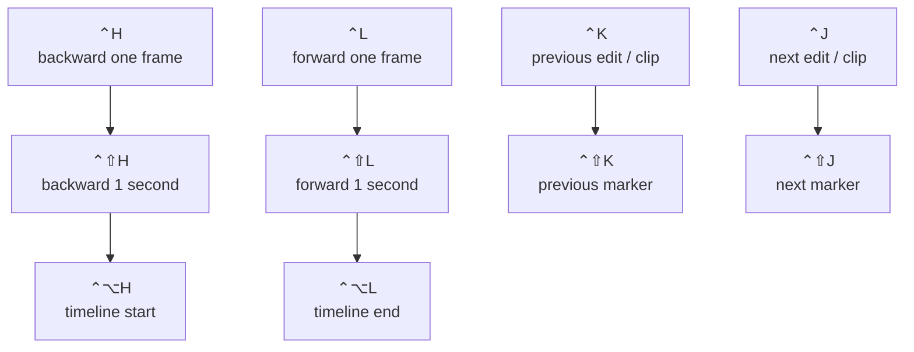
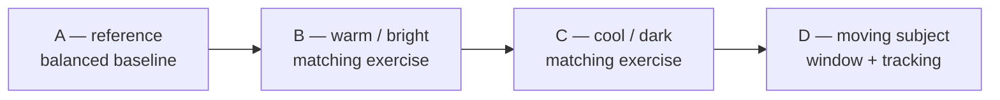
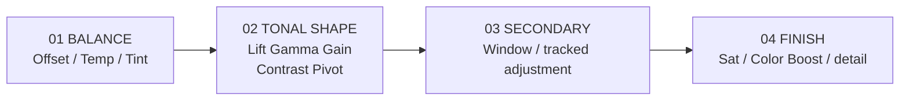
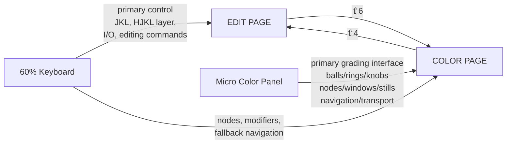

# DaVinci Resolve 21 on macOS: 60% Keyboard + DaVinci Resolve Micro Color Panel

## Executive summary

As of **September 9, 2026**, the Resolve 21 family is current; Blackmagic announced **DaVinci Resolve 21.1 on September 8, 2026**. The Resolve 21 support material includes the Resolve 21 Reference Manual/New Features documentation, while Blackmagic's training guides and the dedicated Micro Color Panel Operation Manual provide the clearest primary-source descriptions of shortcuts and panel behavior. citeturn46search1turn39search0turn49search2

For a real 60% keyboard—no arrows, F-row, Home/End, or separate Forward Delete—the best strategy is **not** to emulate a full keyboard through `Fn`. Resolve's Keyboard Customization system supports custom presets and page/context-specific assignments, so the compact keyboard should be treated as the native interface. Blackmagic documents access to Keyboard Customization with `⌥⌘K` and provides preset load/update/export facilities. citeturn35search0turn27search9

My recommended design is:

| Physical problem | 60% solution |
|---|---|
| ← / → absent | `⌃H` / `⌃L` |
| ↑ / ↓ absent | `⌃K` / `⌃J` |
| Shift+arrows absent | `⌃⇧H/J/K/L` |
| Home / End absent | `⌃⌥H` / `⌃⌥L` |
| F9 / F10 / F11 / F12 absent | `⌃9` / `⌃0` / `⌃-` / `⌃=` |
| Shift+F11 / Shift+F12 absent | `⌃⇧-` / `⌃⇧=` |
| Delete key labeled differently | explicitly capture the physical `Backspace` key |
| Color navigation | **prefer the Micro Color Panel**, retain `⌃H/J/K/L` as fallback |

The `H/J/K/L` layer is intentionally Vim-like:

```text
          ⌃K
      previous edit/clip

⌃H                     ⌃L
previous frame          next frame

          ⌃J
       next edit/clip
```

There is a second important design decision: **do not remap comma and period to frame navigation**. Resolve already gives `,` and `.` useful edit-point nudge functions, with `⇧,` and `⇧.` for larger trim/step operations. Sacrificing those merely to recreate the missing arrow keys wastes excellent native 60%-friendly shortcuts. Blackmagic's published macOS default map documents this comma/period family. citeturn49search0

For Color work, the keyboard should become secondary. The **Micro Color Panel already provides dedicated previous/next frame, clip, node, keyframe, and still controls**, plus transport, grade copy/paste, node creation, Power Windows, keyframes, tracking, still capture/comparison, bypass/disable, resets, Offset, Log, three trackballs/rings, and twelve primary-correction encoders. citeturn42view0turn43view1turn43view2turn43view3turn43view4turn43view5

The optimal Color-page posture is consequently:

```text
LEFT HAND                      RIGHT HAND
60% keyboard                   Micro Color Panel

⌥ + S/P/L/O   nodes            trackballs/rings
⌘ / ⌥ / ⇧     modifiers        12 primary knobs
⌃ H/J/K/L     fallback nav     clip/node/frame navigation
⇧H            highlight        stills / wipe
⌘D            node toggle      Disable / Bypass
⇧D            global bypass    windows / keyframes
Space/J/K/L   fallback play     transport
```

The Micro **Color** Panel should not be confused with the older DaVinci Resolve Micro Panel. The newer unit supports both **USB-C and Bluetooth**, has an internal rechargeable battery and no power switch, contains no built-in LCD parameter displays, and is explicitly designed around the three trackballs/rings, direct primary controls, modifiers, transport/navigation buttons, and an iPad/tablet support slot. On macOS, Blackmagic calls direct USB-C the simplest/reliable connection method; Bluetooth pairing is performed through macOS System Settings. Firmware servicing requires USB. citeturn44view0turn44view1turn44view2turn44view4

One documentation discrepancy deserves highlighting now: the panel has a `USER` key, but Blackmagic's public Operation Manual marks it **reserved for future use**. An earlier Quick Start document described the intended ability to bind a keyboard command but explicitly said the function was not yet available at publication. I found no newer primary-source statement establishing that the `USER` button has become generally programmable in Resolve 21.1, so this report deliberately does **not** build a workflow around it. citeturn43view3turn27search1

There is one unavoidable qualification to the phrase “complete verified keyboard shortcuts.” Blackmagic does **not** currently publish a standalone Resolve 21 macOS default-key sheet equivalent to its older official Mac shortcut reference. Resolve's **live factory `DaVinci Resolve` preset in Keyboard Customization is the final authority for a particular 21.x installation, language/input source, and point release**. Blackmagic's present documentation confirms current shortcuts selectively, while its older official macOS shortcut sheet remains the primary published source for much of the factory lineage. Accordingly, the reference below distinguishes **current-confirmed** shortcuts from **Blackmagic-published factory-lineage** defaults rather than pretending an old PDF is a literal dump of Resolve 21.1's internal keymap. citeturn49search0turn49search2turn35search0

## Verification basis and conventions

This report uses the following hierarchy of evidence.

**Current-confirmed** means a Blackmagic Resolve 20/21 guide or current panel manual explicitly documents the command or behavior. For example, Blackmagic's current training material documents `⇧4` for Edit, `⇧6` for Color, `⌘B` to split a clip, `W` for Dynamic Trim, and `⌥S` for adding a serial Color node. citeturn49search9turn21search0turn27search6turn22search1

**Factory-lineage** means Blackmagic's official macOS keyboard-shortcut publication explicitly documents the binding and I found no later Blackmagic primary source announcing a replacement. This applies to such long-standing bindings as `F9–F12`, `I/O`, `J/K/L`, arrows, Home/End, `A/T/B`, `V/U/E`, comma/period trimming, node shortcuts, memories, grade comparison, stills, and tracking. citeturn49search0

**Unspecified** means Resolve exposes an operation but Blackmagic's public material consulted here does not authoritatively state a current default. I do not invent one. Resolve 21 itself continues to add assignable Keyboard Customization actions—for example, Resolve 21 added shortcuts for selecting Media Pool view modes—illustrating why the live preset necessarily contains more context-sensitive commands than a static training-guide table. citeturn49search2

The notation throughout is macOS notation:

| Symbol | macOS key | Windows-oriented label sometimes seen elsewhere |
|---:|---|---|
| `⌘` | Command | Ctrl in many Resolve cross-platform instructions |
| `⌥` | Option | Alt |
| `⌃` | Control | Ctrl |
| `⇧` | Shift | Shift |
| `⌫` | backward Delete | commonly physically labeled Backspace on PC-style 60% boards |
| `← ↑ ↓ →` | arrow keys | absent on the assumed keyboard |

Blackmagic's own Mac shortcut publication explicitly distinguishes Mac `Command`/`Option` from Windows/Linux `Control`/`Alt`, so blindly translating shortcuts from Windows YouTube tutorials is a particularly good way to create a broken Mac keymap. citeturn49search0

On many PC-layout mechanical 60% keyboards connected to macOS, the physical key marked **Backspace** sends the USB/HID backward-delete key that macOS presents conceptually as `Delete`. Do not rely on the printed keycap: when creating the preset, click the intended command in Keyboard Customization and **physically press the Backspace key to see what Resolve captures**. The factory Delete/Ripple Delete commands are published as `Delete` and `Shift-Delete`. citeturn49search0

Blackmagic's current training material places Keyboard Customization under **DaVinci Resolve → Keyboard Customization**, with `⌥⌘K` as its default shortcut. Its preset controls include loading, updating and exporting presets. Resolve also supports context/page-specific shortcut assignments; recent versions continue extending that mechanism. citeturn35search0turn27search9

A useful architectural consequence is that a chord such as `⌃K` can mean **Previous Edit** in Edit context and **Previous Clip** in Color context while preserving one physical concept—“go backward/up one structural unit.” That is preferable to filling the keyboard with unrelated memorized chords. Resolve's shortcut architecture is explicitly page/context aware. citeturn49search0turn27search9

The panel material is based primarily on Blackmagic's official **DaVinci Resolve Micro Color Panel Operation Manual**, supplemented by Blackmagic's current product/support and Resolve documentation. The Micro Color Panel first required Resolve 19 or later; Resolve 20 subsequently adjusted the sensitivity of its Lift/Gamma/Gain rings, so older launch-era videos can feel somewhat different from current Resolve even where the function is identical. citeturn48search7turn48search11

## macOS Edit and Color keyboard reference

The tables below are the **complete set of Edit/Color-relevant default shortcuts I could verify from Blackmagic's public primary-source shortcut material, with current Resolve training used where it explicitly supersedes or reconfirms older documentation**. A locally installed Resolve 21.x factory preset can contain additional context-sensitive commands, and that live preset wins whenever it disagrees with a historical published binding. citeturn49search0turn49search9turn21search0turn22search1turn27search6

**Edit-page application, modes and basic editing**

| Command | macOS default | Verification |
|---|---:|---|
| Open Keyboard Customization | `⌥⌘K` | Current-confirmed |
| Switch to Edit page | `⇧4` | Current-confirmed |
| Switch to Color page | `⇧6` | Current-confirmed |
| Undo | `⌘Z` | Factory-lineage |
| Redo | `⇧⌘Z` | Factory-lineage |
| Cut | `⌘X` | Factory-lineage |
| Copy | `⌘C` | Factory-lineage |
| Paste | `⌘V` | Factory-lineage |
| Paste Attributes | `⌥V` | Factory-lineage |
| Select All | `⌘A` | Factory-lineage |
| Deselect All | `⇧⌘A` | Factory-lineage |
| Delete Selected | `Delete` / `⌫` semantics | Factory-lineage |
| Delete With Ripple | `⇧Delete` | Factory-lineage |
| Selection/Pointer mode | `A` | Factory-lineage |
| Trim Edit mode | `T` | Factory-lineage |
| Dynamic Trim mode | `W` | Current-confirmed |
| Blade mode | `B` | Factory-lineage |
| Split clip at playhead | `⌘B` | **Current-confirmed** |
| Insert | `F9` | Factory-lineage |
| Overwrite | `F10` | Factory-lineage |
| Replace | `F11` | Factory-lineage |
| Place on Top | `F12` | Factory-lineage |
| Fit to Fill | `⇧F11` | Factory-lineage |
| Append at End | `⇧F12` | Factory-lineage |

Blackmagic's old Mac sheet used different historical terminology around `Command-B`/Razor and a separate Split Clip entry, while current Blackmagic training explicitly teaches **`⌘B` for splitting a clip**. For Resolve 21 workflow design, the current training behavior is the one to train. citeturn49search0turn21search0

**Edit selection, edit points and timeline manipulation**

| Command | macOS default | Verification |
|---|---:|---|
| Select Clips Forward — current track | `Y` | Factory-lineage |
| Select Clips Forward — all tracks | `⌥Y` | Factory-lineage |
| Select Nearest Clip/Gap | `⇧V` | Factory-lineage |
| Linked Selection | `⇧⌘L` | Factory-lineage |
| Link/Unlink Clips | `⌥⌘L` | Factory-lineage |
| Enable/Disable Clip | `D` | Factory-lineage |
| Join Clips | `⌥\` | Factory-lineage |
| Retime Clip / Retime Controls | `⌘R` | Factory-lineage |
| Reset Clip | `⌥⌘R` | Factory-lineage |
| Select Edit Point | `V` | Factory-lineage |
| Cycle/Edit Point Type | `U` | Current behavior also used by Dynamic Trim training |
| Toggle Video+Audio / Video / Audio edit type | `⌥U` | Factory-lineage |
| Add Default Transition | `⌘T` | Factory-lineage |
| Nudge edit one frame left | `,` | Factory-lineage |
| Nudge edit one frame right | `.` | Factory-lineage |
| Trim/step multiframe left | `⇧,` | Factory-lineage |
| Trim/step multiframe right | `⇧.` | Factory-lineage |
| Trim Start | `⇧[` | Factory-lineage |
| Trim End | `⇧]` | Factory-lineage |
| Extend Edit | `E` | Factory-lineage |
| Slip Audio one frame reverse | `⌥,` | Factory-lineage |
| Slip Audio one frame forward | `⌥.` | Factory-lineage |
| Match Frame | `F` | Factory-lineage |
| Snapping | `N` | Factory-lineage |
| Audio Scrubbing | `⇧S` | Factory-lineage |

Current Blackmagic Dynamic Trim training explicitly documents the `W` → `U` → `J/K/L` workflow: `W` enters Dynamic Trim, `U` changes the selected edit operation, and transport keys perform the trim. That is especially useful for a 60% board because none of those keys require an extended keyboard. citeturn27search6

**Track targeting and locking**

| Command family | macOS default | Verification |
|---|---|---|
| Video Destination V1–V8 | `⌥1` … `⌥8` | Factory-lineage |
| Audio Destination A1–A8 | `⌥⌘1` … `⌥⌘8` | Factory-lineage |
| Lock/Unlock Video V1–V8 | `⌥⇧1` … `⌥⇧8` | Factory-lineage |
| Lock/Unlock Audio A1–A8 | `⌥⇧⌘1` … `⌥⇧⌘8` | Factory-lineage |

These range assignments are explicitly present in Blackmagic's published Mac factory mapping; because track-targeting UI has evolved substantially since that publication, I would verify any of these you actually intend to memorize against Resolve 21's live `DaVinci Resolve` preset before training them. citeturn49search0

**Marks and metadata navigation**

| Command | macOS default | Verification |
|---|---:|---|
| Mark In | `I` | Factory-lineage |
| Mark Out | `O` | Factory-lineage |
| Clear In | `⌥I` | Factory-lineage |
| Clear Out | `⌥O` | Factory-lineage |
| Clear In and Out | `⌥X` | Factory-lineage |
| Mark Clip | `X` | Factory-lineage |
| Add Marker | `M` | Factory-lineage |
| Modify Marker | `⇧M` | Factory-lineage |
| Delete Marker | `⌥M` | Factory-lineage |
| Add Flag | `G` | Factory-lineage |
| Go to In | `⇧I` | Factory-lineage |
| Go to Out | `⇧O` | Factory-lineage |

Blackmagic's published defaults for this family are unusually good on a 60% keyboard; there is no reason to change them. citeturn49search0

**Playback and temporal navigation**

| Command | macOS default | Verification |
|---|---:|---|
| Reverse Play | `J` | Factory-lineage/current standard |
| Stop | `K` | Factory-lineage/current standard |
| Forward Play | `L` | Factory-lineage/current standard |
| Play/Stop | `Space` | Factory-lineage/current standard |
| Loop | `⌘/` | Factory-lineage |
| Play Around Current Frame | `/` | Factory-lineage |
| Play In to Out | `⌥/` | Factory-lineage |
| Play to Out | `⌥⌘/` | Factory-lineage |
| Previous frame | `←` | Factory-lineage |
| Next frame | `→` | Factory-lineage |
| One second reverse | `⇧←` | Factory-lineage |
| One second forward | `⇧→` | Factory-lineage |
| Previous clip/edit | `↑` | Factory-lineage |
| Next clip/edit | `↓` | Factory-lineage |
| First frame | `;` | Factory-lineage |
| Last frame | `'` | Factory-lineage |
| Previous keyframe | `[` | Factory-lineage |
| Next keyframe | `]` | Factory-lineage |
| Previous marker | `⇧↑` | Factory-lineage |
| Next marker | `⇧↓` | Factory-lineage |
| Timeline start | `Home` | Factory-lineage |
| Timeline end | `End` | Factory-lineage |

The absent arrows and Home/End are the single largest ergonomic problem on a conventional 60% board, and they are exactly the family replaced by the proposed `⌃H/J/K/L` layer below. citeturn49search0

**Edit viewer and zoom**

| Command | macOS default | Verification |
|---|---:|---|
| Toggle Source/Timeline Viewer | `Q` | Factory-lineage |
| Zoom timeline to Fit | `⇧Z` | Factory-lineage |
| Zoom In | `⌘=` | Factory-lineage |
| Zoom Out | `⌘-` | Factory-lineage |
| Cinema Viewer | `⌘F` | Factory-lineage |
| Full Screen Viewer | `⇧F` | Factory-lineage |

The underlying page-switch defaults remain current: `⇧4` takes you to Edit and `⇧6` to Color. citeturn49search9

**Color-page core grade and version commands**

| Command | macOS default | Verification |
|---|---:|---|
| Switch to Color page | `⇧6` | Current-confirmed |
| Switch to Edit page | `⇧4` | Current-confirmed |
| Auto Color | `⌥A` | Factory-lineage |
| Reset Selected Node Grade | `⇧Home` | Factory-lineage |
| Reset Grades but Keep Nodes | `⇧⌘Home` | Factory-lineage |
| Reset All Grades and Nodes | `⌘Home` | Factory-lineage |
| Add Version | `⌘Y` | Factory-lineage |
| Default Version | `⌘U` | Factory-lineage |
| Previous Version | `⌘B` | Factory-lineage, Color context |
| Next Version | `⌘N` | Factory-lineage, Color context |
| Apply Grade from 1 Clip Prior | `=` | Factory-lineage |
| Apply Grade from 2 Clips Prior | `-` | Factory-lineage |

The three Home-based resets are obvious candidates for remapping on a 60% board, although the Micro Color Panel itself supplies superior reset controls. Because these particular keyboard defaults are factory-lineage rather than independently reprinted in a current 21 guide, verify their exact Resolve 21 command names before committing the optional fallback mappings. citeturn49search0

**Color node operations**

| Command | macOS default | Verification |
|---|---:|---|
| Add Serial Node after current | `⌥S` | **Current-confirmed** |
| Add Serial Node before current | `⇧S` | Factory-lineage |
| Add Parallel Node | `⌥P` | Factory-lineage |
| Add Layer Node | `⌥L` | Factory-lineage |
| Append Node | `⌥K` | Factory-lineage |
| Add Outside Node | `⌥O` | Factory-lineage |
| Add Splitter/Combiner | `⌥Y` | Factory-lineage |
| Enable/Disable selected node | `⌘D` | Factory-lineage |
| Enable/Disable all nodes | `⌥D` | Factory-lineage |

Blackmagic's current Colorist training specifically reconfirms `⌥S` for creating a serial node. citeturn22search1

**Color comparison, viewer and still operations**

| Command | macOS default | Verification |
|---|---:|---|
| Grab Still | `⌥⌘G` | Factory-lineage |
| Play Still | `⌥⌘F` | Factory-lineage |
| Previous Still | `⌥⌘P` | Factory-lineage |
| Next Still | `⌥⌘N` | Factory-lineage |
| Highlight | `⇧H` | Factory-lineage |
| Highlight B&W | `⇧⌥H` | Factory-lineage |
| Highlight Difference | `⇧⌘H` | Factory-lineage |
| Bypass All Grades | `⇧D` | Factory-lineage |
| Show Reference Wipe | `⌘W` | Factory-lineage |
| Cycle Wipe Style | `⇧W` | Factory-lineage |
| Invert Wipe | `⌥W` | Factory-lineage |
| Reposition Reference | `⌥⇧R` | Factory-lineage |
| Primaries/Log Wheels | `⌥Z` | Factory-lineage |
| Scopes | `⇧⌘W` | Factory-lineage |

These remain particularly useful as keyboard fallbacks, but `Grab Still`, still navigation, Highlight, Bypass, viewer functions and comparison operations all have more tactile equivalents on the Micro Color Panel. citeturn49search0turn43view1turn43view3turn43view4

**Color tracking**

| Command | macOS default | Verification |
|---|---:|---|
| Track Reverse | `⌥T` | Factory-lineage |
| Track Forward | `⌘T` | Factory-lineage |
| Stop Tracking | `⌥⌘T` | Factory-lineage |
| Track one frame reverse | `⌥←` | Factory-lineage |
| Track one frame forward | `⌥→` | Factory-lineage |
| Resolve Live on/off | `⌘R` | Factory-lineage |
| Freeze current frame | `⇧⌘R` | Factory-lineage |
| Snapshot | `⌥⌘R` | Factory-lineage |

With a Micro Color Panel, the arrow-dependent one-frame tracking shortcuts are poor choices to train; panel tracking and frame controls are superior. citeturn49search0turn43view2turn43view8turn43view9

**Color memories**

| Operation | macOS default | Verification |
|---|---:|---|
| Load Memories A–H | `⌘1` … `⌘8` | Factory-lineage |
| Save Memories A–H | `⌥1` … `⌥8` | Factory-lineage |
| Preview Memory | `⌥⇧P` | Factory-lineage |
| Original Memory | `⌥⇧O` | Factory-lineage |

These are **Color memories**, not Gallery stills; the concepts should not be conflated. citeturn49search0

**Color playback/navigation inherited from the common transport model**

| Command | macOS default | Recommended use |
|---|---:|---|
| Reverse / Stop / Forward | `J / K / L` | Keep |
| Play/Stop | `Space` | Keep |
| Previous/Next frame | `← / →` | Remap or use panel |
| Previous/Next clip | `↑ / ↓` | Remap or use panel |
| Timeline start/end | `Home / End` | Remap or panel |
| Previous/Next marker | `⇧↑ / ⇧↓` | Remap or panel |

The Micro Color Panel independently exposes direct frame, clip, node, keyframe, still and transport navigation, so the 60% keyboard layer here is redundancy rather than the primary Color control surface. citeturn43view4turn43view5turn43view8turn43view9

## Recommended 60% keyboard preset

The preset is designed around four rules:

**Preserve excellent native bindings.** `J/K/L`, `I/O`, `A/T/W/B`, `V/U/E`, `N`, `M`, `F`, `Q`, `⌥S/P/L/O`, `⌘D`, `⇧D`, `⇧H`, and the comma/period trim family all already belong on a compact keyboard. Blackmagic documents those families directly. citeturn49search0turn22search1turn27search6

**Use `Control` as the missing-key layer.** On macOS Resolve, `Command` and `Option` are already densely occupied. `Control` is comparatively attractive for hardware substitution, and `⌃H/J/K/L` gives a meaningful spatial grammar without stealing ordinary letter commands.

**Preserve the physical F9–F12 sequence.** On a US ANSI 60% row, the keys corresponding naturally to the rightmost part of the number row are:

```text
9      0      -      =
│      │      │      │
Insert Over   Replace Top
```

Adding `Control` makes them deliberate rather than easy to hit accidentally.

**Use page-specific mappings where possible.** Resolve's customization model supports contextual/page assignments, so `⌃K` can remain semantically “one structural item backward” while acting on edits in Edit and clips in Color. citeturn27search9turn49search0



The factory commands represented by this diagram are the published Arrow/Shift-Arrow/Home/End navigation family. citeturn49search0

**Primary remap table**

| Scope | Command | Factory macOS default | New 60% mapping | Why |
|---|---|---:|---:|---|
| Edit | Previous Frame | `←` | **`⌃H`** | Vim-left |
| Edit | Next Frame | `→` | **`⌃L`** | Vim-right |
| Edit | Previous Clip/Edit | `↑` | **`⌃K`** | Vim-up |
| Edit | Next Clip/Edit | `↓` | **`⌃J`** | Vim-down |
| Edit | Step 1 Second Reverse | `⇧←` | **`⌃⇧H`** | larger horizontal step |
| Edit | Step 1 Second Forward | `⇧→` | **`⌃⇧L`** | larger horizontal step |
| Edit | Previous Marker | `⇧↑` | **`⌃⇧K`** | shifted structural back |
| Edit | Next Marker | `⇧↓` | **`⌃⇧J`** | shifted structural forward |
| Edit | Timeline Start | `Home` | **`⌃⌥H`** | extreme-left |
| Edit | Timeline End | `End` | **`⌃⌥L`** | extreme-right |
| Edit | Delete Selected | `Delete` | **physical `Backspace`** | available physical key |
| Edit | Delete With Ripple | `⇧Delete` | **`⇧Backspace`** | paired deletion |
| Edit | Insert | `F9` | **`⌃9`** | preserves four-key order |
| Edit | Overwrite | `F10` | **`⌃0`** | preserves four-key order |
| Edit | Replace | `F11` | **`⌃-`** | preserves four-key order |
| Edit | Place on Top | `F12` | **`⌃=`** | preserves four-key order |
| Edit | Fit to Fill | `⇧F11` | **`⌃⇧-`** | shifted Replace partner |
| Edit | Append at End | `⇧F12` | **`⌃⇧=`** | shifted Top partner |

The default column above is directly grounded in Blackmagic's published macOS map; `Backspace` should be captured physically because key labels and macOS key semantics differ among PC-layout mechanical keyboards. citeturn49search0

**Color fallback mappings**

| Color command | Factory default | New 60% mapping | Preferred actual control |
|---|---:|---:|---|
| Previous Frame | `←` | `⌃H` | Panel `PREV FRAME` |
| Next Frame | `→` | `⌃L` | Panel `NEXT FRAME` |
| Previous Clip | `↑` | `⌃K` | Panel `PREV CLIP` |
| Next Clip | `↓` | `⌃J` | Panel `NEXT CLIP` |
| Timeline Start | `Home` | `⌃⌥H` | `Shift Down + PREV CLIP` |
| Timeline End | `End` | `⌃⌥L` | `Shift Down + NEXT CLIP` |
| Reset Selected Node Grade | `⇧Home` | `⌃⌥1` | Panel `RESET` |
| Reset Grades, Keep Nodes | `⇧⌘Home` | `⌃⌥2` | keyboard fallback |
| Reset all Grades + Nodes | `⌘Home` | `⌃⌥3` | `Shift Down + RESET` |

The Color navigation alternatives on the right are explicitly documented panel functions. The Home-key reset defaults are published Blackmagic Mac factory-lineage bindings; verify their exact command labels in Resolve 21 Keyboard Customization before assigning the optional `⌃⌥1/2/3` family. citeturn49search0turn43view3turn43view4turn43view5

**Commands deliberately left untouched**

| Function | Keep |
|---|---:|
| Selection | `A` |
| Trim | `T` |
| Dynamic Trim | `W` |
| Blade | `B` |
| Split at playhead | `⌘B` |
| Snapping | `N` |
| Match Frame | `F` |
| Mark In / Out | `I` / `O` |
| Marker | `M` |
| Select Edit | `V` |
| Edit type | `U` |
| Extend Edit | `E` |
| Reverse/Stop/Forward | `J/K/L` |
| Play/Stop | `Space` |
| Nudge edit ±1 frame | `,` / `.` |
| Multiframe trim/step | `⇧,` / `⇧.` |
| Serial Color node | `⌥S` |
| Parallel node | `⌥P` |
| Layer node | `⌥L` |
| Outside node | `⌥O` |
| Node enable/disable | `⌘D` |
| Grade bypass | `⇧D` |
| Highlight | `⇧H` |
| Grab Still | `⌥⌘G` |
| Edit page | `⇧4` |
| Color page | `⇧6` |

These are all physically comfortable on a 60% board already and are part of Blackmagic's published/current command families. citeturn49search0turn49search9turn21search0turn22search1turn27search6

There are two caveats. First, `⌃H/J/K/L` can have conventional text-editing meanings in macOS text fields. That does not make them bad timeline shortcuts, but when a rename/search/numeric field owns keyboard focus, the field may consume the chord; hit `Esc` or return focus to the timeline/viewer. Second, `⌃-` and `⌃=` assume an **en-US/ANSI positional layout**. With another macOS input source, bind by the desired physical positions rather than assuming those glyphs.

## Micro Color Panel complete control map

The Micro Color Panel is designed around **three high-resolution trackballs, three surrounding level rings, twelve primary-correction encoders, dedicated reset keys, grading/navigation/transport buttons and two hardware Shift modifiers**. It has **no built-in LCD parameter displays**; parameter values and palette state are shown by Resolve itself, while panel buttons use illumination to indicate relevant modes/states. It can connect to macOS by USB-C or Bluetooth. citeturn44view0turn43view0turn43view1

A useful mental map of the physical grading area is:

```text
┌────────────────────────────────────────────────────────────────────┐
│ Y LIFT │ Y GAMMA │ Y GAIN │ CONTRAST │ PIVOT │ MID DETAIL        │
│ COLOR BOOST │ SHADOWS │ HIGHLIGHTS │ SAT │ HUE │ LUM MIX         │
├────────────────────────────────────────────────────────────────────┤
│             RESET        RESET        RESET                        │
│                                                                    │
│              ●             ●             ●                         │
│             LIFT          GAMMA          GAIN                       │
│             ◯ ring        ◯ ring         ◯ ring                    │
│                                                                    │
│        shadows         midtones       highlights                   │
└────────────────────────────────────────────────────────────────────┘
```

Blackmagic's official panel diagram and control descriptions identify this same 12-encoder/three-trackball structure. citeturn42view0turn43view0turn43view1

**Normal Primaries trackballs and rings**

| Physical control | Normal Primary mapping |
|---|---|
| Left trackball | Lift color balance |
| Left ring | Lift master/Y level |
| Center trackball | Gamma color balance |
| Center ring | Gamma master/Y level |
| Right trackball | Gain color balance |
| Right ring | Gain master/Y level |

The **ball changes chromatic balance; the surrounding ring changes the corresponding master level**. Lift broadly emphasizes shadows, Gamma the midrange, and Gain the brighter range. citeturn42view0turn42view1

**Offset mode**

Pressing `OFFSET` changes the physical mapping:

| Control | Offset mapping |
|---|---|
| Left ring | Temperature |
| Center ring | Tint |
| Right trackball | Master/Offset color balance |
| Right ring | Master Exposure/Offset level |
| Left/center trackballs | no primary Offset assignment documented |

The Offset button illuminates to indicate the mode. This makes the panel particularly effective for establishing a broad shot balance before shaping tonal regions with Lift/Gamma/Gain. citeturn42view2turn43view3

**Log mode**

`Shift Up + OFFSET` toggles the Log-wheel mapping:

| Physical area | Log mapping |
|---|---|
| Left ball/ring | Shadow color / level |
| Center ball/ring | Midtone color / level |
| Right ball/ring | Highlight color / level |

This gives more localized tonal ranges than the standard Lift/Gamma/Gain Primaries. citeturn42view1

**Trackballs as Power Window controls**

With the relevant Window palette active, holding **Shift Up** changes the balls/rings to geometric controls:

| Control | Shift Up + active Window |
|---|---|
| Gain/right trackball | Pan/Tilt window position |
| Gain/right ring | Window size |
| Gamma/center trackball | Window aspect ratio |
| Gamma/center ring | Window rotation |
| Lift/left trackball | no documented effect |
| Lift/left ring | Softness 1 |

These mappings only make sense when the relevant Window context is active; “nothing happens” is often a palette/selection issue rather than a defective panel. citeturn42view2turn43view6

**Trackballs as Sizing controls**

With the Sizing palette active, holding **Shift Down** maps:

| Control | Shift Down + active Sizing |
|---|---|
| Gain/right trackball | input sizing position/pan/tilt |
| Gain/right ring | Zoom |
| Gamma/center trackball | Width/Height |
| Gamma/center ring | Rotation |
| Lift/left ball/ring | no documented effect |

Again, software palette context matters. citeturn42view3turn43view6

**Three trackball reset keys**

Each Lift/Gamma/Gain section has its own reset key.

| Gesture | Primary-mode reset behavior |
|---|---|
| Tap reset | reset both RGB/color and level for that range |
| `Shift Up + reset` | reset RGB/color only; preserve level |
| `Shift Down + reset` | reset level only; preserve RGB/color |

This is one of the panel's most valuable learning tools: it lets you deliberately over-correct color and exposure independently, then reset only the dimension you dislike. In Offset mode, the three reset positions correspond to the relevant Offset assignments—Temperature, Tint, and Offset/master controls. citeturn42view3turn43view7

That means the practical vocabulary is:

```text
tap RESET LIFT
    "throw away everything I did to Lift"

Shift Up + RESET LIFT
    "throw away the Lift color bias, keep its level"

Shift Down + RESET LIFT
    "throw away the Lift level, keep its color bias"
```

The same model applies to Gamma and Gain. citeturn42view3

**The twelve primary encoders**

Blackmagic specifies twelve endless/high-resolution primary-control encoders with reset/detent behavior. Their panel-to-software mapping is fixed and arranged left to right as follows. citeturn43view0turn43view1

| Encoder | Software control | What it actually does |
|---|---|---|
| **Y Lift** | Primaries Y Lift | Raises/lowers luminance primarily in darker regions, with progressively less influence toward brighter values. |
| **Y Gamma** | Primaries Y Gamma | Adjusts primarily midtone luminance/contrast while overlapping lower and upper ranges. |
| **Y Gain** | Primaries Y Gain | Adjusts luminance primarily toward the bright/highlight end. |
| **Contrast** | Contrast | Expands or compresses tonal separation between dark and bright values. |
| **Pivot** | Pivot | Moves the tonal center around which Contrast acts. |
| **Mid Detail** | Midtone Detail | Alters local/detail contrast; positive values make texture/detail more apparent, negative values soften it. |
| **Color Boost** | Color Boost | Increases or decreases colorfulness with proportionally greater emphasis on less-saturated colors than ordinary Saturation. |
| **Shadows** | Shadows | Selectively lightens/darkens shadow detail with less influence on the midrange. |
| **Highlights** | Highlights | Recovers/reshapes bright highlight detail, particularly useful with high-dynamic-range source material. |
| **Saturation** | Saturation | Globally adjusts chroma intensity; zero produces grayscale. |
| **Hue** | Hue Rotation | Rotates hue relationships globally; neutral/default position preserves original hue distribution. |
| **Lum Mix** | Luminance Mix | Controls the balance between Y/luminance behavior and RGB-channel contributions in primary corrections. |

Blackmagic's manual describes these controls individually, including Pivot's relationship to Contrast, Mid Detail's local-detail behavior, Color Boost's preferential treatment of low-saturation colors, and the selective Shadows/Highlights operations. citeturn43view0turn43view1

The most useful pairings to learn are therefore:

```text
Contrast  ↔ Pivot
Lift      ↔ Gamma ↔ Gain
Color Boost ↔ Saturation
Shadows   ↔ Highlights
RGB balls ↔ Lum Mix
```

Do not treat the twelve knobs as twelve unrelated effects.

**Top grading-operation controls**

| Button | Press | Shift Up | Shift Down / special behavior |
|---|---|---|---|
| `PLAY STILL` | displays/plays comparison with selected Gallery still | Split Screen | Gallery display |
| `WIPE STILL` | hold while using right/Gain ring to alter wipe position | cycle wipe-still mode/style | — |
| `GRAB STILL` | capture current frame and grade/node metadata to Gallery | — | — |
| `H/LITE` | toggle Highlight | cycle Highlight modes | — |
| `VIEWER` | Cinema/full-screen viewer | Clips display | Lightbox |
| `CURSOR` | show/move Viewer crosshair | — | — |
| `SELECT` | sample/select color at cursor in applicable color tools | — | — |
| `ADD NODE` | Serial node | Parallel node | Layer node |
| `ADD WINDOW` | Circular Power Window | Linear Power Window | Track active window both directions |
| `ADD KEYFRM` | Dynamic Keyframe | Static Keyframe | — |

These mappings come directly from Blackmagic's Micro Color Panel operation tables. citeturn43view1turn43view2turn43view7turn43view8

`GRAB STILL` is not merely a screenshot function: Resolve Gallery stills carry grading/node information and are designed for reference and grade application. The panel gives the Gallery workflow direct physical controls for capture, still navigation, playback/comparison and wipe manipulation. citeturn43view1turn43view4

**Left-side command bank**

| Button | Press | Shift Up | Shift Down |
|---|---|---|---|
| `AUTO COLOR` | Auto Color selected clip(s) | apply grade from two clips earlier | apply grade from one clip earlier |
| `OFFSET` | Offset mode | Log mode toggle | — |
| `COPY` | copy clip grade | copy node grade | — |
| `PASTE` | paste copied clip grade | apply selected Gallery still grade | — |
| `UNDO` | page-aware multilevel Undo | — | — |
| `REDO` | page-aware multilevel Redo | — | — |
| `DELETE` | delete selected node | delete selected Power Window | delete selected still |
| `RESET` | reset current node grade | reset selected palette | reset all grades/nodes on current clip |
| `BYPASS` | bypass all grades | — | — |
| `DISABLE` | disable selected node | — | — |
| `USER` | **reserved/not authoritatively available** | — | — |
| `LOOP` | toggle looping | toggle Window overlay | mute/unmute audio |

`BYPASS` and `DISABLE` have importantly different scopes: **Disable tests a selected node; Bypass tests the grade more globally**. Their illuminated state makes this distinction easy to use during evaluation. citeturn43view2turn43view3turn43view5turn43view6

The panel's `USER` button deserves the conservative treatment noted earlier: the current public operation documentation calls it reserved, while an earlier Quick Start documented an intended custom-shortcut role that was explicitly unavailable at that time. Unless Resolve 21.1 on your particular firmware exposes an assignable User action, consider it inert. citeturn43view3turn27search1

**Right-side still/keyframe/node/frame/clip navigation**

| Button | Press | Shift Up | Shift Down |
|---|---|---|---|
| `PREV STILL` | previous Gallery still | previous Still Album | add flag to current clip |
| `NEXT STILL` | next Gallery still | next Still Album | no documented lower action |
| `PREV KEYFRM` | previous keyframe | previous marker | add marker at current position |
| `NEXT KEYFRM` | next keyframe | next marker | select marker/open marker pop-up |
| `PREV NODE` | previous node numerically | — | first node |
| `NEXT NODE` | next node numerically | — | last node |
| `PREV FRAME` | one frame backward | — | first frame of clip |
| `NEXT FRAME` | one frame forward | — | last frame of clip |
| `PREV CLIP` | previous clip | previous grade version | timeline start |
| `NEXT CLIP` | next clip | next grade version | timeline end |

This bank almost completely solves the absence of arrow, Home and End keys during Color work without any keyboard remapping at all. citeturn43view4turn43view5turn43view8

**Panel transport**

| Control | Press | Repeated/modified behavior |
|---|---|---|
| Reverse Play | play reverse | repeated presses increase reverse speed |
| Forward Play | play forward | repeated presses increase forward speed |
| Stop/Play square | stop; subsequent press plays | `Shift Down` stops tracking |
| `Shift Down + Reverse` | — | track active Window backward |
| `Shift Down + Forward` | — | track active Window forward |
| `LOOP` | toggle loop playback | useful while grading motion |

Blackmagic explicitly documents the transport and tracker-modified behaviors. citeturn43view8turn43view9

**Hardware Shift modifiers**

The panel's two triangular Shift keys are actual panel modifiers rather than macOS `Shift` equivalents. `Shift Up` and `Shift Down` select the upper/lower secondary functions printed or documented for panel keys and also activate the Window/Sizing trackball mappings. They illuminate green while active. citeturn42view0turn43view6

It is useful to write them differently from keyboard Shift:

```text
⇧              = macOS keyboard Shift

PANEL ↑SHIFT    = Micro Color Panel Shift Up
PANEL ↓SHIFT    = Micro Color Panel Shift Down
```

That prevents instructions such as “Shift + Reset” from becoming ambiguous.

**Displays, LEDs and physical connectivity**

The Micro Color Panel has **no integrated LCD parameter screens**. This distinguishes it from larger Blackmagic grading panels. Its feedback comes from physical control position/feel, key illumination, and Resolve's software UI. The chassis also provides a tablet/iPad support slot, but the tablet is not an integrated panel display. citeturn44view0turn49search6

For macOS:

| Hardware behavior | macOS procedure |
|---|---|
| USB operation | connect USB-C directly to Mac; Resolve detects the panel |
| Charging | USB-C charges internal battery |
| Bluetooth | press rear Bluetooth control, then pair in macOS System Settings → Bluetooth |
| Firmware update | connect by USB and use DaVinci Control Panels Setup |
| Power | no ordinary on/off switch; designed to remain available |
| Factory reset | USB-connected reset procedure or DaVinci Control Panels Setup |

Blackmagic recommends USB as the simplest/reliable connection path and specifically requires USB for firmware servicing. citeturn44view0turn44view1turn44view2turn44view4

The documented hardware factory-reset procedure uses USB-C and the panel button combination involving `AUTO COLOR` and `STOP` until the key illumination cycles; Blackmagic also provides a factory-reset function through its control-panel setup utility. citeturn42view0

Panel commands themselves are not “Mac shortcuts”: once connected, the grading-panel mappings are essentially Resolve control-surface functions. The macOS-specific differences are **connection/pairing, Control Panels Setup, and the keyboard-side use of Command/Option/Control**.

## Combined printable quick reference

The following is the version worth printing. **Bold entries are the recommended 60% additions; unbolded keyboard commands remain factory bindings.** Panel actions are named as printed on the Micro Color Panel. Factory shortcut sources and panel mappings are Blackmagic's official documentation. citeturn49search0turn21search0turn22search1turn43view1turn43view2turn43view4

| Workflow action | 60% Mac keyboard | Micro Color Panel | Annotation |
|---|---:|---|---|
| Edit page | `⇧4` | — | editing |
| Color page | `⇧6` | — | grading |
| Play reverse | `J` | Reverse | repeated taps = faster |
| Stop | `K` | Stop | panel second press can resume |
| Play forward | `L` | Forward | repeated taps = faster |
| Play/stop | `Space` | Stop/Play | |
| Previous frame | **`⌃H`** | `PREV FRAME` | panel preferred in Color |
| Next frame | **`⌃L`** | `NEXT FRAME` | panel preferred in Color |
| Previous edit/clip | **`⌃K`** | `PREV CLIP` | structural back |
| Next edit/clip | **`⌃J`** | `NEXT CLIP` | structural forward |
| Timeline start | **`⌃⌥H`** | `↓SHIFT + PREV CLIP` | |
| Timeline end | **`⌃⌥L`** | `↓SHIFT + NEXT CLIP` | |
| In / Out | `I / O` | — | source/timeline range |
| Clear both | `⌥X` | — | |
| Marker | `M` | `↓SHIFT + PREV KEYFRM` | panel version is current-position marker |
| Selection | `A` | — | |
| Trim | `T` | — | |
| Dynamic Trim | `W` | — | use J/K/L |
| Blade | `B` | — | |
| Split at playhead | `⌘B` | — | generally preferable to Blade |
| Delete/lift | **Backspace** | — | bind physical key |
| Ripple Delete | **`⇧Backspace`** | — | removes gap |
| Select edit | `V` | — | |
| Cycle edit type | `U` | — | |
| Extend edit | `E` | — | |
| Nudge edit left/right | `, / .` | — | preserve these defaults |
| Multiframe trim/step | `⇧, / ⇧.` | — | |
| Snapping | `N` | — | |
| Match Frame | `F` | — | |
| Insert | **`⌃9`** | — | replaces F9 |
| Overwrite | **`⌃0`** | — | replaces F10 |
| Replace | **`⌃-`** | — | replaces F11 |
| Place on Top | **`⌃=`** | — | replaces F12 |
| Fit to Fill | **`⌃⇧-`** | — | replaces ⇧F11 |
| Append at End | **`⌃⇧=`** | — | replaces ⇧F12 |
| Serial node | `⌥S` | `ADD NODE` | |
| Parallel node | `⌥P` | `↑SHIFT + ADD NODE` | |
| Layer node | `⌥L` | `↓SHIFT + ADD NODE` | |
| Outside node | `⌥O` | — | keyboard fastest |
| Previous/next node | — | `PREV/NEXT NODE` | |
| First/last node | — | `↓SHIFT + PREV/NEXT NODE` | |
| Disable selected node | `⌘D` | `DISABLE` | node-level A/B |
| Bypass grade | `⇧D` | `BYPASS` | broad A/B |
| Highlight | `⇧H` | `H/LITE` | |
| Grab Still | `⌥⌘G` | `GRAB STILL` | panel preferred |
| Previous/next still | `⌥⌘P / ⌥⌘N` | `PREV/NEXT STILL` | |
| Copy clip grade | `⌘C` contextually | `COPY` | panel explicit |
| Paste clip grade | `⌘V` contextually | `PASTE` | panel explicit |
| Auto Color | `⌥A` | `AUTO COLOR` | |
| Grade 2 clips prior | `-` | `↑SHIFT + AUTO COLOR` | |
| Grade 1 clip prior | `=` | `↓SHIFT + AUTO COLOR` | |
| Circular Window | UI | `ADD WINDOW` | |
| Linear Window | UI | `↑SHIFT + ADD WINDOW` | |
| Track Window both ways | UI | `↓SHIFT + ADD WINDOW` | |
| Dynamic Keyframe | UI/context | `ADD KEYFRM` | |
| Static Keyframe | UI/context | `↑SHIFT + ADD KEYFRM` | |
| Window overlay | UI | `↑SHIFT + LOOP` | |
| Loop playback | `⌘/` | `LOOP` | |
| Mute audio | UI | `↓SHIFT + LOOP` | panel shortcut |
| Cinema viewer | `⌘F` | `VIEWER` | |
| Clips | UI | `↑SHIFT + VIEWER` | |
| Lightbox | context | `↓SHIFT + VIEWER` | |
| Offset mode | UI | `OFFSET` | Temp/Tint/Master |
| Log mode | `⌥Z` switches wheel UI family | `↑SHIFT + OFFSET` | panel direct mode |
| Reset current node | optional `⌃⌥1` | `RESET` | panel preferred |
| Reset palette | UI | `↑SHIFT + RESET` | |
| Reset all grade/nodes | optional `⌃⌥3` | `↓SHIFT + RESET` | destructive |
| Undo/redo | `⌘Z / ⇧⌘Z` | `UNDO/REDO` | |

For Color, the compact mental model is even smaller:

```text
BALANCE
Offset → Lift/Gamma/Gain → Contrast/Pivot
                      ↓
           Shadows/Highlights
                      ↓
          Saturation/Color Boost

STRUCTURE
ADD NODE → PREV/NEXT NODE → DISABLE

COMPARE
GRAB STILL → PLAY/WIPE STILL → BYPASS

NAVIGATE
PREV/NEXT FRAME
PREV/NEXT CLIP
PREV/NEXT KEYFRM
PREV/NEXT STILL
```

All four operations are directly represented on the panel. citeturn42view0turn43view1turn43view3turn43view4

## Training curriculum on a sample clip

Use **one 20–40 second clip** containing as many of these as possible: a human face or other recognizable midtone subject, a nominally neutral object, colored objects, genuinely dark areas, specular/brighter highlights, and subject or camera movement. The exercise deliberately splits one source into multiple timeline clips so you can practice shot-to-shot Color navigation without needing a prepared editing project.

The resulting training timeline is:



The grading node tree used later is:



Serial nodes are deliberately used first because Blackmagic's current training explicitly teaches `⌥S` for a serial node, while the Micro Color Panel's `ADD NODE` key provides Serial/Parallel/Layer through its modifier states. citeturn22search1turn43view2

**Initial setup — approximately five minutes**

Connect the Micro Color Panel directly over USB-C for the first session. Confirm that its controls illuminate and that Resolve sees it. Bluetooth can be configured after the wired workflow is known-good; Blackmagic's troubleshooting instructions recommend checking the cable/direct connection and using USB for firmware work. citeturn44view0turn44view1turn44view2

Open Keyboard Customization with `⌥⌘K`, create the preset described in the next section, then perform a smoke test:

```text
⌃H   one frame back
⌃L   one frame forward
⌃K   previous edit
⌃J   next edit

⌃9   Insert
⌃0   Overwrite

Backspace
⇧Backspace
```

**Expected outcome:** not one normal navigation/edit operation requires an `Fn` layer.

If `Backspace` behaves unexpectedly, return to Keyboard Customization and bind the command by **pressing the physical Backspace key**, rather than assuming the keyboard firmware and macOS label it identically.

**Edit preparation — approximately seven minutes**

Press `⇧4` for Edit. Current Blackmagic training documents `⇧4` as the Edit-page shortcut. citeturn49search9

Play with:

```text
L L
K
J
K
```

Repeated `J/L` presses are shuttle behavior; the point is to stop mouse-scrubbing every temporal decision.

Now use `⌃H/⌃L` to step frame by frame. Make four sections using `⌘B`, which current Blackmagic training explicitly teaches as Split Clip on macOS. citeturn21search0

Practice:

```text
⌃J     next cut
⌃K     previous cut

V      select nearest edit
U      cycle edit side/type
T      trim mode
W      dynamic trim
J/K/L  perform dynamic trim
```

`W`, `U`, and `J/K/L` are explicitly part of Blackmagic's current Dynamic Trim workflow. citeturn27search6

Delete one temporary section with Backspace, undo with `⌘Z`, then delete it with `⇧Backspace` to feel the difference between deletion that leaves space and ripple deletion.

**Expected outcome:** you can make and navigate four edits without arrows, Home/End or a mouse-driven playhead.

**Three-point editing drill — approximately five minutes**

Open a source clip, navigate with `J/K/L`, set:

```text
I    source In
O    source Out
```

Then exercise the remapped four-operation row:

```text
⌃9     Insert
⌃0     Overwrite
⌃-     Replace
⌃=     Place on Top
```

Undo after each. The source factory operations are F9–F12; this exercise teaches the same conceptual order without an F-row. citeturn49search0

Do not memorize the characters individually. Memorize this shape:

```text
9     0     -     =
INS   OVR   REP   TOP
```

**Panel orientation and deliberate mistakes — approximately ten minutes**

Press `⇧6` for Color. citeturn49search9

Without trying to produce a pretty grade, move each trackball dramatically:

- Lift ball toward a visible color.
- Gamma ball in the opposite direction.
- Gain ball somewhere equally obnoxious.

Then alter all three rings.

The purpose is sensory calibration: **ball = RGB/color balance; ring = corresponding master level**. Blackmagic documents this normal Lift/Gamma/Gain mapping directly. citeturn42view0turn42view1

Now deliberately change both the Lift ball and ring and test:

```text
RESET LIFT
```

Change both again and test:

```text
PANEL ↑SHIFT + RESET LIFT
```

Color should reset while its level correction remains.

Change both again and test:

```text
PANEL ↓SHIFT + RESET LIFT
```

Level should reset while the color correction remains.

Repeat for Gamma and Gain. The selective RGB-versus-level resets are documented panel behaviors. citeturn42view3turn43view7

**Expected outcome:** you stop reaching for Undo whenever one dimension of a primary correction is wrong.

**Offset balancing — approximately eight minutes**

Select node 01.

Press `OFFSET`.

Use:

```text
left ring     Temperature
center ring   Tint
right ball    global color balance
right ring    master exposure
```

The mapping is the Micro Color Panel's documented Offset mode. citeturn42view2turn43view3

Make the shot obviously too warm, then too cool. Restore it.

Make it too green, then too magenta. Restore it.

Raise global exposure until it is plainly wrong, then lower it until plainly wrong. Return to a plausible baseline.

The pedagogical point is that **“correct” becomes easier to identify after you have seen both wrong directions**.

**Expected outcome:** node 01 establishes the broad photographic balance before fine tonal shaping.

**Lift/Gamma/Gain tonal shaping — approximately ten minutes**

Exit Offset.

On node 02, created with panel `ADD NODE` or keyboard `⌥S`, adjust:

```text
Lift ring    shadow/master level
Gamma ring   midtone/master level
Gain ring    highlight/master level
```

Then introduce subtle color using each ball. The current serial-node shortcut is explicitly documented as `⌥S`. citeturn22search1

Watch the scopes as well as the image. Try to create separation without crushing the entire shadow region or driving highlights unnecessarily out of range.

Now toggle:

```text
DISABLE
```

on node 02.

This tests **that node only**.

Then turn the node back on and test:

```text
BYPASS
```

This compares against the broader grade. These are distinct documented panel operations. citeturn43view3

**Expected outcome:** you can answer two different questions:

> Did node 02 improve the shot?

and

> Did the complete grade improve the shot?

Those should not be the same button.

**Primary-knob laboratory — approximately twelve minutes**

Create a temporary serial node.

For every encoder, perform the same four-part drill:

1. turn strongly positive;
2. observe the Viewer and scopes;
3. turn strongly negative;
4. reset/return to neutral.

Do this in exact physical order:

```text
Y Lift
Y Gamma
Y Gain
Contrast
Pivot
Mid Detail
Color Boost
Shadows
Highlights
Saturation
Hue
Lum Mix
```

Blackmagic documents all twelve controls in this order and describes their separate tonal/color functions. citeturn43view0turn43view1

Then repeat three pairwise exercises.

First:

```text
Contrast ↑
Pivot low → high
```

Learn that Pivot changes **where** the contrast expansion/compression is centered.

Second:

```text
Saturation ↑
reset
Color Boost ↑
```

Pay particular attention to already-saturated versus weakly saturated colors; Color Boost is designed to behave differently from uniform Saturation. citeturn43view1

Third:

```text
strong RGB wheel correction
Lum Mix low → high
```

Lum Mix is difficult to internalize from prose; deliberately exaggerating the underlying RGB correction makes its role much clearer.

Delete the laboratory node afterward.

**Log-versus-Primaries exercise — approximately eight minutes**

Create node 03 temporarily.

Make a highlight correction in normal Gain.

Reset it.

Activate:

```text
PANEL ↑SHIFT + OFFSET
```

to enter Log mode.

Repeat the intended correction using the Highlight control.

Now repeat with Shadow and Midtone.

Blackmagic maps the three balls/rings to Shadow/Midtone/Highlight while Log is active. citeturn42view1

**Expected outcome:** you should feel that ordinary Lift/Gamma/Gain are broad, overlapping primary tools whereas Log ranges are more constrained. Neither is “better”; they solve different tonal-selection problems.

**Node-structure drill — approximately seven minutes**

Return to a clean node tree and create:

```text
01 Balance
02 Contrast
03 Secondary
04 Finish
```

using `ADD NODE` four times or `⌥S`.

Navigate solely with:

```text
PREV NODE
NEXT NODE
```

Then:

```text
PANEL ↓SHIFT + PREV NODE   first node
PANEL ↓SHIFT + NEXT NODE   last node
```

Blackmagic documents both numerical node navigation and first/last-node modifiers. citeturn43view4turn43view5

Delete one experimental node using panel `DELETE`, then undo and redo from the panel.

Create a Parallel node with:

```text
PANEL ↑SHIFT + ADD NODE
```

Undo it.

Create a Layer node with:

```text
PANEL ↓SHIFT + ADD NODE
```

Undo it.

The keyboard equivalents are `⌥P` and `⌥L`. citeturn49search0turn43view2

**Expected outcome:** the node graph becomes navigable hardware structure rather than something that requires pointer hunting.

**Power Window and trackball-control exercise — approximately fifteen minutes**

Select node 03.

Press:

```text
ADD WINDOW
```

to make a circular Window.

Then hold the panel's **Shift Up** and learn the geometry controls:

```text
right ball     position
right ring     size

center ball    aspect
center ring    rotation

left ring      softness
```

These are Blackmagic's documented Window-mode trackball assignments. citeturn42view2turn43view6

Move the Window over a face or colored object. Add a mild exposure or color correction so its coverage is obvious.

Enable the Window overlay through:

```text
PANEL ↑SHIFT + LOOP
```

Then track:

```text
PANEL ↓SHIFT + ADD WINDOW
```

for the combined tracking function, or use the dedicated tracker transport modifier controls:

```text
PANEL ↓SHIFT + Forward
PANEL ↓SHIFT + Reverse
PANEL ↓SHIFT + Stop
```

Blackmagic documents both Window tracking and tracker-modified transport. citeturn43view2turn43view6turn43view8turn43view9

**Expected outcome:** during playback, the Window remains attached closely enough to the intended moving subject to make the correction believable.

**Troubleshooting:** if Shift-Up trackball movement does nothing useful, confirm that a Power Window is selected and the proper Window context is active. The alternate ball/ring mappings are contextual rather than universal. citeturn42view2turn42view3

**Sizing exercise — approximately five minutes**

Activate the relevant Sizing context.

Hold **Shift Down**.

Practice:

```text
right ball     position
right ring     zoom
center ball    width / height
center ring    rotation
```

Those are the documented Sizing mappings. citeturn42view3turn43view6

Reset after the drill.

**Still/reference workflow — approximately twelve minutes**

Grade Clip A into your best clean reference.

Press:

```text
GRAB STILL
```

Move to Clip B with:

```text
NEXT CLIP
```

Deliberately make B warmer/brighter than A.

Use the selected Gallery still and test:

```text
PLAY STILL
WIPE STILL + right ring
```

Use the wipe to compare local parts of the two images rather than judging from memory. Blackmagic documents Grab Still, still playback/reference, still navigation and ring-controlled wipe positioning as direct panel operations. citeturn43view1turn43view4

Match B to A using Offset followed by Lift/Gamma/Gain and Contrast/Pivot.

Move to Clip C. Make it intentionally cool/dark, then match it.

Navigate A/B/C exclusively with:

```text
PREV CLIP
NEXT CLIP
```

Then test:

```text
PANEL ↑SHIFT + PREV CLIP
PANEL ↑SHIFT + NEXT CLIP
```

to move through grade versions, and:

```text
PANEL ↓SHIFT + PREV CLIP
PANEL ↓SHIFT + NEXT CLIP
```

for timeline start/end. citeturn43view4turn43view5

**Expected outcome:** you stop judging shot matching by visual memory alone and use still/reference comparison as a normal part of grading.

**Copy/apply-grade exercise — approximately five minutes**

On one graded clip:

```text
COPY
NEXT CLIP
PASTE
```

Then undo.

Test:

```text
PANEL ↓SHIFT + AUTO COLOR
```

for the documented “grade from one clip earlier” operation and:

```text
PANEL ↑SHIFT + AUTO COLOR
```

for two clips earlier. citeturn43view2turn43view3

Finally select a Gallery still and test the panel's Gallery-still grade-application modifier on `PASTE`.

This distinguishes three related but different concepts:

```text
COPY / PASTE
    explicit grade clipboard

previous-clip grade
    relative timeline source

Gallery still grade
    persistent stored reference
```

**Keyframe and marker exercise — approximately eight minutes**

On a clip with some movement, create an adjustment and press:

```text
ADD KEYFRM
```

to create a Dynamic Keyframe.

Move later and alter the parameter.

Navigate using:

```text
PREV KEYFRM
NEXT KEYFRM
```

Then create a Static Keyframe with:

```text
PANEL ↑SHIFT + ADD KEYFRM
```

The panel explicitly distinguishes Dynamic and Static keyframe creation. citeturn43view2turn43view4

Test marker functions:

```text
PANEL ↑SHIFT + PREV KEYFRM    previous marker
PANEL ↑SHIFT + NEXT KEYFRM    next marker

PANEL ↓SHIFT + PREV KEYFRM    add marker
PANEL ↓SHIFT + NEXT KEYFRM    select marker / popup
```

Blackmagic documents these modifier assignments. citeturn43view4

**Loop-and-grade exercise — approximately five minutes**

Press:

```text
LOOP
Forward Play
```

While the shot loops, adjust Gamma, Gain, Saturation and finally the tracked Window.

The purpose is to break the still-frame grading habit. A correction that looks perfect on one frozen frame may fail during motion, especially around faces, reflective highlights and tracked masks. The Micro Color Panel explicitly provides Loop and transport controls for this reason. citeturn43view3turn43view8

**Timed final speed run — ten minutes**

Start with an untouched fifth duplicate of the source.

The objective is to finish in ten minutes without arrow keys or an Fn layer:

| Time | Required action |
|---:|---|
| 0:00–1:00 | navigate shot, inspect frames, select representative frame |
| 1:00–2:30 | node 01 broad Offset balance |
| 2:30–4:00 | node 02 Lift/Gamma/Gain + Contrast/Pivot |
| 4:00–5:00 | Shadows/Highlights, Saturation/Color Boost as required |
| 5:00–7:00 | node 03 Window/secondary and basic tracking |
| 7:00–8:00 | node 04 subtle finishing adjustment |
| 8:00–9:00 | Grab Still/reference comparison |
| 9:00–10:00 | Disable each node, then Bypass complete grade; correct anything that fails the comparison |

A successful run does **not** mean “cinematic grade in ten minutes.” It means you can operate the fundamental Edit/Color system without searching for controls.

The expected hand allocation by the end is:

```text
COLOR PAGE

left hand                         right hand
─────────                         ──────────
⌥S/P/L/O                         balls + rings
⌘D / ⇧D                          primary knobs
⇧H                               reset keys
⌃H/J/K/L fallback                node navigation
Space / JKL fallback             clip navigation
                                 windows/keyframes
                                 stills/comparison
                                 transport/tracking
```

**Common failures and diagnosis**

| Symptom | Likely cause | Correction |
|---|---|---|
| Panel not detected | cable/hub/connection | direct USB-C; try known-good cable; open Control Panels Setup |
| Bluetooth panel not appearing | not paired at OS level | rear Bluetooth pairing, then macOS System Settings → Bluetooth |
| Firmware update unavailable | wireless connection | connect USB; firmware servicing requires wired connection |
| Grade appears to do nothing | `BYPASS` active | inspect Bypass state |
| One node appears ineffective | `DISABLE` active | re-enable selected node |
| Trackball unexpectedly edits Temp/Tint | Offset mode active | press `OFFSET` to return |
| Balls behave like Window geometry | Shift Up + Window context | release modifier/change context |
| Balls behave like Sizing | Shift Down + Sizing context | release modifier/change context |
| Window controls do nothing | no valid current Window/palette | select appropriate Window/context |
| Wipe appears meaningless | no relevant Gallery still selected | select/grab still first |
| `⌃H/J/K/L` types/edits text | text field owns focus | `Esc`/return focus to timeline or viewer |
| Backspace does wrong thing | keycode differs from keycap assumption | rebind by physically capturing the key |
| `⌃-`/`⌃=` mismatch | non-US input source | bind physical number-row positions manually |
| shortcut conflict warning | chord already assigned in same scope | resolve conflict or make assignment page-specific |
| panel behavior differs from old launch tutorial | ring sensitivity changed in newer Resolve | calibrate by current behavior; Resolve 20 changed Lift/Gamma/Gain ring sensitivity |

The connectivity/firmware guidance and panel-state behaviors above are documented by Blackmagic; the sensitivity change is specifically noted in Resolve 20's official changes. citeturn44view1turn44view2turn43view3turn42view2turn42view3turn48search11

## Preset export and machine-readable remap

Blackmagic's documented workflow is to create/manage the mapping from **DaVinci Resolve → Keyboard Customization**, opened by `⌥⌘K`, then use the preset menu's save/update/export functions. The current customization system is context aware, so page-specific mappings should be used for the Edit/Color `⌃H/J/K/L` reuse where Resolve presents that option. citeturn35search0turn27search9

The recommended procedure is:

1. Open **DaVinci Resolve → Keyboard Customization** with `⌥⌘K`.
2. Start from Blackmagic's **DaVinci Resolve** factory preset rather than Premiere/FCP/Avid emulation.
3. Save a new preset named, for example, **`Resolve 21 macOS 60% + Micro Color Panel`**.
4. Search each command by name rather than hunting visually on the virtual keyboard.
5. Assign the Edit mappings from the table above.
6. Assign Color-specific fallbacks in Color context where Resolve exposes contextual assignment.
7. Check Resolve's conflict indication before accepting every new chord.
8. Physically press your keyboard's `Backspace`, `-`, and `=` keys when assigning them; do not infer their keycodes from the printed legends.
9. Close/reopen Keyboard Customization and verify the preset remains selected.
10. Use the preset menu's **Export Preset** operation to save Resolve's own native exported preset. Blackmagic explicitly documents `Load Preset`, `Update Preset`, `Export Preset`, and `Delete Preset` in the Keyboard Customization workflow. citeturn35search0

The JSON and CSV supplied with this report are deliberately **not represented as native Resolve preset files**. Blackmagic's cited public material documents Resolve's own Export Preset mechanism but does not document JSON or CSV as supported keyboard-preset import formats. The files below are therefore an auditable, portable manifest from which the native preset can be entered and verified, after which Resolve itself should produce the actual export artifact. citeturn35search0

[Download the CSV remap](sandbox:/mnt/data/resolve21_macos_60pct_remap.csv)

[Download the JSON remap](sandbox:/mnt/data/resolve21_macos_60pct_remap.json)

The effective machine-readable mapping is:

```json
{
  "name": "Resolve 21 macOS 60% + Micro Color Panel",
  "platform": "macOS",
  "keyboard": "60% ANSI-style; no dedicated arrows, F-row, Home or End",
  "edit": {
    "Previous Frame": {
      "default": "Left Arrow",
      "new": "Ctrl+H"
    },
    "Next Frame": {
      "default": "Right Arrow",
      "new": "Ctrl+L"
    },
    "Previous Clip/Edit": {
      "default": "Up Arrow",
      "new": "Ctrl+K"
    },
    "Next Clip/Edit": {
      "default": "Down Arrow",
      "new": "Ctrl+J"
    },
    "Step One Second Reverse": {
      "default": "Shift+Left Arrow",
      "new": "Ctrl+Shift+H"
    },
    "Step One Second Forward": {
      "default": "Shift+Right Arrow",
      "new": "Ctrl+Shift+L"
    },
    "Previous Marker": {
      "default": "Shift+Up Arrow",
      "new": "Ctrl+Shift+K"
    },
    "Next Marker": {
      "default": "Shift+Down Arrow",
      "new": "Ctrl+Shift+J"
    },
    "Timeline Start": {
      "default": "Home",
      "new": "Ctrl+Option+H"
    },
    "Timeline End": {
      "default": "End",
      "new": "Ctrl+Option+L"
    },
    "Delete Selected": {
      "default": "Delete",
      "new": "Backspace"
    },
    "Delete With Ripple": {
      "default": "Shift+Delete",
      "new": "Shift+Backspace"
    },
    "Insert": {
      "default": "F9",
      "new": "Ctrl+9"
    },
    "Overwrite": {
      "default": "F10",
      "new": "Ctrl+0"
    },
    "Replace": {
      "default": "F11",
      "new": "Ctrl+-"
    },
    "Place on Top": {
      "default": "F12",
      "new": "Ctrl+="
    },
    "Fit to Fill": {
      "default": "Shift+F11",
      "new": "Ctrl+Shift+-"
    },
    "Append at End": {
      "default": "Shift+F12",
      "new": "Ctrl+Shift+="
    }
  },
  "color_fallbacks": {
    "Previous Frame": {
      "default": "Left Arrow",
      "new": "Ctrl+H",
      "preferred_panel_control": "PREV FRAME"
    },
    "Next Frame": {
      "default": "Right Arrow",
      "new": "Ctrl+L",
      "preferred_panel_control": "NEXT FRAME"
    },
    "Previous Clip": {
      "default": "Up Arrow",
      "new": "Ctrl+K",
      "preferred_panel_control": "PREV CLIP"
    },
    "Next Clip": {
      "default": "Down Arrow",
      "new": "Ctrl+J",
      "preferred_panel_control": "NEXT CLIP"
    },
    "Timeline Start": {
      "default": "Home",
      "new": "Ctrl+Option+H",
      "preferred_panel_control": "Shift Down + PREV CLIP"
    },
    "Timeline End": {
      "default": "End",
      "new": "Ctrl+Option+L",
      "preferred_panel_control": "Shift Down + NEXT CLIP"
    },
    "Reset Selected Node Grade": {
      "default": "Shift+Home",
      "new": "Ctrl+Option+1",
      "preferred_panel_control": "RESET",
      "verification": "Verify exact Resolve 21 Keyboard Customization command name"
    },
    "Reset Grades and Keep Nodes": {
      "default": "Shift+Command+Home",
      "new": "Ctrl+Option+2",
      "verification": "Verify exact Resolve 21 Keyboard Customization command name"
    },
    "Reset All Grades and Nodes": {
      "default": "Command+Home",
      "new": "Ctrl+Option+3",
      "preferred_panel_control": "Shift Down + RESET",
      "verification": "Verify exact Resolve 21 Keyboard Customization command name"
    }
  },
  "leave_factory_default": {
    "Selection": "A",
    "Trim Edit": "T",
    "Dynamic Trim": "W",
    "Blade": "B",
    "Split Clip": "Command+B",
    "Snapping": "N",
    "Match Frame": "F",
    "Mark In": "I",
    "Mark Out": "O",
    "Marker": "M",
    "Select Edit Point": "V",
    "Edit Point Type": "U",
    "Extend Edit": "E",
    "Reverse": "J",
    "Stop": "K",
    "Forward": "L",
    "Play Stop": "Space",
    "Nudge Edit Left": ",",
    "Nudge Edit Right": ".",
    "Serial Node": "Option+S",
    "Parallel Node": "Option+P",
    "Layer Node": "Option+L",
    "Outside Node": "Option+O",
    "Toggle Selected Node": "Command+D",
    "Bypass Grades": "Shift+D",
    "Highlight": "Shift+H",
    "Grab Still": "Option+Command+G",
    "Edit Page": "Shift+4",
    "Color Page": "Shift+6"
  }
}
```

The corresponding CSV contains one mapping per row with columns for **scope, command, factory macOS default, new 60% mapping, rationale and verification/status**. The punctuation choices assume an en-US/ANSI physical layout; other input sources should preserve the *positions/concepts* rather than blindly preserving `-` and `=` characters.

The final operating model is therefore intentionally asymmetrical:



That division follows the strengths of the hardware rather than trying to make a 60% board impersonate an extended keyboard: **Edit remains keyboard-dominant; Color becomes panel-dominant; the mouse is reserved for the parts of Resolve whose graphical nature actually justifies a pointer.** Blackmagic's own product design places dedicated editing keyboards and dedicated grading panels in exactly these separate control-surface roles, while the Micro Color Panel exposes the Color operations documented throughout this report. citeturn49search6turn43view0turn43view1turn43view2turn43view4